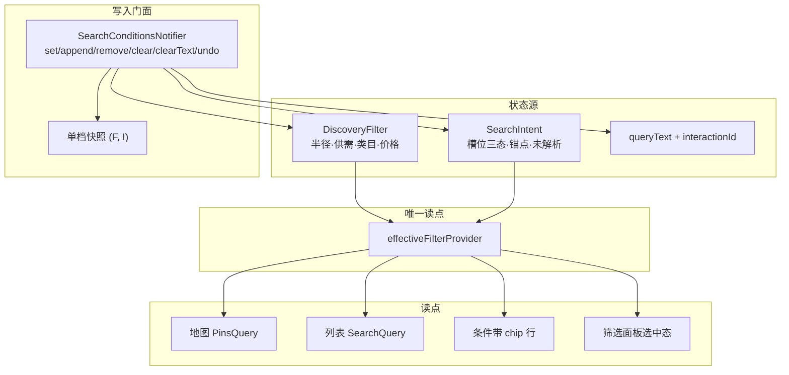

## Goal Capsule

- **Objective:** 用户在首页地图或列表页看到同一份当前条件——改一处，两页同时收窄；说不清的条件能被改、被删、被追加、被撤销。
- **Means:** 一条两行常驻条件带（搜索行 + 可编辑 chip 行），由单一「生效条件」投影驱动（KTD1）。
- **Authority:** `docs/PRD.md:1142-1156`（§6.4.1，本轮按 R17、R23、R24 改写落点与关键词口径）；`docs/architecture/编码规范.md`；`docs/api/openapi.yaml`（本轮为 `/posts/search` 增两个可选参数）。
- **Stop conditions:** 任一读点仍直接读 `DiscoveryFilter` 或 `SearchIntent` 而不经投影，即停止推进；两页对同一条件产出不同请求参数，即停止上线。
- **Tail ownership:** 前端 `lib/features/map/`、`lib/features/discovery/`；后端 `map` 包与 `/posts/search` 的契约扩展。

---

## Product Contract

### Summary

把地图顶部三层合成一条常驻条件带：第一行是搜索输入，第二行是当前生效条件的可编辑 chip 行，浮在地图上方。地图请求、列表页、筛选面板只读同一份「生效条件」。文本只用于语义解析，不做字面过滤；价格成为持久条件，并在地图与列表两侧都生效。

### Problem Frame

三层并存不是视觉冗余，而是「当前条件」被写了三遍：摘要只读持久筛选，回执只读一次性搜索态，查询逐槽位优先搜索态再回落持久筛选。三处各读各的，于是打字时摘要已宣称「关键词『租』」而地图一动不动、列表已经变了；同一句话还能同时出现「5km · 资源+需求 · 全部分类」与「1km / 房源」两套当前筛选。语义搜索已上线，这个表达缺口没修，用户无法判断屏幕上哪一份条件是真的。

### Requirements

**入口与条件带**

- R1. 地图页顶部收敛为一条常驻两行条件带，浮在地图上方：第一行是搜索输入行（文字输入、有文本时出现提交按钮与清除叉号、语音入口），第二行是当前生效条件的 chip 行。
- R2. chip 行在无搜索态下显示持久筛选，在搜索态下显示投影后的生效条件；两态都不隐藏该行。
- R3. 删除摘要胶囊与独立回执条；命中数并入 chip 行右端。
- R4. chip 行为单行横滑，chip 再多也不撑高；右上 ⋮ 入口保留，作为批量改条件的入口。
- R5. 语义理解成功时，chip 行右端只显示命中数，不回执「听懂 N 项」。
- R6. 语义未理解或全部槽位越界时，不回执本次搜索产生的过滤 chip，右端显示「没听懂」并给一个重试动作；持久筛选条件仍按 R2 显示。

**条件修改与追加**

- R7. 每个条件 chip 可单删；删除一个槽位表示「显式不要这一维」，不再回落持久筛选值。
- R8. 每个条件 chip 可点开改值：半径选档、价格输入、类目重选、供需切换。地点与小区不可改值，但小区可在本次解析给出的候选里重选。
- R9. chip 行末固定「＋ 条件」入口，可追加半径 / 类目 / 供需 / 价格；已存在的槽位显示当前值而非重复添加。
- R10. 类目选择使用半屏选择器，支持一级分类多选；半屏外任意位置点击即收起，已选结果保留。
- R11. 改值、追加、删除进入同一撤销栈，深度为一档；只要存在可回退状态就显示撤销入口，不区分搜索态。

**状态与生命周期**

- R12. 地图请求、chip 行、筛选面板、列表页统一读同一份「生效条件」投影，投影按槽位标注来源（持久筛选 / 本次搜索），来源同时决定改写的目标源。
- R13. 搜索态下经筛选面板改条件，写入当前搜索而非只写持久筛选。
- R14. 「清除」结束整次搜索：搜索框文本、槽位、撤销栈一并清空，回到持久筛选态。
- R15. 搜索框叉号只在有文本时出现，只清文本，不改条件、不结束搜索。
- R16. 未解析字段以灰态 chip 呈现，不参与命中计数，也不进入生效条件。
- R17. 搜索文本只作语义解析输入；应用不维护独立的字面关键词过滤条件，地图与列表都不按原文做文本匹配。

**跨视图共享**

- R18. 列表页提供与地图一致的搜索输入行（文字与语音），共用同一份生效条件、同一份输入文本与同一撤销栈。
- R19. 切到列表页时搜索态继续有效，列表结果按同一生效条件过滤；切回地图不重置。
- R20. 列表页顶部显示同一条件带，不复制第二份条件。
- R21. 列表页空态用生效条件解释，而非只显示持久筛选摘要。

**价格**

- R23. 价格是持久条件，默认不过滤；下限与上限可分别设置，设为空即取消该侧过滤。设置上限时排除面议，与解析产出的价格语义一致。地图与列表两侧都按价格收窄。

**提交与计数**

- R24. 命中数只有一种口径：地图取服务端 `total`，列表取服务端 `total`；被搜索圈裁掉的条数单独显示为「另有 N 条在范围外」，不并入命中数。取数未完成时显示占位而非 0。
- R25. 文本提交是显式动作：输入行有文本时显示提交按钮，键盘动作键为搜索；「没听懂」的重试等价于以同一段原话重新提交一次。

**可观测**

- R22. 一次搜索可按 `X-Interaction-Id` 在服务端访问日志里串起解析与取数两条请求，还原原话、生效条件与命中数；不新增埋点事件名，客户端只在调试构建输出一行解析摘要。

### Key Decisions

- **删摘要胶囊，改常驻 chip 行** (session-settled: user-directed — chosen over 保留摘要胶囊: 摘要与 chip 行展示同一组条件，保留即重复)。Governs R2, R3.
- **回执只报生效过滤项与命中数** (session-settled: user-directed — chosen over 报「听懂 N 项」: 未解析项与动作项被计入会报出偏大的成功数)。Governs R5, R6, R16.
- **清除与叉号分两个动作** (session-settled: user-directed — chosen over 清除仅重置搜索态: 残留文本让用户无法判断当前是否处于搜索)。Governs R14, R15.
- **清除同时清空撤销栈** (session-settled: user-directed — chosen over 清除后保留一档可撤销: 清除被定义为结束本次搜索，保留快照会让「结束」与「可回退」两种语义并存)。Governs R14.
- **chip 全量可改** (session-settled: user-directed — chosen over 只删与放宽: 只删会逼用户重说一遍)。Governs R8, R9.
- **删除等于显式清空该维** (session-settled: user-directed — chosen over 删除后回落持久筛选: 回落会让被删的 chip 立刻以另一个来源重新出现，删除看起来失灵)。Governs R7, R23.
- **搜索态下面板写入当前搜索** (session-settled: user-directed — chosen over 提示但不生效: 死控件比覆盖一次性态更贵)。Governs R13.
- **搜索跨视图共享** (session-settled: user-directed — chosen over 切视图即结束搜索: 否则地图与列表结果分叉无法消除)。Governs R18, R19, R20.
- **取消字面关键词过滤** (session-settled: user-directed — chosen over 保留关键词并让地图也过滤: 用户不知道标题与描述写了什么，字面匹配收益低，而地图侧 LIKE 会破坏覆盖索引)。Governs R17.
- **价格进入持久筛选并扩到列表接口** (session-settled: user-directed — chosen over 价格只在地图生效: 只在地图生效会让同一条件在两页结果不同，与本轮目标相反)。Governs R23.
- **条件带作地图浮层** (session-settled: user-directed — chosen over 放进导航栏下方实体位: 浮层保留地图满幅，代价是与地图手势争同一区域，PRD 落点口径需同步改写)。Governs R1.
- **命中数统一取服务端 total** (session-settled: user-directed — chosen over 地图用圈内计数: 两个口径会让同一条件显示两个数字，正是本轮要消除的分叉)。Governs R24.

### Key Flows

- F1. 语音或文字搜索
  - **Trigger:** 用户在地图页长按地图说话，或在搜索输入行提交文字。
  - **Steps:** 提交（输入行内联进度、禁重复提交）→ 解析返回槽位卡或失败 → 写入当前搜索 → chip 行按投影重建 → 地图与列表同时按生效条件重取。
  - **Covered by:** R1, R5, R12, R19, R25.
- F2. 改值
  - **Trigger:** 用户点开任意条件 chip。
  - **Steps:** 就地小层给出该槽位的可选项或输入 → 选定后写回生效条件并进撤销栈 → chip 与结果同步刷新。
  - **Covered by:** R8, R11, R12.
- F3. 追加
  - **Trigger:** 用户点「＋ 条件」。
  - **Steps:** 列出四个可加槽位（已存在的显示当前值）→ 选定槽位进入改值流程 → 结果刷新。
  - **Covered by:** R9, R10, R11.
- F4. 结束搜索
  - **Trigger:** 用户点「清除」或点搜索框叉号。
  - **Steps:** 清除清空本次搜索与撤销栈并回到持久筛选；叉号只清文本并保留条件。
  - **Covered by:** R14, R15.

### Acceptance Examples

- AE1. **Covers R2, R3.** Given 无搜索态，When 用户打开地图，Then 顶部浮层只有搜索输入行与一行 chip（5km / 资源+需求 / 全部分类 / ＋ 条件 / 命中数），没有摘要胶囊与回执条。
- AE2. **Covers R5, R16.** Given 用户说「锦绣小区 1km 合租 两千以内」，When 解析完成，Then chip 行出现四枚 chip（小区只读、其余三枚可改），右端只显示命中数，不出现「听懂 N 项」。
- AE3. **Covers R6.** Given 用户说「那个离地铁近点的合作」，When 全部槽位越界，Then 不出现本次搜索的过滤 chip，持久条件仍在，右端显示「没听懂」并给重试动作。
- AE4. **Covers R7, R11, R23.** Given chip 行有「≤2000 元」，When 用户点开改成 1500，Then 结果收窄且撤销回到 2000；再点该 chip 删除，价格维不再过滤，且不回落成 2000。
- AE5. **Covers R13.** Given 处于搜索态，When 用户在筛选面板切换供需方向，Then chip 行即时反映该变化，地图与列表结果随之变化。
- AE6. **Covers R17, R19, R24.** Given 用户在地图页说「房源 3km」，When 切到列表页，Then 顶部显示同一条件带与同一输入文本，两页命中数取自服务端且相等，输入框不残留原文作为过滤条件。
- AE7. **Covers R10.** Given 用户在「＋ 条件」里选择类目，When 半屏选择器展开后点击半屏外空白，Then 选择器收起且已选类目保留。
- AE8. **Covers R24, R25.** Given 提交后取数尚在进行，When chip 行右端渲染，Then 显示占位而非「0 条」；提交按钮在取数期间禁用。

### Scope Boundaries

- 不做多档撤销时间线，撤销仍只有一档回退。
- 不做搜索圈、不做按密度自动扩圈；半径只用于过滤。
- 不改解析服务侧口径：`/search/resolve` 的请求与响应契约不变。
- 地点与小区不提供改值入口；小区只能从解析给出的候选中重选。
- 不做向量召回、同义词表的三消费方接线。
- 不新增独立搜索页。
- `/map/pins` 契约与 `idx_pins_cover` 本轮不动。

### Dependencies / Assumptions

- `/posts/search` 现有实现从 `post` 表取数并在内存分页，价格条件可落在同一条 SQL 的 `WHERE` 上，不需要新索引。
- 现有 `SearchIntentState` 的撤销为单档 `previous`，需扩展为可同时回退两个来源的快照。
- `DiscoveryFilter` 未重写 `==`，投影与快照都依赖值相等。
- 浮层落点会占用地图上方一片可拖拽区域，需在真机上确认 Pins 密度与手势冲突可接受。

### Outstanding Questions

- **Deferred:** 列表页条件带与排序 / 计数条的间距与吸顶行为，落地时按真机高度定。
- **Deferred:** 地点条件的改值入口，等 `MapSelectorScreen` 的嵌入方案确定后再评估。
- **Deferred:** 价格上限「排除面议」是否需要在 chip 上显式标注，等运营确认文案后定。

### Sources / Research

- `docs/PRD.md:1142-1156`（搜索框常驻、摘要回显关键词、不新增独立搜索页；本轮改写落点与关键词口径）。
- `lib/features/map/map_screen.dart`（顶部浮层同时渲染 `_SearchIntentBar` 与 `_FilterSummaryChip`；`build()` 内联逐槽位回落；`_searchController` 页面私有，`ref.listen` 直接赋 `.text` 故不触发 `onChanged`；`_zoomOutToShowAll` 另读一次持久半径）。
- `lib/features/discovery/search_intent.dart`（槽位卡、`without*`、单档 `previous`、`_copy` 私有且不含 `queryText`）。
- `lib/features/discovery/discovery_filter.dart`（四字段、`summaryLabel`、无 `==`）。
- `lib/features/discovery/discovery_providers.dart`（`PinsQuery` 与 `SearchQuery` 以值相等作 family 键；`pinsProvider` 按 post_type 拆请求）。
- `lib/core/cache/pin_cache_key.dart`（价格与小区后缀已存在，关键词未入键）。
- `lib/features/discovery/filter_panel.dart`（三处 watch、四处直写持久筛选，无价格控件）。
- `lib/features/discovery/list_screen.dart`（只读持久筛选；AppBar 刻意未放搜索框，本轮推翻；`_SortBar` 自带计数）。
- `lib/core/network/interceptors/header_interceptor.dart`（`X-Interaction-Id` 仅在缺失时兜底生成）。
- `lib/features/publish/category_selector_screen.dart`（全屏三列级联，`CategorySelection` 为单叶子）。
- `docs/api/openapi.yaml`（`/posts/search` 无价格参数；`/map/pins` 有价格参数）。
- `docs/solutions/workflow-issues/test-data-fidelity-for-performance-claims.md`（百万行实测：`/map/pins` 回表即磁盘随机读，是取消地图文本匹配的依据）。
- `docs/plans/2026-10-24-0708-feat-map-voice-semantic-search-plan.md`（第一轮已上线的解析与收窄链路）。

---

## Planning Contract

### Key Technical Decisions

- KTD1. **单一投影 + 双源写入门面**。保留 `DiscoveryFilter`（持久）与 `SearchIntent`（一次性）两个存储，新增 `EffectiveFilter` 作为唯一读点，新增 `SearchConditionsNotifier` 作为唯一写点。理由：两源生命周期不同，合并会丢失「清除后回到哪个状态」的语义；读侧分裂正是当前缺陷根因。
- KTD2. **投影用纯函数 + Provider 派生**。`effectiveFilterOf(filter, intent)` 放在 `lib/features/discovery/effective_filter.dart`，provider 只 watch 两源后调用它。理由：仓库已有纯函数先例，可直接单测并被门禁断言。
- KTD3. **槽位三态**。每个槽位取值 `unset / explicitEmpty / value(来源)`；投影只在 `unset` 时回落持久值，`explicitEmpty` 表示该维不参与过滤。理由：R7 的删除与 R23 的清空都需要「空」与「未指定」区分，否则删除会被回落立刻填回（KTD1 现有实现只有两态）。
- KTD4. **撤销用单档快照**。快照持有 `(DiscoveryFilter, SearchIntent)` 两份值，撤销时一起回写；`clearAll` 不压快照并清空撤销栈。理由：只存 `SearchIntent` 无法回退跨源改动；清除被定义为终结动作。
- KTD5. **文本状态归门面**。`queryText` 与交互标识由 `SearchConditionsNotifier` 单一持有，两页从同一 provider 读取并各自持有受控 controller 镜像。理由：R18 要求两页共用输入文本，页面私有 controller 无法跨页共享。
- KTD6. **半屏类目选择器新建 sheet，不改发布流程的全屏页**。sheet 复用 `categoryTreeProvider`，支持一级多选并以「确认」提交；点遮罩收起等同放弃本次未确认改动。理由：全屏页是路由级页面，嵌入会带出路由栈与返回语义。
- KTD7. **列表页不再常驻展开 `FilterPanel`**，改为条件带 + 由 ⋮ 按需展开的面板。理由：常驻面板与地图浮层不同形，是「两套筛选体系」的观感来源。
- KTD8. **Pin 缓存键不扩维**。U1 落地后关键词退出请求链，`PinsQuery` 五要素不变；价格后缀与小区后缀已存在。理由：扩维会让历史缓存全部失效，而本轮没有新增请求维度。
- KTD9. **`DiscoveryFilter` 补值相等**。投影与快照都要比较它，当前按引用比较会让撤销与派生每次判为「变了」。
- KTD10. **投影输出 chip 模型，视图只渲染**。`EffectiveFilter` 给出有序 `ConditionChip`（槽位、文案、来源、是否可编辑、是否灰态、是否显式空），地图与列表渲染同一份列表。
- KTD11. **浮层高度实测后驱动按钮避让**。条件带高度随文本缩放变化，地图右上两个圆钮按其实测高度下移，沿用现有测高模式，不写死偏移。
- KTD12. **交互标识显式透传，拦截器只兜底**。一次提交生成标识，解析与取数请求都带上；重试复用同一标识。理由：拦截器在缺失时各自补新 UUID，会让两条请求拿到不同标识。

### High-Level Technical Design

图表是权威内容，与下文冲突时以 KTD 为准。

### Assumptions

- 语音入口继续复用 `showVoiceSearchSheet`，其返回值进入 `resolve`，不新增语音链路。
- 列表页语音锚点取当前定位，取不到时回退参考中心；锚点来源写进 chip 的副文案。
- 未解析字段的灰态 chip 继续使用现有 `_unresolvedLabel` 文案映射。
- 零结果时的「扩大范围 / 放宽价格」两个动作并入 chip 行末，触发后写入生效条件。

### Sequencing

先立单一读点与门面（U2、U3），再换 UI（U4、U10），再接两页（U5、U6、U7）。U1 先行，因为价格字段与关键词退场是投影的输入。U11 与 U1 可并行，但必须早于 U6 的验收。U8 依赖 U5、U6。U9 最后收口。

### System-Wide Impact

- **用户可感知**: 顶部从三层变两层；打字不再即时改变列表结果，提交才解析；地图上方一片区域让给浮层。
- **列表页**: 失去常驻筛选面板，改由条件带承担可见性；搜索结果新增价格维度。
- **后端 / 契约**: `/posts/search` 增 `price_min` / `price_max` 两个可选参数，其余不动。
- **可观测**: 解析与取数共用交互标识，服务端日志可成对检索；不新增埋点事件。

### Risks & Dependencies

- **打字即时反馈消失**: R17 取消关键词后，输入到提交之间没有结果变化。缓解：输入行有文本即出现提交按钮，重试原话一键可用。
- **浮层遮挡与手势**: 浮层覆盖地图上方约 72px，拖动与长按语音在边缘争用。缓解：浮层外留拖拽余量，长按判定排除浮层区域。
- **快照引用污染**: 快照若存引用，撤销后会被后续改动污染。缓解：存值并补值相等（KTD9）。
- **横滑与固定操作区争宽**: 360px 下 chip 区必须横滑，撤销与清除贴右；固定区宽度上限写进 U10 的测试。
- **列表页空态依赖投影**: 空态改读投影后，加载中会出现空态闪动。缓解：空态只在 `AsyncData` 且为空时渲染。

---

## Implementation Units

| U-ID | 标题 | 主要文件 | 依赖 |
| --- | --- | --- | --- |
| U1 | 持久筛选字段调整 | `discovery_filter.dart`、`filter_panel.dart` | — |
| U2 | 生效条件投影 | `effective_filter.dart`（新） | U1 |
| U3 | 写入门面与撤销 | `search_conditions.dart`（新）、`search_intent.dart`、`filter_panel.dart` | U2 |
| U4 | 条件带外壳与搜索行 | `condition_band.dart`（新） | U3 |
| U10 | chip 行与右端态 | `condition_band.dart` | U4 |
| U5 | 地图页接入 | `map_screen.dart` | U10 |
| U6 | 列表页接入 | `list_screen.dart` | U10、U11 |
| U7 | 改值、追加与半屏类目 | `condition_editor.dart`、`category_sheet.dart`（新） | U10 |
| U11 | 列表价格过滤 | `openapi.yaml`、`map` 包、`map_repository.dart` | U1 |
| U8 | 交互标识贯通 | `search_conditions.dart`、`discovery_providers.dart` | U5、U6 |
| U9 | 同源门禁与回归 | `test/gates/` | U5、U6、U7 |

### U1. 持久筛选字段调整：加价格、去关键词

- **Goal:** `DiscoveryFilter` 承载价格上下限，不再承载关键词；筛选面板提供价格输入。
- **Requirements:** R23, R17
- **Dependencies:** 无
- **Files:** `lib/features/discovery/discovery_filter.dart`, `lib/features/discovery/filter_panel.dart`, `lib/features/discovery/list_screen.dart`, `lib/features/map/map_screen.dart`, `test/features/discovery/discovery_filter_test.dart`（新建）
- **Approach:**
  - 删除 `keyword` 字段与 `setKeyword`；新增可空的 `priceMin` / `priceMax`，`copyWith` 支持显式置空。
  - `summaryLabel` 去掉关键词段，价格有值时追加「≤N 元」「≥N 元」「N–M 元」。
  - `filter_panel.dart` 在供需行下方加价格行：两侧输入 + 「不限」入口。
  - 补 `==` / `hashCode`（KTD9）。
  - `list_screen.dart` 的 `SearchQuery` 去掉 `keyword` 传参；`map_screen.dart` 删除 `onChanged` 里的 `setKeyword` 调用。
- **Patterns to follow:** `search_intent.dart` 的值相等写法；`_PillButton` 的行内控件密度。
- **Test scenarios:**
  - 设下限 500 时 `summaryLabel` 含「≥500 元」；置空后不再含价格段。
  - 仅设上限后置空上限，`priceMax` 为 null 且文案只剩下限。
  - 同值实例 `==` 为真、`hashCode` 相同；仅价格不同则为假。
  - `SearchQuery` 不再含 `keyword` 字段（编译期验证）。
- **Verification:** 字段与文案符合断言；请求链路的价格断言在 U11/U6 完成，不在本单元。

### U2. 生效条件投影

- **Goal:** 提供唯一读点 `EffectiveFilter`，把两源投影成有序 chip 列表与请求字段。
- **Requirements:** R12, R16, R5, R7
- **Dependencies:** U1
- **Files:** `lib/features/discovery/effective_filter.dart`（新建）, `lib/features/discovery/effective_filter_provider.dart`（新建）, `test/features/discovery/effective_filter_test.dart`（新建）
- **Approach:**
  - 槽位三态（KTD3）：`unset` 回落持久值，`explicitEmpty` 不参与过滤，`value` 取自指定来源。
  - `ConditionChip` 带槽位、文案、来源、可编辑、灰态、显式空六项（KTD10）。
  - 类目归一为 `leafCategoryIds` + labels：持久来源经 `leafCategoryIdsFor` 换算，意图来源直接采用。
  - 价格合并：上限存在即带「排除面议」标志，与意图态一致。
  - 同时输出 `pinsQueryOf` / `searchQueryOf` 所需字段，两页不再各写回落。
- **Patterns to follow:** `discovery_query.dart` 的纯函数组织；`PinsQuery` 的值相等。
- **Test scenarios:**
  - 仅持久筛选时 chip 顺序为 半径 → 供需 → 类目 → 价格，来源均为持久。
  - 意图覆盖半径与类目、供需未覆盖时，供需回落持久且来源标为持久。
  - 删除某槽位后该槽位为 `explicitEmpty`，投影不再回落持久值（Covers AE4）。
  - 未解析字段只出现在 `unresolved`，不进 chip 列表的生效项（Covers AE3）。
  - 同一组输入两次投影得到相等对象。
- **Verification:** 同一输入两次调用输出相等；地图与列表可只靠它拿到请求字段。

### U3. 条件写入门面与单档撤销

- **Goal:** 所有条件改动走一个入口，撤销能同时回退两个来源，面板读写改走门面与投影。
- **Requirements:** R7, R8, R9, R11, R13, R14, R15
- **Dependencies:** U2
- **Files:** `lib/features/discovery/search_conditions.dart`（新建）, `lib/features/discovery/search_intent.dart`, `lib/features/discovery/filter_panel.dart`, `test/features/discovery/search_conditions_test.dart`（新建）, `test/features/discovery/search_intent_test.dart`
- **Approach:**
  - 门面暴露 `setRadius` / `setPrice` / `toggleSupplyDemand` / `setCategories` / `removeSlot` / `appendSlot` / `clearAll` / `clearText` / `submit` / `undo`。
  - 写入路由：槽位已有来源则写回该来源；无搜索态写 `DiscoveryFilter`；有搜索态写 `SearchIntent`。价格无论有无搜索态都写 `DiscoveryFilter`。
  - 为 `SearchIntent` 补公开 `copyWith`（radius、radiusMeters、leafCategoryIds+labels、postType、priceMin/Max、queryText、anchor、community），并支持显式置空。
  - `queryText` 与交互标识由门面持有（KTD5）；`clearText` 只清文本。
  - `clearAll` 清搜索态、文本与撤销栈（KTD4）。
  - `filter_panel.dart` 三处 watch 改读投影，四处写入改调门面。
  - 把 `SearchIntentState.previous` 的撤销迁入门面，`SearchIntentNotifier` 只保留解析与装配；同步迁移 `search_intent_test.dart` 中的撤销断言。
- **Execution note:** 先写门面单测锁定写入路由（哪种状态写哪个源），再接面板。
- **Patterns to follow:** 现有 `SearchIntentNotifier.undo/update` 的语义；`Notifier` 而非 `StateNotifier`。
- **Test scenarios:**
  - 无搜索态改半径，只有 `DiscoveryFilter` 变化。
  - 有搜索态改半径，只有 `SearchIntent` 变化。
  - 搜索态改价格，写 `DiscoveryFilter` 且面板选中态由投影反映。
  - 删除类目 chip 后撤销，类目与删除前一致（Covers AE4）。
  - 有搜索态改面板后撤销，两源同时回到快照前。
  - `clearAll` 后两源为默认值且 `canUndo` 为假（Covers R14）。
  - `clearText` 后条件保留、文本为空。
  - 面板在搜索态下切换供需，`SearchIntent` 变化而 `DiscoveryFilter` 不变（Covers AE5）。
- **Verification:** 每个公开方法都有断言；撤销在跨源改动后仍生效；面板不再直写持久筛选。

### U4. 条件带外壳与搜索行

- **Goal:** 一个可复用的条件带外壳，承载第一行输入与第二行插槽。
- **Requirements:** R1, R15, R25
- **Dependencies:** U3
- **Files:** `lib/features/discovery/condition_band.dart`（新建）, `test/features/discovery/condition_band_test.dart`（新建）
- **Approach:**
  - 外壳负责布局、圆角、描边与高度测量回调，把 chip 行作为子插槽，便于两页共用。
  - 第一行：输入框（受控，文本来自门面）+ 有文本时的提交按钮（`textInputAction.search`）+ 叉号 + 语音入口。
  - 提交进行中禁用按钮并给内联进度；输入回填不触发解析。
  - 高度随文本缩放取最小约束，不写固定值。
- **Patterns to follow:** `showVoiceSearchSheet` 的触发方式；`_SearchIntentBar` 的胶囊布局。
- **Test scenarios:**
  - 有文本时出现提交按钮与叉号，无文本时都不出现。
  - 点提交调用门面 `submit`，且重复点击只触发一次。
  - 点叉号只清文本，chip 不变（Covers R15）。
  - 提交进行中按钮禁用。
  - 文本缩放 1.3 时输入行不裁切。
- **Verification:** 外壳在两种状态下可独立渲染，不依赖地图或列表页面级状态。

### U10. chip 行与右端态

- **Goal:** 第二行的 chip 列表、追加入口、计数与右端动作。
- **Requirements:** R2, R3, R4, R5, R6, R7, R9, R11, R24
- **Dependencies:** U4
- **Files:** `lib/features/discovery/condition_band.dart`, `test/features/discovery/condition_band_test.dart`
- **Approach:**
  - 横滑 `InputChip` 列表 + 固定「＋ 条件」；右端计数胶囊、撤销、清除贴右。
  - 灰态 chip 用虚线描边、无删除按钮；搜索来源 chip 用主色描边以区分持久来源。
  - 命中数三种态：加载中「—」、有值「N 条」、零结果「0 条」；圈外条数作为独立小标签「另有 N 条在范围外」。
  - 撤销入口在 `canUndo` 时显示，不区分搜索态。
  - chip 主体与删除图标各留 44 命中区，删除后可撤销。
  - 每个 chip 提供语义标签（值 + 来源），计数与「没听懂」为 liveRegion。
- **Patterns to follow:** `_intentChip` 的 chip 形态；`_PillButton` 的透明 padding 命中区约定。
- **Test scenarios:**
  - 无搜索态渲染持久 chip、计数与撤销入口（有快照时）。
  - 搜索来源 chip 与持久来源 chip 视觉可区分（Covers R12 的表现面）。
  - 点 chip 删除调用 `removeSlot`，chip 立即消失且不以持久值回填（Covers AE4）。
  - 未解析字段渲染为灰态且不计入计数（Covers AE2）。
  - 加载中显示「—」而非「0 条」（Covers AE8）。
  - 「没听懂」态不渲染本次搜索 chip，持久 chip 仍在（Covers AE3）。
  - 固定区在 360px 内不挤压 chip 到不可滚动的程度。
- **Verification:** 组件单测覆盖三种右端态与两种来源；命中数口径与 R24 一致。

### U5. 地图页接入条件带

- **Goal:** 地图顶部浮层换成条件带，删掉摘要胶囊与回执条，请求改由投影驱动。
- **Requirements:** R1, R2, R3, R12, R14, R15, R24
- **Dependencies:** U10
- **Files:** `lib/features/map/map_screen.dart`, `test/features/map/map_screen_condition_test.dart`（新建）
- **Approach:**
  - 删除 `_FilterSummaryChip` 与 `_SearchIntentBar`；AppBar 内的搜索框与麦克风一并删除，AppBar 只留标题与非搜索入口，避免出现两个输入框。
  - 浮层按 KTD11 实测高度驱动右上两个圆钮下移；长按语音的命中判定排除浮层区域。
  - `PinsQuery` 从投影派生，删除内联逐槽位回落；`_zoomOutToShowAll` 改读投影半径。
  - `_SearchIntentBar` 原有的三项能力重新安置：小区候选点选并入小区 chip 的点击行为；零结果「扩大范围 / 放宽价格」并入 chip 行末；圈外条数按 R24 单列。
- **Patterns to follow:** 现有 `ref.watch(pinsProvider(pinsQuery))`；`_avoidFilterPanel` 的避让方式保留给面板。
- **Test scenarios:**
  - 无搜索态下页面只有一个输入框、一个语音入口。
  - 意图覆盖半径后，`PinsQuery.radius` 与类目取意图值、供需取持久值。
  - 解析完成后 chip 行出现，且不出现「听懂 N 项」。
  - 点清除后 `PinsQuery` 回到清除前的无搜索态取值。
  - 零结果时 chip 行末出现扩大范围动作，触发后半径变化（Covers R9 的动作面）。
  - 缩小视野动作使用的是投影半径而非持久半径。
- **Verification:** 地图页任何请求都可由投影解释；不存在第二处回落逻辑；浮层外长按仍唤起语音。

### U6. 列表页接入条件带

- **Goal:** 列表页拥有同款条件带与输入文本，结果与地图同源，空态按生效条件解释。
- **Requirements:** R18, R19, R20, R21, R24
- **Dependencies:** U10, U11
- **Files:** `lib/features/discovery/list_screen.dart`, `test/features/discovery/list_screen_condition_test.dart`（新建）
- **Approach:**
  - `SearchQuery` 由投影组装（含价格）；顶部顺序为条件带 → 排序条 → 列表，`_SortBar` 不再显示计数，避免与 chip 行重复。
  - 常驻 `FilterPanel` 改为由条件带 ⋮ 触发的展开层（KTD7）。
  - 空态文案取投影；空态只在 `AsyncData` 且为空时渲染。
  - 输入文本读门面，语音锚点取当前定位，无定位回退参考中心。
- **Test scenarios:**
  - 地图页解析出类目后切到列表，列表请求的类目与地图一致（Covers AE6）。
  - 地图页输入文本后切到列表，输入行回显同一文本且不触发解析。
  - 列表页删除 chip 后切回地图，地图结果同步收窄。
  - 空态显示生效条件文案；加载中不显示空态。
  - 两页在同一条件下命中数相等（Covers R24）。
- **Verification:** 同一条件下两页的叶子类目、供需、半径、价格四要素与命中数逐一相等。

### U7. chip 改值、追加与半屏类目选择器

- **Goal:** chip 可点开改值，行末可追加槽位，类目走半屏多选且点外部收起。
- **Requirements:** R8, R9, R10
- **Dependencies:** U10, U3
- **Files:** `lib/features/discovery/condition_editor.dart`（新建）, `lib/features/discovery/category_sheet.dart`（新建）, `test/features/discovery/category_sheet_test.dart`（新建）, `test/features/discovery/condition_editor_test.dart`（新建）
- **Approach:**
  - 半径用底部小层选档，价格用同层输入（非法值就地提示不写入），供需直接切换。
  - 类目走 `showModalBottomSheet`，支持一级多选 + 「确认」提交；点遮罩等同放弃未确认改动，已确认结果保留（KTD6）。
  - 追加层列四个槽位，已存在槽位显示当前值并直接进入改值。
  - 小区 chip 点开在解析候选列表中重选，不调起地图选点。
  - 所有写入调用门面，编辑层不直接碰 provider。
- **Patterns to follow:** `settings_screen.dart` 的 `_pickRadius` 底部小层；`category_selector_screen.dart` 的选择模型。
- **Test scenarios:**
  - 点类目 chip 打开半屏，多选后确认，chip 文案更新且只产生一次写入。
  - 半屏打开后点遮罩，选择器关闭且未确认改动不写入。
  - 追加层中点已存在的半径，显示当前档位而非空值。
  - 价格输入非数字或下限大于上限时不写入并提示。
  - 小区 chip 点开显示解析候选，选中后 chip 文案更新（Covers R8 的候选分支）。
- **Verification:** 四种槽位都能从 chip 与追加两个入口改到同一份状态。

### U11. 列表价格过滤（契约 + 后端）

- **Goal:** `/posts/search` 支持可选价格过滤，使列表与地图按同一价格收窄。
- **Requirements:** R23, R12
- **Dependencies:** U1
- **Files:** `docs/api/openapi.yaml`, `src/main/java/com/s2s/server/map/MapController.java`, `src/main/java/com/s2s/server/map/MapService.java`, `src/main/java/com/s2s/server/map/mapper/MapPostMapper.java`, `src/main/resources/mapper/MapPostMapper.xml`, `lib/features/discovery/map_repository.dart`, `lib/features/discovery/discovery_providers.dart`, `src/test/java/com/s2s/server/map/MapServiceTest.java`, `test/features/discovery/map_repository_test.dart`, `test/gates/openapi_contract_gate_test.dart`
- **Approach:**
  - 契约新增两个可选参数，语义与 `/map/pins` 的价格参数一致（含上限排除面议）。
  - Service 复用 `validatePriceRange`；Mapper 在 `selectSearchPosts` 的 `WHERE` 增加两个条件，写法对齐现有价格过滤。
  - 同步 `SearchQuery` 字段、仓库形参与既有 `getPins` 调用的测试签名。
  - 价格过滤不进入 `idx_pins_cover` 讨论范围：列表查询本就按网格集合取数，不承诺 index-only。
- **Execution note:** 先改契约与 gate，再改实现，最后补前端形参。
- **Patterns to follow:** `/map/pins` 的价格参数与 `validatePriceRange`。
- **Test scenarios:**
  - 只传下限时 SQL 只加下界条件；两个都传时按区间过滤。
  - 上限存在时请求带排除面议的语义，与地图侧一致。
  - 非法区间（下限大于上限、负数）返回既有参数错误码。
  - 前端 `searchPosts` 未设价格时不传这两个参数（Covers 兼容性）。
  - 契约 gate 对新参数有白名单断言。
- **Verification:** 同一价格条件下，列表与地图返回的条数按同一规则收窄。

### U8. 搜索链路的交互标识贯通

- **Goal:** 一次搜索的解析请求与取数请求携带同一个 `X-Interaction-Id`。
- **Requirements:** R22
- **Dependencies:** U5, U6
- **Files:** `lib/features/discovery/search_conditions.dart`, `lib/features/discovery/search_intent.dart`, `lib/features/discovery/discovery_providers.dart`, `lib/features/discovery/voice_search_sheet.dart`, `test/features/discovery/search_conditions_test.dart`
- **Approach:**
  - 提交时由门面生成标识并持有；解析与随后的取数都显式带该标识（KTD12）。
  - 标识作为独立参数逐层传到仓库，不放进 `PinsQuery` / `SearchQuery` 的相等性字段，避免改变 family 键语义。
  - 「没听懂」的重试复用同一标识；再次提交（新原话）换新。
  - 清除后标识作废。
  - 调试构建输出一行摘要（原话长度、槽位数量、未解析数量），不打印原话全文。
- **Execution note:** 先用一条请求断言锁定「解析与取数同标识」，再补摘要。
- **Patterns to follow:** 编码规范 §5.3 的逐层透传约定；拦截器仅在缺失时兜底。
- **Test scenarios:**
  - 一次提交后解析与取数请求的标识相同。
  - 重试后仍为同一标识。
  - 再次提交换新标识，旧标识不再出现。
  - 清除后标识作废，下次搜索重新生成。
  - 调试摘要不含完整原话。
- **Verification:** 用同一标识能在服务端日志找到成对请求（解析 + 取数）。

### U9. 同源门禁与回归

- **Goal:** 用可失败的断言锁住「唯一读写点」与「两页同参数」，并清理旧实现。
- **Requirements:** R12, R19, R24
- **Dependencies:** U5, U6, U7
- **Files:** `test/gates/source_parity_gate_test.dart`（新建）, `test/gates/anti_redundancy_gate_test.dart`, `test/features/discovery/discovery_providers_test.dart`, `test/features/discovery/filter_panel_measure_test.dart`
- **Approach:**
  - 源码门禁扫描 `lib/features/map/` 与 `lib/features/discovery/`：除投影 provider 与门面外，不得出现对两源的 `watch` / `read` / `listen` / `.notifier`；`filter_panel.dart` 纳入扫描。
  - 符号门禁：`_FilterSummaryChip`、`_SearchIntentBar`、`_measureIntentBar`、`setKeyword`、`summaryLabel` 的关键词分支不得残留。
  - 请求同源断言：同一投影产出的 Pin 与列表请求在四要素（含面议标志）与命中数口径上相等。
  - 更新既有面板测高测试以适配「由 ⋮ 展开」的路径。
- **Execution note:** 门禁先写成失败态，再逐步改实现。
- **Test scenarios:**
  - 人为在 `map_screen.dart` 插入一次直接 watch 时门禁变红，删除后恢复绿。
  - 人为在 `filter_panel.dart` 插入一次 `.notifier` 直写时门禁变红。
  - 同一投影产出的四要素与面议标志相等。
  - 面板从条件带展开仍记录图层切换会话，列表页不记录。
- **Verification:** 门禁在故意违规时变红；全量测试通过且基线只增不减。

---

## Verification Contract

| 范围 | 命令 | 通过判据 |
| --- | --- | --- |
| 静态检查 | `flutter analyze` | 0 issue |
| 单元与 widget | `flutter test` | 全绿，基线用例只增不减 |
| 门禁 | `flutter test test/gates` | 全部通过；`source_parity_gate_test` 在违规时为红 |
| 反冗余 | `flutter test test/gates/anti_redundancy_gate_test.dart` | `ApiException.parse` 计数不超基线 |
| 后端单测 | `mvn -q -Dtest=MapServiceTest test` | 价格参数与校验用例通过，既有 `getPins` 用例已同步签名 |
| 后端构建 | `mvn -q -DskipTests package` | 通过 |
| 可观测 | `flutter test test/features/discovery/search_conditions_test.dart` | 解析与取数同标识断言通过；测试环境按标识检索到成对访问日志 |
| 手工冒烟 | iOS 模拟器 + Android 真机各一轮，含横屏与文本缩放 1.3 | AE1–AE8 全部可复现 |
| 文档 | 人工核对 `docs/PRD.md` §6.4.1 | 落点、关键词、价格三处口径与 R1/R17/R23 一致 |

停止推进的条件：`flutter analyze` 出现新增 issue，或门禁在合规代码上为红，或后端单测在新签名下无法通过。

## Definition of Done

- 顶部只剩一条两行条件带；全仓不存在 `_FilterSummaryChip`、`_SearchIntentBar`、「听懂 N 项」文案。
- `discoveryFilterProvider` 与 `searchIntentProvider` 在 `map_screen.dart`、`list_screen.dart`、`filter_panel.dart` 中无直接 `watch` / `read` / `listen` / `.notifier`，只有投影与门面。
- 同一条件下地图与列表的叶子类目、供需、半径、价格（含面议标志）逐项相等，且命中数相等，并由门禁断言。
- 删除条件后该维不再过滤且不被持久值回填；价格可设、可清、可撤销；无价格时请求不带价格参数。
- 关键词退出过滤链：输入框内容不再独立过滤任何一页。
- 撤销在跨源改动后仍能回到上一状态；清除后 `canUndo` 为假。
- 解析与取数携带同一 `X-Interaction-Id`，服务端日志可按标识找到成对请求并读到命中数。
- `docs/PRD.md` §6.4.1 的落点与关键词口径已改写，不再与本计划冲突。
- 清理判据：`_measureIntentBar`、`summaryLabel` 的关键词分支、`setKeyword`、逐槽位回落代码、`_SortBar` 的重复计数均已删除；无遗留实验分支或注释掉的旧实现。
