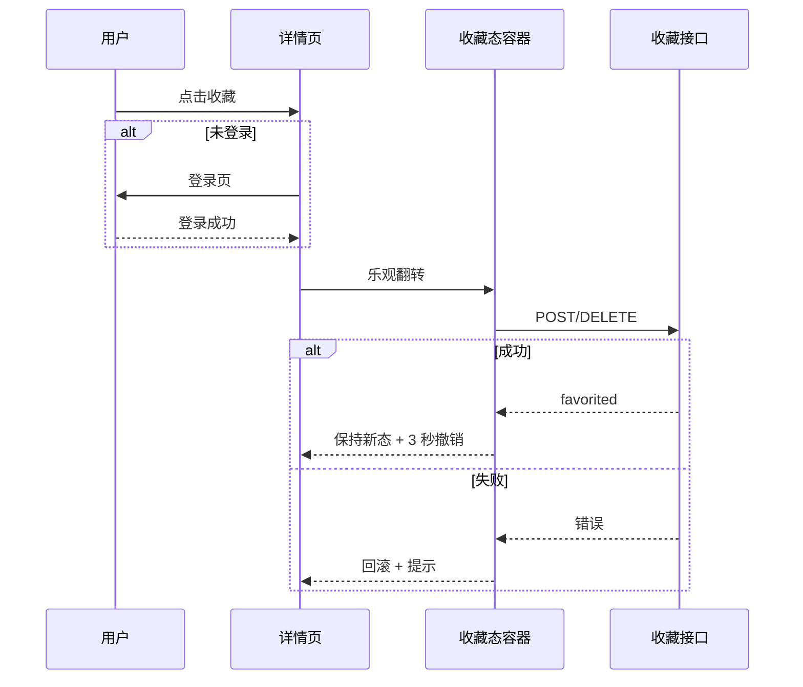
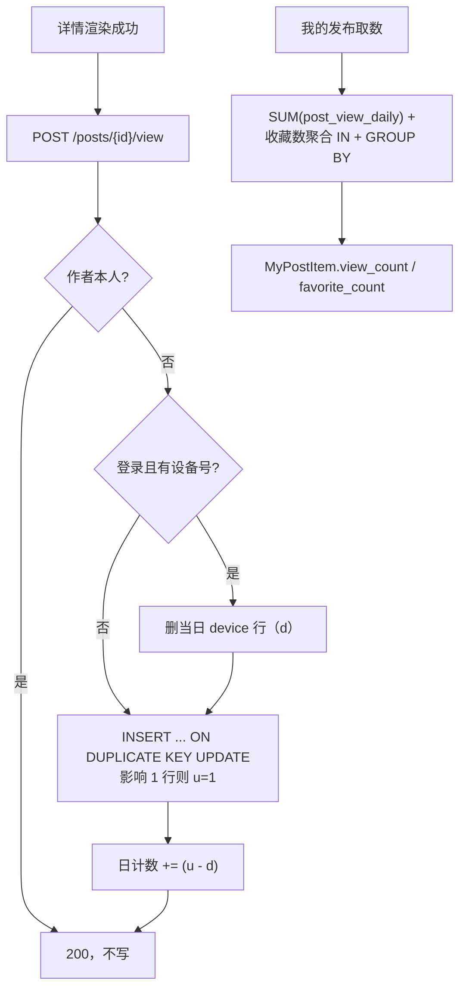

## Goal Capsule

- **Objective:** 用户能在详情页完成收藏并看到明确状态；帖主能在「我的发布」看到自己帖子的浏览数与收藏数。写入、聚合、契约、测试与文档保持一致。
- **Means:** 详情页外壳常驻 + 按「会话 + `postId`」的收藏单一事实源 + 乐观写与 3 秒撤销（KTD1–KTD4）；浏览数用「明细去重表 + 日计数表」写入即结算，读取只走日计数表（KTD6–KTD8）。
- **Authority:** `docs/PRD.md` §8.3.1 / §12.3 / §13.2 / §13.4 / §14.1；`docs/api/openapi.yaml`；`docs/database/数据库设计文档.md`；Figma `sds-app` → `04 · 收藏与计数（2026-10-27 新增）`。
- **Execution profile:** 契约先行，后端与前端可并行；前后端以契约 + 内存 mock 解耦（`contract-first-flutter-wiring` 既有约定）。
- **Stop conditions:** 新增错误码；计数出现在帖主以外的视角；浏览数从埋点库聚合；任一写路径依赖拦截器顺序。
- **Tail ownership:** 前端 `lib/features/detail/`、`lib/features/favorite/`、`lib/features/post/`；后端 `contact`、`post` 包；`db/migration`；`docs/`。

---

## Product Contract

### Summary

详情页新增可用的收藏入口，并把 41001 从「整页替换」改为「同壳降级」，让已下架信息仍可收藏与取消。帖主在「我的发布」的非草稿卡片看到浏览数与收藏数。计数只对帖主可见，收藏数排除作者自收藏，浏览数按人/天去重。

### Problem Frame

收藏后端已经完整：`POST/DELETE /posts/{post_id}/favorite` 与 `GET /favorites` 均已实现，`favorite` 表用 `uk_user_post` 保证幂等，下架帖也能收藏（`FavoriteMapper.xml` 的 `countPostById` 只查主键）。缺的是详情页入口，以及详情页把 41001 整页替换成 `_NotFoundScreen`，导致「已下架仍保留收藏」在界面层落不了地。

计数侧没有数据源：`PostQueryService.listMine` 把 `viewCount` 恒写 `null`，`MyPostItem` 没有 `favorite_count`，`/posts/{post_id}/view` 仍是 Batch2 占位。埋点库不能承载业务计数：表无 `post_id` 列、独立库、强制登录、90 天即弃、明确标注不可用于合规举证。因此浏览数必须在业务库新建可去重、可累计的写路径。

### Requirements

**详情页收藏**

- R1. 详情页导航栏右侧提供「星标 + 收藏/已收藏」，点击区不小于 44×44，不与其他动作争位。
- R2. 收藏状态三态：已收藏（实心星）、未收藏（空心星）、未知（详情未加载完成或已登录但状态不可得）。未知态不可点，且不得渲染成确定的空心态；唯一例外是 R5 的「来自我的收藏的已下架帖」。
- R3. 未登录点击收藏时先进入登录；登录成功返回后自动补执行本次收藏，不要求用户再点一次。
- R4. 收藏切换为乐观更新：点击立即翻转；请求失败回滚并提示；成功后提供 3 秒「撤销」。
- R5. 41001 时保留同一外壳与提示条，联系按钮禁用。仅当入口能证明该帖曾存在（从「我的收藏」进入）时，星标才可点击；深链或未知来源的 41001 渲染不可点的未知星标，避免把「不存在/不可见」当成「已下架可收藏」。
- R6. 收藏状态以「会话 + `postId`」为键的唯一事实源；详情页与「我的收藏」页对已有条目读写同一处。新收藏的条目在收藏页下次刷新后出现，不做本地插入。

**帖主计数**

- R7. 「我的发布」的非草稿卡片副标题展示「完整度 · 浏览数 · 收藏数 · 发布时间」，计数用图标 + 数字，单行不换行。全部、在架、已下架三个页签使用同一规则；草稿不显示。
- R8. 收藏数为 0 显示图标 + `0`；浏览数正常返回 `0`（上线后起算）。`null` 仅作防御分支：字段缺失时隐藏对应计数。
- R9. 计数仅帖主可见：发现列表、地图卡片、详情页、排序一律不出现浏览数或收藏数。
- R10. 浏览数按人/天去重、排除作者本人、功能上线后从 0 起算；收藏数排除作者自收藏。同一设备当日先游客后登录，登录上报时合并当日设备行，只计 1。

**契约与兼容**

- R11. 契约新增 `PostDetail.favorited` 与 `MyPostItem.favorite_count`，`MyPostItem.view_count` 改为真实数据源；新增字段不进入 `required`，服务端恒返回，旧客户端可忽略。
- R12. 详情页数据渲染成功后上报一次浏览；上报失败不影响详情展示。自动重试由全局 `RetryInterceptor` 负责，服务端按人/天幂等，重复上报不增计数。
- R13. 不新增错误码。收藏复用 `40101`、`41001`、`50001`；浏览上报复用 `40001`、`41001`、`429xx`、`50001`；收藏接口本轮不做限流。

### Key Decisions

- **收藏入口用「星标 + 文字」** (session-settled: user-directed — chosen over 仅星标 / 底部次按钮: 意图最明确，代价是导航栏占位更大)。Governs R1.
- **收藏为 0 显示图标 + 0** (session-settled: user-directed — chosen over 「暂无收藏」: 图标化后文字占位与减字目标相反)。Governs R8.
- **浏览数保留并补齐后端数据源** (session-settled: user-directed — chosen over 本期只做收藏: 用户明确要求两数都上线)。Governs R10, R12.
- **计数仅帖主可见** (session-settled: user-directed — chosen over 对外展示: 公开计数会变成信任信号与热度标尺，撞 PRD 的非商业化口径)。Governs R9.
- **浏览数人/天去重并排除作者** (session-settled: user-directed — chosen over 原始 PV: PV 可被同一人刷新放大，人/天更可解释)。Governs R10.
- **收藏数排除作者自收藏** (session-settled: user-directed — chosen over 全量计入: 作者自点不应算作对外反馈)。Governs R10.

### Key Flows

- F1. 已登录用户收藏
  - **Trigger:** 详情页点击「收藏」。
  - **Steps:** 本地立即实心并计入待提交 → 发 POST → 成功保留并提供 3 秒撤销 → 撤销发 DELETE 并复原。
  - **Covered by:** R1, R4, R6.
- F2. 未登录用户收藏
  - **Trigger:** 详情页点击「收藏」。
  - **Steps:** `push<bool>(login)` → 返回 `true` → 自动执行 F1；返回非 `true` 则不改状态。
  - **Covered by:** R3.
- F3. 已下架信息收藏
  - **Trigger:** 从「我的收藏」进入已下架详情，或通过深链进入 41001。
  - **Steps:** 同壳降级；来自收藏页时预填已收藏态且星标可点；深链来源渲染不可点未知星标。
  - **Covered by:** R5.
- F4. 帖主查看计数
  - **Trigger:** 进入「我的发布」。
  - **Steps:** 分页取帖 → 整页聚合计数字段 → 卡片按图标 + 数字渲染。
  - **Covered by:** R7, R8, R9.
- F5. 浏览上报
  - **Trigger:** 详情数据渲染成功。
  - **Steps:** 客户端 fire-and-forget POST → 服务端按人/天去重、合并当日设备行并结算日计数 → 失败静默。
  - **Covered by:** R10, R12.

### Acceptance Examples

- AE1. **Covers R1, R2.** Given 已登录用户打开详情页，When 数据加载完成，Then 导航栏右侧显示空心星 +「收藏」；加载中时星标置灰不可点，不显示为确定未收藏。
- AE2. **Covers R3.** Given 游客打开详情页并点击收藏，When 登录成功返回，Then 星标直接变为实心并提示已收藏，无需二次点击。
- AE3. **Covers R4.** Given 已收藏，When 点击取消并立即点「撤销」，Then 3 秒内恢复实心且服务端重新写入收藏。
- AE4. **Covers R5.** Given 从「我的收藏」进入一条返回 41001 的帖子，When 详情页渲染，Then 顶部显示已下架提示、联系按钮禁用、星标按已收藏态显示且可点击取消。Given 深链进入一个未知 41001，Then 星标为不可点未知态。
- AE5. **Covers R7, R8.** Given 帖主有 2 条在架、1 条已下架、1 条草稿，When 打开「我的发布」，Then 非草稿卡片都显示「● 完整 👁 42 ☆ 3｜3 天前发布」，0 收藏显示 `☆ 0`，草稿卡不显示计数。
- AE6. **Covers R9.** Given 任意用户在发现列表或详情页查看他人帖子，When 页面渲染，Then 页面任何位置都不出现浏览数或收藏数。
- AE7. **Covers R10.** Given 同一设备当日先以游客打开帖子，随后登录再打开，When 两次上报完成，Then 该帖当日浏览数仍为 1。

### Scope Boundaries

**In scope:** 详情页收藏、我的收藏页状态同步、帖主计数展示、收藏数聚合、浏览上报与计数、浏览明细清理、契约与数据库变更、前后端测试、文档回写。

**Out of scope:** 对外展示计数；热度分与计数排序；互动通知扩展为「被收藏」；收藏夹分组与收藏上限；历史浏览回溯；浏览漏斗与埋点报表；作者收藏自己帖子的写侧拦截（仅计数排除）。

**Deferred to Follow-Up Work:** 收藏接口限流；计数大数缩写（万/亿）；收藏页本地插入新收藏；DELETE 请求补 `Idempotency-Key`（现有契约-实现缺口，非本轮引入）；浏览明细的审计用途。

### Sources / Research

- `docs/ideation/2026-10-27-favorite-and-counts-ideation.html`（同日方案对比与反例）
- `src/main/java/com/s2s/server/contact/FavoriteService.java`、`src/main/resources/mapper/FavoriteMapper.xml`（下架可收藏、唯一键幂等）
- `src/main/java/com/s2s/server/post/PostQueryService.java`、`src/main/resources/mapper/PostQueryMapper.xml`（`viewCount` 恒 null、`countContactEvents` 整页聚合范式）
- `docs/PRD.md` §8.3.1（我的发布）、§8.3.2（我的收藏与 3 秒撤销）、§12.3（收藏与详情接口）、§13.2（`favorite` 表）、§13.4（保留策略）、§14.1（常量真源）
- `docs/api/openapi.yaml`（`PostDetail`、`MyPostItem`、`/posts/{post_id}/view` 占位）
- `docs/database/数据库设计文档.md` §3.10（`favorite`）、§4（索引）、§5（保留策略）

---

## Planning Contract

### Key Technical Decisions

- KTD1. **详情页外壳常驻。** `Scaffold` 与 `AppBar` 提到 `detailAsync.when` 之外，body 内分流 loading/error/41001/40301/data。理由：现在四种状态各自建整页，星标只能在 data 态出现，且「已下架仍可收藏」无法落地。40301 保持现有整页文案与动作，只是纳入同一外壳。
- KTD2. **收藏态按「会话 + `postId`」单一事实源。** 容器键包含当前 `userId`（未登录用匿名代次），登出或换号时清空；详情页与收藏页共读。服务端 `favorited` 只做首次填充与对账，不作为交互路径。
- KTD3. **乐观写 + 立即提交 + 反向撤销。** 点击先本地翻转；请求失败回滚；成功后 3 秒内「撤销」发反向请求。服务端 POST/DELETE 均幂等，反向请求安全；撤销窗口内连点按「先撤销再执行」排队，同帖只保留一个在途请求。
- KTD4. **41001 分两类入口。** 从「我的收藏」进入时，用列表已加载的状态预填星标并可点；深链/未知来源进入时，星标渲染为不可点未知态。理由：41001 同时覆盖「已下架」与「不存在/不可见」，后端收藏校验只查主键，对不可见帖会返回 200；把两者都做成可点会把 41001 变成存在性探针。
- KTD5. **登录后补收藏复用既有范式。** 使用 `isLoggedInProvider` 与 `push<bool>(AppRoutes.login)`，返回 `true` 后执行本次收藏（`contact_screen.dart` 的登录后重放范式）。
- KTD6. **浏览写入：明细去重表 + 日计数表。** `post_view(post_id, viewer_key, view_day)` 唯一键负责人/天去重；`post_view_daily(post_id, view_day, view_count)` 负责累计。写入用 `INSERT ... ON DUPLICATE KEY UPDATE post_id = post_id`，影响行数为 1 才算首次；`INSERT IGNORE` 会把数据错误静默降级为 0 行，不能用来区分「已去过重」。`view_day` 取业务日 `Asia/Shanghai`，由可注入 `Clock` 提供。理由：单明细表无法长期保留清理；单计数表无法去重；Redis 去重键一旦丢键会永久漏计，且引入缓存强依赖。
- KTD7. **浏览读取只走日计数表，且计数单调不降。** `MyPostItem.view_count` = 该帖 `post_view_daily.view_count` 之和；整页 `IN + GROUP BY` 一次取回。`post_view_daily` 永不参与保留清理；`post_view` 明细按保留期删除不影响计数。
- KTD8. **浏览上报允许游客，登录时合并当日设备行。** 登录用户 `viewer_key = user:<id>`，游客 `device:<X-Device-Id>`；登录上报时先删当日该帖的设备行（记 `d`），再插入用户行（新增记 `u`），日计数按 `u - d` 调整，保证同一设备先游客后登录只计 1。作者本人直接返回成功但不写。`X-Device-Id` 缺失时游客回 `40001`，登录用户跳过合并。
- KTD9. **`favorited` 可空语义。** 登录用户返回 `true/false`；游客返回 `null`，客户端把「游客」映射为可收藏的空心态，把「已登录但值为 `null`」映射为未知态。
- KTD10. **计数三态渲染。** `null` = 字段缺失（防御分支），隐藏该计数；`0` = 真实 0，显示图标 + `0`；正整数显示数字。
- KTD11. **收藏数聚合排除作者。** `favorite` 聚合条件为 `deleted_at IS NULL AND user_id <> 帖子作者`；写侧不拦截作者收藏（保留书签能力），只在计数侧排除。
- KTD12. **新增阈值全部进常量。** Java 新增 `NfrFavorite.UNDO_WINDOW_SECONDS`、`NfrPostView.DETAIL_RETENTION_DAYS` 与浏览限频阈值；Dart 只新增客户端真正消费的 `NfrFavorite.undoWindowSeconds`。PRD §14.1 同步。
- KTD13. **浏览上报不挂 `@Idempotent`。** 契约仍要求写请求带 `Idempotency-Key`（拦截器自动注入），服务端去重靠明细唯一键，避免为每次浏览写一条 Redis 幂等记录。

### High-Level Technical Design

### Assumptions

- 「我的发布」卡片宽度沿用现有 358dp 设计稿；图标化后最坏副标题宽度不超过卡片主体可用宽度。
- `X-Device-Id` 由现有 `HeaderInterceptor` 在隐私同意后注入；未同意隐私时登录用户跳过合并，游客上报回 `40001` 并静默失败。
- 跨身份合并只覆盖「游客→登录」方向；登录后退出再以游客浏览无法反推账号，可能多计 1，作为已知限制。
- 内测规模下 `post_view_daily` 单帖单日一行的写入热点可接受，不引入 Redis 计数。

### Sequencing

契约与常量先行（U1），数据库迁移紧随（U2）。U3、U4、U5 在 U2 之后可并行：详情收藏态只依赖契约；计数聚合只依赖表与契约；浏览上报独立。前端详情页（U6）只依赖 U1 + 契约 mock，可在 U3–U5 完成前开工；在架计数（U7）依赖 U4 的字段形状。清理任务（U10）在 U5 之后。门禁与回归（U8）最后收口，文档回写（U9）与 U8 同步。

### System-Wide Impact

- **用户可感知:** 详情页多一个收藏动作；已下架页不再整页消失；我的发布卡片多两个图标计数。
- **契约:** `PostDetail` 与 `MyPostItem` 各加一个可空字段；`/posts/{post_id}/view` 由占位转真。
- **数据库:** 新增两张表、一条索引、一条保留策略键与清理任务；`favorite` 写路径不变。
- **可观测:** 浏览上报与详情共用 `X-Interaction-Id`，可在访问日志串联；不新增埋点事件。
- **隐私:** 浏览明细只存 `viewer_key`（用户 id 或随机设备标识），不存手机号、联系方式或明文身份信息；设备标识不写日志。

### Risks & Dependencies

| 风险 | 影响 | 缓解 |
| --- | --- | --- |
| 设备号可重置，浏览数可被刷高 | 帖主看到虚高数字 | 限频轨含 IP 维；设备维仅辅助；单帖日计数内测期接受，超阈值后续评估截断 |
| 41001 同时表示「不存在/不可见」 | 可点星标会变成存在性探针 | KTD4 仅允许来自收藏页的 41001 可点 |
| `post_view_daily` 热点行 | 爆款帖同日并发写同一行 | 内测规模可接受；明细唯一键先挡重复写 |
| `favorite` 新增索引影响写 | 收藏写入多一列索引维护 | 索引为 `(post_id, deleted_at)`，只增读能力；内测数据量小 |
| 新增保留策略键击穿门禁 | `RetentionRuleCoverageTest` 红 | U10 同步 `RetentionRuleRegistry` 与期望条数 |
| 反冗余守门 C1 基线 | 新增 `ApiException.parse` 抛点会击穿基线 | U6/U8 同步更新基线与调用点登记注释 |
| 迁移不可变性 | 改 V1 会让下游拒绝执行 | 只新增 `V20`，历史迁移原样保留 |

---

## Implementation Units

| U-ID | 标题 | 主要文件 | 依赖 |
| --- | --- | --- | --- |
| U1 | 契约与常量基线 | `docs/api/openapi.yaml`、`common/constants/` | — |
| U2 | 浏览计数表与收藏索引迁移 | `db/migration/V20__favorite_and_post_view.sql` | U1 |
| U3 | 详情收藏态字段 | `post/dto/PostDetail.java`、`PostQueryService.java`、`FavoriteMapper.xml` | U1 |
| U4 | 帖主计数聚合 | `post/dto/MyPostItem.java`、`PostQueryMapper.xml` | U1、U2 |
| U5 | 浏览上报接口 | `contact/PostViewController.java`、`PostViewService.java` | U2 |
| U6 | 前端收藏态与详情页 | `favorite/favorite_state.dart`、`detail/detail_screen.dart` | U1 |
| U7 | 前端非草稿卡片计数 | `post/post_dto.dart`、`post/my_publish_screen.dart` | U1、U4 |
| U8 | 门禁与回归 | `test/gates/`、`test/features/`、`src/test/java/` | U3–U7、U10 |
| U9 | 文档回写 | `docs/PRD.md`、`docs/database/数据库设计文档.md`、`说明文档.md` | U1–U8、U10 |
| U10 | 浏览明细清理任务 | `task/PostViewCleanupTask.java`、`RetentionRuleRegistry.java` | U2、U5 |

### U1. 契约与常量基线

- **Goal:** 契约先具备三个字段/接口形状，阈值有唯一常量名。
- **Requirements:** R11, R12, R13
- **Dependencies:** 无
- **Files:** `docs/api/openapi.yaml`, `src/main/java/com/s2s/server/common/constants/NfrFavorite.java`（新建）, `src/main/java/com/s2s/server/common/constants/NfrPostView.java`（新建）, `lib/nfr_constants.dart`
- **Approach:**
  - `PostDetail` 增 `favorited`（boolean，nullable，不进入 `required`）：登录用户恒返回，游客为 `null`。
  - `MyPostItem` 增 `favorite_count`（int64，nullable，不进入 `required`），并给 `view_count` 补 description：仅帖主可见、人/天去重、上线后起算。
  - `/posts/{post_id}/view` 转真：参数补 `X-Interaction-Id`、`X-Device-Id`、`Idempotency-Key`；响应 200；错误列 `40001`/`41001`/`429xx`/`50001`。
  - Java 常量：`NfrFavorite.UNDO_WINDOW_SECONDS = 3`；`NfrPostView.DETAIL_RETENTION_DAYS = 30`；浏览上报限频阈值。
  - Dart 只新增 `NfrFavorite.undoWindowSeconds = 3`（客户端唯一消费者）。
- **Patterns to follow:** `openapi.yaml` 既有 `MyPostItem` 字段写法；`RateLimitThresholds` 的常量命名与注释风格。
- **Test scenarios:** 契约与常量由 U8 的守门断言覆盖；本单元不写测试。
- **Verification:** `openapi.yaml` 可解析；三个形状存在；Java 常量可编译；Dart 无未消费常量。

### U2. 浏览计数表与收藏索引迁移

- **Goal:** 浏览数可去重写入、可累计读取；收藏数聚合有索引支撑。
- **Requirements:** R10, R13
- **Dependencies:** U1
- **Files:** `src/main/resources/db/migration/V20__favorite_and_post_view.sql`（新建）
- **Approach:**
  - `favorite` 增 `idx_post_deleted(post_id, deleted_at)`。
  - 新建 `post_view`：`id`、`post_id`、`viewer_key`、`view_day`、`created_at`；唯一键 `uk_post_viewer_day(post_id, viewer_key, view_day)`；索引 `idx_view_day(view_day)` 供清理。
  - 新建 `post_view_daily`：`post_id`、`view_day`、`view_count`；主键 `(post_id, view_day)`。
  - 不建外键；不修改任何已应用迁移。
- **Patterns to follow:** `V1__init_schema.sql` 的 `favorite`/`contact_event` 表写法；`docs/solutions/workflow-issues/applied-flyway-migration-is-immutable-historical-artifact.md`。
- **Test scenarios:** Test expectation: none — 纯 DDL；唯一键与写入行为由 U5/U10 的 SQL 守门与手工冒烟覆盖。
- **Verification:** 空库 `flyway migrate` 成功；`SHOW INDEX` 可见 `uk_post_viewer_day` 与 `idx_post_deleted`。

### U3. 详情收藏态字段

- **Goal:** 登录用户在详情接口拿到 `favorited`，游客拿到 `null`。
- **Requirements:** R2, R6, R11
- **Dependencies:** U1
- **Files:** `src/main/java/com/s2s/server/post/dto/PostDetail.java`, `src/main/java/com/s2s/server/post/PostQueryService.java`, `src/main/java/com/s2s/server/contact/mapper/FavoriteMapper.java`, `src/main/resources/mapper/FavoriteMapper.xml`, `src/test/java/com/s2s/server/post/PostQueryServiceTest.java`
- **Approach:**
  - `FavoriteMapper` 增「按用户 + 帖子查有效收藏」，条件 `deleted_at IS NULL`。
  - `PostDetail` 增 `Boolean favorited`；`getDetail` 在 41001/40301 分流之后、构造 DTO 之前查询。
  - 游客（`viewerId == null`）不查询，直接 `null`。
- **Patterns to follow:** `PostQueryService.getDetail` 现有 `isOwner` 计算与鉴权顺序；`FavoriteService` 的 Mapper 调用方式。
- **Test scenarios:**
  - 登录用户已收藏：`favorited=true`。
  - 登录用户未收藏：`favorited=false`。
  - 游客：`favorited=null`，且不调用收藏 Mapper。
  - 41001 帖子：仍抛 `41001`，不额外查询收藏。
- **Verification:** `mvn -q test -Dtest=PostQueryServiceTest` 通过；JSON key 为 `favorited`。

### U4. 帖主计数聚合

- **Goal:** `MyPostItem` 返回真实 `view_count` 与 `favorite_count`，整页一次聚合。
- **Requirements:** R7, R8, R10, R11
- **Dependencies:** U1, U2
- **Files:** `src/main/java/com/s2s/server/post/dto/MyPostItem.java`, `src/main/java/com/s2s/server/post/PostQueryService.java`, `src/main/java/com/s2s/server/post/mapper/PostQueryMapper.java`, `src/main/resources/mapper/PostQueryMapper.xml`, `src/test/java/com/s2s/server/post/PostQueryServiceTest.java`, `src/test/java/com/s2s/server/post/PostQuerySqlGuardTest.java`（新建）
- **Approach:**
  - 读侧两条聚合都放进 `PostQueryMapper`，沿用 `countContactEvents` 的 `IN + GROUP BY` 范式，避免跨域注入 `contact` 的 Mapper。
  - 收藏数条件 `deleted_at IS NULL AND user_id <> #{ownerId}`；浏览数 `SUM(post_view_daily.view_count)`。
  - 两个 Map 缺省取 `0`；`null` 只可能是字段被显式置空，属客户端防御分支。
  - `listMine` 保持「先取 postIds，再批量聚合」。
- **Patterns to follow:** `PostQueryMapper.xml` 的 `countContactEvents`；`PostQueryService.contactCountByPost`。
- **Test scenarios:**
  - 三个帖子分别 0/3/7 收藏：返回对应 `favorite_count`。
  - 作者自收藏不计数：服务传入当前用户 id，SQL 条件含 `user_id <>`。
  - `post_view_daily` 无行：`view_count=0`。
  - 两页数据只触发一次收藏聚合与一次浏览聚合（Mockito `times(1)`）。
  - SQL 守门：XML 中存在 `deleted_at IS NULL`、`user_id <>`、`SUM(` 与 `GROUP BY post_id`。
- **Verification:** `mvn -q test -Dtest=PostQueryServiceTest,PostQuerySqlGuardTest` 通过；`/posts/mine` 响应含两个新字段。

### U5. 浏览上报接口

- **Goal:** `POST /posts/{post_id}/view` 可用，按人/天去重、排除作者、合并当日设备行、结算日计数。
- **Requirements:** R10, R12, R13
- **Dependencies:** U2
- **Files:** `src/main/java/com/s2s/server/contact/PostViewController.java`（新建）, `src/main/java/com/s2s/server/contact/PostViewService.java`（新建）, `src/main/java/com/s2s/server/contact/mapper/PostViewMapper.java`（新建）, `src/main/resources/mapper/PostViewMapper.xml`（新建）, `src/main/java/com/s2s/server/common/ratelimit/RateLimitTrack.java`, `src/main/java/com/s2s/server/common/ratelimit/RateLimitKeys.java`, `src/main/java/com/s2s/server/common/ratelimit/RateLimitEntries.java`, `src/main/java/com/s2s/server/common/constants/RateLimitThresholds.java`, `src/test/java/com/s2s/server/contact/PostViewServiceTest.java`（新建）
- **Approach:**
  - 解析 `viewer_key`：登录 `user:<id>`，游客 `device:<X-Device-Id>`；游客缺设备号回 `40001`。
  - 帖子不存在回 `41001`；作者本人返回成功不写。
  - 登录且有设备号：先删当日该帖设备行记 `d`，再 upsert 用户行记 `u`，日计数按 `u - d` 调整。
  - 游客：upsert 设备行，新增则日计数 +1。
  - 写日计数用 `INSERT ... ON DUPLICATE KEY UPDATE view_count = view_count + delta`，delta 为 0 时不写。
  - 新增浏览限频轨：账号轨 + IP 轨为主，设备轨辅助；`RateLimitKeys` 必须补键拼装，`RateLimitEntries` 必须补分支，否则新轨静默失效。
  - 不挂 `@Idempotent`（KTD13）。
- **Patterns to follow:** `FavoriteController` 的路径与 `AuthContext`；`FavoriteMapper.xml` 的 upsert；`RateLimitTrack` / `RateLimitKeys` / `RateLimitEntries` 三处成对修改。
- **Test scenarios:**
  - 首次上报：明细 1 行，日计数 1。
  - 同日重复：明细 1 行，日计数 1。
  - 次日再上报（可控 `Clock`）：明细 2 行，日计数 2。
  - 先游客后登录同一设备：日计数仍 1。
  - 作者上报：两表 0 行，返回成功。
  - 游客缺 `X-Device-Id`：`40001`。
  - 帖子不存在：`41001`。
  - 超限：回既有 `429xx`；同 IP 换设备号仍受限。
- **Verification:** `mvn -q test -Dtest=PostViewServiceTest,RateLimitTrackTest` 通过；连续调用两次只计 1。

### U6. 前端收藏态与详情页

- **Goal:** 详情页有可用的收藏动作，三态、登录补收藏、乐观写与撤销、41001 同壳降级；详情成功后上报一次浏览。
- **Requirements:** R1–R6, R12, R13
- **Dependencies:** U1
- **Files:** `lib/features/favorite/favorite_state.dart`（新建）, `lib/features/detail/detail_screen.dart`, `lib/features/detail/post_detail_provider.dart`, `lib/domain/listing_detail.dart`, `lib/features/favorite/favorite_provider.dart`, `lib/features/favorite/favorite_screen.dart`, `lib/features/favorite/favorite_repository.dart`, `lib/features/post/post_repository.dart`, `test/features/detail/detail_favorite_test.dart`（新建）, `test/features/favorite/favorite_state_test.dart`（新建）
- **Approach:**
  - 收藏态容器键为 `(userId, postId)`，登出/换号时清空；同帖并发只保留一个在途请求。
  - 详情页改为 `ConsumerStatefulWidget`，用实例级布尔保证浏览上报只发一次；外层常驻 `Scaffold`/`AppBar`，星标在 `actions`。
  - body 按 loading/error/41001/40301/data 分流；41001 按 KTD4 区分「来自收藏」与「深链未知」。
  - 登录补收藏复用 `isLoggedInProvider` 与 `push<bool>(AppRoutes.login)`。
  - 成功提示用 `SnackBarAction` 承载「撤销」，时长读 `NfrFavorite`；撤销发反向请求并复原。
  - 收藏页取消改读写共享收藏态；新收藏不本地插入，依赖下次刷新。
- **Patterns to follow:** `contact_screen.dart` 的登录后重放；`favorite_screen.dart` 的卡片与错误提示；`media_section.dart` 的 `SnackBarAction`。
- **Test scenarios:**
  - 未收藏点击：立即实心，POST 成功，显示撤销。
  - POST 失败：图标回滚，提示错误。
  - 撤销：3 秒内点击发出 DELETE，图标恢复空心。
  - 游客点击：先进入登录，返回 `true` 后自动 POST。
  - 登录返回 `false`：不发请求、状态不变。
  - 41001 来自收藏页：星标实心可点，联系按钮禁用。
  - 41001 深链：星标未知不可点。
  - 详情渲染成功：只发一次浏览上报；失败不影响页面。
  - A 账号收藏 → 登出 → B 登录：该帖星标为空心。
- **Verification:** `flutter test test/features/detail/detail_favorite_test.dart test/features/favorite/favorite_state_test.dart` 通过；真机可见三态与撤销。

### U7. 前端非草稿卡片计数

- **Goal:** 「我的发布」非草稿卡片用图标 + 数字展示浏览与收藏，三态正确。
- **Requirements:** R7, R8, R9
- **Dependencies:** U1, U4
- **Files:** `lib/features/post/post_dto.dart`, `lib/features/post/my_publish_screen.dart`, `test/support/post_fixtures.dart`, `test/features/post/my_publish_screen_test.dart`
- **Approach:**
  - `MyPostItemDto` 增 `favoriteCount`，沿用 `optInt` 可空解析。
  - 把 `_subtitle()` 替换为横向副标题组件：完整度圆点 + 文案、眼睛图标 + 浏览数、星形图标 + 收藏数、`｜` + 相对时间。
  - `null` 计数隐藏对应组（防御）；`0` 显示 `0`；整行 `maxLines: 1`。
  - 草稿卡不渲染该组件；全部/在架/已下架三个页签一致。
- **Patterns to follow:** `my_publish_screen.dart` 现有 `_CompletenessDot`、`formatRelativePublishAge`、卡片间距常量。
- **Test scenarios:**
  - 浏览 42、收藏 3：两图标与数字都出现。
  - 浏览 `null`：只出现收藏组（防御分支）。
  - 收藏 0：星形图标与 `0`。
  - 草稿卡：不出现图标计数。
  - 已下架卡：与在架卡同样显示计数。
  - 超长数字：单行省略，不撑高卡片。
- **Verification:** `flutter test test/features/post/my_publish_screen_test.dart` 通过；与 Figma `04 · 收藏与计数` 区块一致。

### U8. 门禁与回归

- **Goal:** 新增能力有守门测试，且不破坏既有门禁。
- **Requirements:** R9, R11, R13
- **Dependencies:** U3–U7, U10
- **Files:** `test/gates/openapi_contract_gate_test.dart`, `test/gates/count_visibility_gate_test.dart`（新建）, `test/gates/anti_redundancy_gate_test.dart`, `lib/core/network/api_exception.dart`（仅同步调用点计数注释，如新增解析点）, `src/test/java/com/s2s/server/post/PostQueryServiceTest.java`, `src/test/java/com/s2s/server/post/PostQuerySqlGuardTest.java`, `src/test/java/com/s2s/server/contact/PostViewServiceTest.java`
- **Approach:**
  - 契约门禁断言 `PostDetail.favorited`、`MyPostItem.favorite_count` 存在，`/posts/{post_id}/view` 不再是占位。
  - 可见性门禁断言 `PostCard`、`PostDetail` 不含计数语义键，且 `MyPostItem` 只被 `/posts/mine` 引用。
  - SQL 守门断言收藏聚合含 `deleted_at IS NULL` 与 `user_id <>`，浏览聚合含 `SUM` 与 `GROUP BY post_id`。
  - 若 U6 新增 `ApiException.parse` 抛点，同步 `api_exception.dart` 头注释的基线计数。
- **Patterns to follow:** `test/gates/openapi_contract_gate_test.dart` 的 `walkYaml`/`collectCodes`；`anti_redundancy_gate_test.dart` 的 C1 判据；`TaskSqlGuardTest` 的 SQL 文本断言。
- **Test scenarios:**
  - 契约门禁：三个形状存在时通过；删掉 `favorite_count` 时失败。
  - 可见性门禁：`PostCard` 或 `PostDetail` 出现计数键时失败；`MyPostItem` 被其他路径引用时失败。
  - SQL 守门：删除 `user_id <>` 或 `SUM(` 时失败。
  - 反冗余：基线计数与调用点一致时通过。
- **Verification:** `flutter test test/gates/` 全绿；`mvn -q test` 全绿。

### U9. 文档回写

- **Goal:** 口径、表结构、保留策略与进度记录同源。
- **Requirements:** R7, R10, R11, R13
- **Dependencies:** U1–U8, U10
- **Files:** `docs/PRD.md`, `docs/database/数据库设计文档.md`, `说明文档.md`
- **Approach:**
  - PRD §8.3.1 补卡片计数展示；§12.3 把 `/posts/{post_id}/view` 从占位改为真实接口；§13.2 增 `post_view`、`post_view_daily` 与 `favorite` 索引；§13.4 补浏览明细保留策略；§14.1 补 `NfrFavorite`、`NfrPostView` 常量条目。
  - 数据库设计文档 §3 增两张表、§4 增索引说明、§5 增保留策略行。
  - `说明文档.md` 记录本轮范围、完成项与验证结论。
- **Patterns to follow:** PRD §13.2 `favorite` 表写法；数据库设计文档 §3.10 格式。
- **Test scenarios:** Test expectation: none — 文档回写。
- **Verification:** PRD、数据库文档、openapi、常量四处口径一致；`RetentionRuleCoverageTest` 的期望键集合已同步。

### U10. 浏览明细清理任务

- **Goal:** `post_view` 明细按保留期删除，日计数永久保留。
- **Requirements:** R10
- **Dependencies:** U2, U5
- **Files:** `src/main/java/com/s2s/server/task/PostViewCleanupTask.java`（新建）, `src/main/java/com/s2s/server/common/retention/RetentionRuleRegistry.java`, `src/test/java/com/s2s/server/common/retention/RetentionRuleCoverageTest.java`, `src/test/java/com/s2s/server/task/CleanupTaskOrchestrationTest.java`
- **Approach:**
  - 按 `view_day < today - NfrPostView.DETAIL_RETENTION_DAYS` 分批删除 `post_view`，复用 `BatchCleanupRunner`。
  - 保留策略键登记进 `RetentionRuleRegistry`，并同步 `EXPECTED_KEY_COUNT`（9 → 10）与执行者说明。
  - `post_view_daily` 永不清理，作为计数单调不降的保障。
- **Patterns to follow:** `FavoriteCleanupTask` 的 cron 与分批写法；`RetentionRuleRegistry` / `RetentionRuleCoverageTest`。
- **Test scenarios:**
  - 过期明细被删除，未过期保留。
  - 清理后 `post_view_daily` 的 `SUM` 不变。
  - 保留策略键集合与 PRD §13.4 逐值相等。
- **Verification:** `mvn -q test -Dtest=PostViewCleanupTaskTest,RetentionRuleCoverageTest` 通过。

---

## Verification Contract

| 范围 | 命令 | 通过条件 |
| --- | --- | --- |
| 前端静态检查 | `flutter analyze` | 0 error / 0 warning |
| 前端单测 | `flutter test` | 全绿，基线只增不减 |
| 前端守门 | `flutter test test/gates/` | 契约门禁、可见性门禁、反冗余门禁全绿 |
| 后端单测 | `mvn -q test` | 全绿，含 `RetentionRuleCoverageTest` |
| 数据库 | 本地/开发库执行 `flyway migrate` | `V20` 成功；两张表、唯一键与 `idx_post_deleted` 存在 |
| 手工冒烟 | 详情页连续打开两次同一帖子 | 帖主 `view_count` 只 +1；游客→登录只计 1；收藏切换后计数正确 |
| 设计一致 | 对比 Figma `04 · 收藏与计数` | 星标形态、图标计数、0 值一致 |

---

## Definition of Done

- 详情页收藏在登录/游客/未知/已下架（来自收藏 vs 深链）状态下均有确定行为，乐观写、回滚、3 秒撤销可用。
- 「我的发布」非草稿卡片按 R7–R9 渲染，发现列表、地图卡片、详情页不出现计数。
- `POST /posts/{post_id}/view` 可用；同日重复上报不增加计数，作者上报不写入，游客→登录只计 1。
- 浏览明细按保留期清理，日计数单调不降。
- 契约、PRD、数据库文档、常量、保留策略注册表五处一致；未新增错误码；未出现魔法数字。
- `flutter analyze`、`flutter test`、`flutter test test/gates/`、`mvn -q test` 全绿。
- 无遗留调试代码、临时代码或未使用字段；旧迁移文件未被修改。
