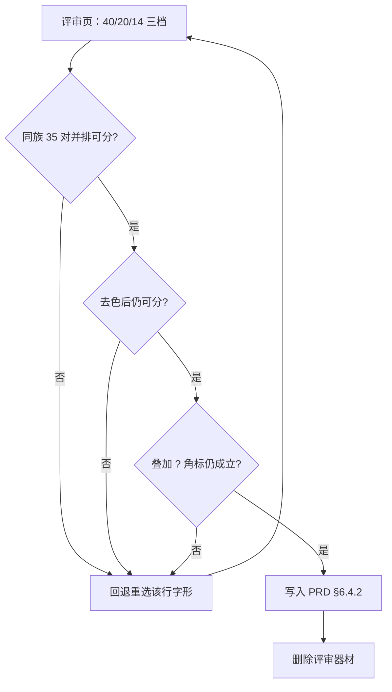

# 地图二级分类图标选型 - Plan

## Goal Capsule

**Objective:** 地图上的同一个一级大类内部，21 个二级分类各自有唯一、可辨识、且真实存在的字形；任意两个同族二级在 20px 渲染尺寸下去色后仍能区分。

**Means:** 21 行选型表写入 PRD §6.4.2 成为设计真源，验收用与线上同字形的静态页人工判定（KTD1、KTD2）。

**Product authority:** 产品方已拍板三项口径——族内一致性按「同对象域 + 同轴」、允许一级母题下沉、21 行全部定死。其余设计口径沿用 `docs/PRD.md` §6.4.2。

**Open blocker:** 无。验收方式已定为人工三档对照图（KD6）；Q1/Q2 属验收期判定点，不阻塞执行。

## Product Contract

### Summary

为地图的 21 个二级分类各锁定一个字形，按 5 个族组织，每族一条语义轴。表内每行给出编码、逐字名称、轴位置、Material 名、覆盖的叶子，以及斜杠名的取舍——15 个斜杠名里 9 行取一侧弃另一侧、6 行两侧同指一义。验收靠 20px 真实尺寸对照与同族两两比较，不靠放大预览。

### Problem Frame

地图现在只按一级分类取图标与配色：同一个「房屋」下的整租、求租、短租、咨询，圆底颜色相同、圆心图标也相同，只有供需态（实心/空心 + 右上 `?`）不同。密集区域里一屏全是同一个紫色屋形，用户无法靠扫视读出「这一片在租什么」。

这不是图标画得不好，而是**信息维度不够**：一级分类只覆盖 5 种可能，却被要求承载 21 种语义。PRD 曾因同样的原因卸掉完整度角标——40×40 里叠 4 条信息时，分类被重复编码两次，可辨识度反而下降。

同时，可用通道已经分配完：颜色归一级（含 deep 变体约束），形状归供需态（实心/空心 + 右上角标），尺寸归聚合档位。二级能拿到的只有**圆心那一个字形**，且实际只有 20px。所以这套设计的目标不是「画得更好看」，而是「在一条只剩 20px 的通道里塞进 21 个可区分的值」。

### Key Decisions

- **KD1 族内一致性按「同对象域 + 同轴」，不按「同一剪影 + 变体」。** `(session-settled: user-directed — chosen over 同一剪影+变体: Material 库在房屋、车辆、服务三族凑不出同剪影的多个变体，只有不同形态的实物)` 约束 R2、R3。
- **KD2 允许一级母题下沉。** `(session-settled: user-directed — chosen over 每个二级各自成形: 母题自然、族群感强)` 101 用 `work`、402 用 `volunteer_activism`；代价是这两个二级在地图上与现状看起来一致。约束 R1。
- **KD3 21 行全部锁定到具体字形，不留候选短名单。** `(session-settled: user-directed — chosen over 候选短名单: 要一张可直接评审的最终字形表)` 约束 R1。
- **KD4 二级不持有独立色相。** 五原色与五个 deep 变体已被一级占满，deep 与原色不可互换；再加 21 个色相会破坏「同一大类全站同色」的承诺。约束 R4。
- **KD5 只做图标设计，不做展示实现。** 本次产出是选型表与验收口径；地图如何呈现（尺寸层级、聚合、选中态）与图标名如何进数据层另立工作。
- **KD6 验收靠人工三档对照图，不建生成脚本。** `(session-settled: user-directed — chosen over 可重跑对照条: 不新建工具链，也不改 PRD「评审器材用后即清」的纪律)` 约束 R6。

### Requirements

**选型表**

R1. 21 行必须全部锁定到具体 Material 字形，且每个名字都已在本机 Flutter SDK 的 `icons.dart`（8825 个字形）中核实存在；不得出现未核实的名字。

| 编码 | 名称（逐字） | 族内轴位置 | Material 名 | 覆盖叶子 | 斜杠取舍 |
|---|---|---|---|---|---|
| 101 | 全职招聘 | 招人 · 标准岗位 | `work` | 5 | — |
| 102 | 兼职/临时工 | 招人 · 非全时 | `work_history` | 3 | 取「临时」，弃「兼职」 |
| 103 | 求职找工作 | 被招 · 我来找 | `person_search` | 1 | — |
| 201 | 整租/合租 | 整套居住单元 | `apartment` | 3 | 取「整租」，弃「合租」 |
| 202 | 求租/找房 | 我去找房 | `real_estate_agent` | 1 | 两侧交集（都是找房） |
| 203 | 短租/日租 | 短住 | `hotel` | 1 | 两侧交集（都是短住） |
| 204 | 租房信息咨询 | 问 | `support_agent` | 1 | — |
| 301 | 顺风车/拼车 | 同乘 | `airport_shuttle` | 3 | 两侧交集（都是共乘） |
| 302 | 租车/借车 | 租借 | `car_rental` | 2 | 取「租」，弃「借车」 |
| 303 | 二手车转让 | 买卖 | `sell` | 1 | — |
| 304 | 求搭车/求拼 | 我要搭 | `hail` | 1 | 两侧交集（都是求搭） |
| 401 | 二手闲置转让 | 物 | `inventory_2` | 5 | — |
| 402 | 借物/互助 | 人 · 给出与善意 | `volunteer_activism` | 3 | 取「互助」，弃「借物」 |
| 403 | 寻物启事/失物招领 | 物 · 寻找 | `search` | 2 | 两侧交集（都是找） |
| 404 | 宠物相关 | 活物 | `pets` | 2 | — |
| 405 | 求购/求助 | 人 · 公开求助 | `campaign` | 2 | 取「求助」，弃「求购」 |
| 501 | 家政/保洁 | 清洁 | `cleaning_services` | 3 | 取「保洁」，弃「家政」 |
| 502 | 维修/安装 | 上门修 | `home_repair_service` | 3 | 取「维修」，弃「安装」 |
| 503 | 教学/培训 | 教 | `school` | 2 | 两侧交集（都是教） |
| 504 | 美容/美发/按摩 | 身体护理 | `spa` | 2 | 取「美容/按摩」，弃「美发」 |
| 505 | 代办/跑腿 | 跑 | `directions_run` | 2 | 取「跑腿」，弃「代办」 |

R2. 每个一级大类对应一条族内语义轴，族内成员必须落在同一条轴上：工作 = 雇佣方向（招人 / 被招 / 找活）；房屋 = 居住单元的粒度与用途；车辆 = 参与方式（同乘 / 租借 / 买卖 / 搭车）；生活 = 物与人；服务 = 上门做什么。

R3. 族内禁止双件拼贴——不得把两个物件画进同一字形来同时表达斜杠两侧；凑不出同域候选时改族内轴，不改字形来源。

**颜色与通道**

R4. 二级图标不引入任何新色相：资源态取白、需求态取所属一级的分类色；二级之间的区分只能来自字形本身。

**可追溯**

R5. 每个二级记录它覆盖的三级叶子数量，并与 `lib/domain/category_tree.dart` 的 48 个叶子核对一致（本表 21 行合计 48）。

**验收**

R6. 验收必须在真实渲染尺寸下进行：按 PRD §6.4.2 的四步法出 40px（marker）、20px（图层面板）、14px（图例）三档对照图，人工评审；并同时通过去色校验（Saturation −100）——去色后仍能区分，才算形状承载了语义。三档中 20px 是主判据。

R7. 同族内需完成两两比较：工作 3 对、房屋 6 对、车辆 6 对、生活 10 对、服务 10 对，合计 35 对；判据是「并排不混」，不是「单独能说出名字」——二级图标在筛选面板与发布页始终与文字并排。

R8. 需求态叠加右上 `?` 角标后，字形仍须成立：角标圆心位于 `radius × 0.7`、自身半径 8，与 20px 字形的右上角相交，因此字形的右上区域不得承载辨识信息。

### Acceptance Examples

AE1. **Covers R6, R7.** 把生活族 5 个字形（`inventory_2` / `volunteer_activism` / `search` / `pets` / `campaign`）以 20px 单色条并排、去掉名称。评审者需指出「哪个是丢东西、哪个是在求」而不混淆。混了即回退重选。

AE2. **Covers R8.** 同一字形分别贴到资源态（分类色实心 + 白图标）与需求态（白底 + 分类色描边 + 右上 `?`）两种 pin 上，20px 并排。若某字形只在无角标时成立，淘汰。

AE3. **Covers R4.** 对同一张对照条做去色处理。若去色后只能靠颜色差异区分类别，说明字形不承载语义，判不通过。

AE4. **Covers R1.** 抽查任一行的 Material 名，必须能在 `icons.dart` 中检索到同名常量；检索不到的视为本表缺陷，不允许「先写着、实现时再补」。

### Success Criteria

- 21 行全部有经核实的字形名，无一行留空或写「待定」。
- 35 对同族比较中，20px 去色后不可分的对数为 0。
- 需求态叠加 `?` 角标后，21 个字形全部仍可辨（AE2 无淘汰）。
- 一级分类色板不变：仍是 5 原色 + 5 deep，无新增。
- 9 行「取 X / 弃 Y」的被弃语义，100% 能在对应二级的名称文字中看到；6 行「两侧交集」不参与此判据。

### Scope Boundaries

- **不在范围：** 地图上的展示实现（尺寸层级、聚合策略、选中态与阴影）；把图标名接进数据层（当前 DB → API → DTO → domain 的 icon 链路在转 domain 时丢弃，本次不修）；图标尺寸与描边的 token 化；一级 5 个图标的任何改动；分类树本身的增删改。
- **后续可另立：** 若本表通过验收，才值得讨论「图标名是否改为可运营配置」——那需要先修断链。

### Dependencies / Assumptions

- **A1** 假设 Flutter 内置 Material Icons 与 PRD 指定的 Material Symbols filled 属同一设计网格。`lib/domain/listing_category_style.dart:46-48` 已按此认定，本次沿用。
- **A2** 「高频侧」是按语义代表性判定的，不是按发布量。仓库内没有二级发布量数据；PRD 只写了需求弹层「默认按最近 7 天发布数排序」。**这是一条需要在有数据后复核的假设。**
- **A3** 21 个字形在 20px 下的可辨性尚未实测。本表只保证名字真实存在与语义对应，不保证渲染效果——后者正是 R6/R7 要验收的内容。

### Outstanding Questions

- **Q1（deferred，非阻塞）** 高风险对的处置在验收时判定：301 `airport_shuttle` 与 304 `hail` 都含「车 + 人」；302 `car_rental` 与 301 都是车辆形态；103 `person_search` 与 403 `search` 都表达「找」。三对列入 U1 的优先判定，不可分则回退该行字形并重跑。
- **Q2（deferred，非阻塞）** 服务族 505 `directions_run` 与族内其他字形（扫帚 / 房子+扳手 / 学士帽 / 莲花）形态差异最大，是否破坏族群一致性由 U1 判。

<!-- ce-section: work-relationships -->

### How This Work Fits Together

本计划只拥有「21 行选型表 + 验收口径 + 表的落点」。周边工作按当前理解如下，属于上下文而非承诺路线图：

- **本计划** — 锁定 21 个字形，并把它们写进 PRD §6.4.2。
  - **Enables** 地图展示实现：有了稳定的字形集合，才谈得上在地图上按二级渲染。
  - **Enables** 数据层接线：字形定稿后，把 icon 名写进分类数据才有意义。
  - **Can proceed independently of** 聚合策略调整——那属于展示层，与字形选择无关。
  - **Still to decide** 图标名是否存在数据侧（DB 列已存在但二级为空、且前端转换时丢弃）。
- 上游上下文：`docs/ideation/2026-10-28-map-l2-category-icons-ideation.html` 记录了本次选型之前的 41 条候选与 34 条落选理由。

### Sources / Research

- `docs/PRD.md` §6.4.2 — 图标映射表、选型方法论、配色规则、验收口径、两次历史否决记录（`package_2` 覆盖 11/15、`handyman` 20px 粘连）。
- `lib/domain/category_tree.dart` — 5 / 21 / 48 全量分类树，名称逐字建模，编码规则与「已发布编号不得重排」。
- `lib/features/map/marker_layer.dart` — 40 / 48 直径、图标边长 = 直径 × 0.5、字形经 `TextPainter` 绘制、`?` 角标位置。
- `lib/features/map/clustering/` — 聚合按一级分桶与差异化阈值。
- `lib/design_tokens.dart` — 五原色与五个 deep 变体，无图标尺寸 / 描边 token。
- `docs/progress/Batch1-进度记录.md` — 三轮图标返工记录与「小尺寸下结构简单优先于语义精确」的沉淀。
- Flutter SDK `packages/flutter/lib/src/material/icons.dart` — 8825 个字形，本表 21 个名字已逐个核实存在。
- `docs/ideation/2026-10-28-map-l2-category-icons-ideation.html` — 本次选型的构思来源。

## Planning Contract

**Product Contract preservation:** unchanged. R1–R8、AE1–AE4、KD1–KD6、Scope、Assumptions 含义与 ID 均未改动；本次只新增 Planning Contract 及以下的实现段落，并把 Q1/Q2 从「Deferred to Planning」改写为验收期判定点（同一含义，非范围变更）。

### Key Technical Decisions

KTD1. **二级表的唯一权威落点是 PRD §6.4.2 的「图标实现形式」区块，与一级映射表同节并列。** `(session-settled: user-directed — chosen over 只留在计划与评审页: 设计真源须与一级映射表同处一节，分两处必然漂移)` 计划文件与评审页都是派生，不承担口径。

KTD2. **验收器材用内嵌同一份 MaterialIcons 字体的静态页，弃 Figma 放大稿。** 线上是 `TextPainter` 按 `MaterialIcons` 字形绘制，评审页嵌入 Flutter SDK 自带的同一份 OTF、按 40/20/14 实尺寸渲染，评审看到的与用户看到的是同一字形。PRD 已记录「在 Figma 里放大到 400% 检视」正是前两版误判的成因。与 PRD 四步法的偏离：四步法第 ① 步的 SVG 路径抓取不适用于本轮（字形直接取 SDK 字体），第 ③ 步的 40px 需求态由双态 pin 区块覆盖。

KTD3. **先验收、后落笔。** 未通过的行先重选字形、重跑判定，再进 PRD。PRD 是团队口径源，写入未验证的表等于把返工成本转给所有读者。

KTD4. **不新增 Dart 常量，`lib/` 不做任何改动。** `category.icon` 只在 `listing_category_style.dart` 里服务一级；二级若现在落一份本地映射，会与 DB 既有的 `icon` 列构成同一事实的第二、第三处记录。等展示实现启动、断链一起修时再定归属。

### High-Level Technical Design

验收是一道四段闸门，任一段不过都回到「重选该行字形」而不是调色或放大；族内其余行不连带重判，只重跑涉及该行的那几对。重选候选须同族同轴、同对象域、单一剪影。

### Sequencing

U1 验收通过后才进入 U2 落笔；器材清理与代码零改动是 Definition of Done 的收尾条件，不单列工作单元。

### Assumptions

- 验收由产品 / 设计本人一次连续完成，不设第二人复现——Lightweight 范围内不引入评审流程成本。
- 评审页字体内嵌于页面本身，离线可开；它代表线上字形的依据是 A1 的同一网格认定。

## Implementation Units

### U1. 按四段闸门执行 21 个字形的人工验收

**Goal:** 判定 21 个字形在真实尺寸下是否成立，给出逐族通过与否、以及需回退重选的具体行。

**Requirements:** R3、R6、R7、R8；Covers AE1、AE2、AE3、AE4。

**Dependencies:** 无。

**Files:**
- `docs/design/二级分类图标选型表.html`（评审器材，只使用、不修改）

**Approach:**
1. 逐族看主表的三档预览，先以 20px 为主判据扫一遍，40px 与 14px 只用于确认放大后不跑形、缩小后不糊成块。
2. 逐行检查字形有没有把两个物件画进同一轮廓（R3 禁双件拼贴），命中即回退该行。
3. 打开去色开关，重看同族对照条——去色后仍能区分的组合才算字形承载了语义。
4. 打开隐藏名称的盲测开关，只看字形判断，重做生活族的「哪个是丢东西、哪个是在求」。
5. 逐个看双态 pin，确认 `?` 角标没有吞掉该字形的辨识信息。
6. 优先判定三对高风险：顺风车与求搭车、顺风车与租车、求职与寻物。
7. 判定 505 与族内其余四个的族群一致性，记下「静态物件 + 一个人形」是否可接受。
8. 记录结论：每族通过与否；不通过的行写明是「与谁混」还是「角标下不成立」。

**Execution note:** 全部判定在 100% 屏幕缩放下完成，不放大、不截图后放大看。

**Test scenarios:**
- 20px 单色条并排时，生活族 5 个字形两两不混。Covers AE1。
- 同一字形在资源态与需求态两种 pin 上均成立，角标遮挡后不产生歧义。Covers AE2。
- 去色后同族仍可分，不依赖颜色差异。Covers AE3。
- 抽查任一行的 Material 名可在 `icons.dart` 检索到同名常量。Covers AE4。

**Verification:** 每个族都有明确结论；每个「不通过」都指到具体行与具体对比对象，而不是「感觉不像」。

### U2. 把 21 行映射表与验收结论写入 PRD §6.4.2

**Goal:** 让二级字形成为设计真源的一部分，与一级映射表并列，并留下验收结论与日期。

**Requirements:** R1、R2、R5；R4 作为「不新增色相」的声明引用既有配色规则。

**Dependencies:** U1。

**Files:**
- `docs/PRD.md`（§6.4.2「图标实现形式」区块）

**Approach:**
1. 在现有一级图标映射表之后新增「二级图标映射表」，列为：编码 / 名称（逐字）/ 族内轴位置 / Material 名 / 覆盖叶子 / 斜杠取舍；21 行按五个族分组。
2. 紧接表后写三条口径：族内一致性按「同对象域 + 同轴」；允许一级母题下沉（101 与 402 与一级同形）；斜杠名只取一侧，两侧同指一个语义时取共同语义，被弃语义保留在名称文字里；不做双件拼贴。
3. 明写二级不持独立色相：资源态取白、需求态取一级分类色，区分只来自字形。
4. 记录验收结论与日期：三档尺寸、35 对、去色、`?` 叠加四项的结果；被回退重选的行以最终字形入表。
5. §6.4.2 的其他段落（尺寸、聚合档位、`?` 位置、完整度角标、验收四步法）一律不动。

**Patterns to follow:** 该节既有的记录写法——「（2026-08-24 定稿）」式的日期标注，以及「为什么」段落先给判据再给否证理由。

**Test scenarios:**
- 表内 21 行、覆盖叶子合计 48，与 `lib/domain/category_tree.dart` 逐条对得上。
- 21 个 Material 名逐个在 Flutter SDK 的 `icons.dart` 中检索得到。
- 验收结论段落包含四类判据的结果，且与被回退后的最终字形一致。

**Verification:** PRD 的 diff 只落在 §6.4.2 内；未新增分类、色板或尺寸口径。

## Verification Contract

本计划不改代码，Dart 侧的 `flutter analyze` / `flutter test` 不是判据——跑了也不会因本次变红或变绿。判据是两道人工闸门加一道范围闸门：

| 闸门 | 判据 | 通过标准 |
|---|---|---|
| 验收 | U1 的评审结论 | 每族有结论；35 对无「20px 去色后不可分」；三对高风险（301·304、301·302、103·403）与 505 的族群一致性均有判定 |
| 文档 | PRD 的 diff | 只动 §6.4.2；21 行齐、叶子合计 48、字形名可检索；结论与日期在位 |
| 范围 | 代码目录的 diff | `lib/` 与 `src/` 无改动 |

## Definition of Done

- 21 行表在 PRD §6.4.2 内，与一级映射表并列，无一行留空或写「待定」。
- 验收结论与日期写在同节，含三对高风险与 505 的判定。
- 验收中被打回的行已换字形并重跑，最终表与评审记录一致。
- 一级色板未新增：仍是 5 原色 + 5 deep。
- `docs/design/二级分类图标选型表.html` 已删除——评审器材用后即清（KD6）；若需复现，按 KTD2 的内嵌字体方式重建。
- `lib/` 与 `src/` 无改动。
