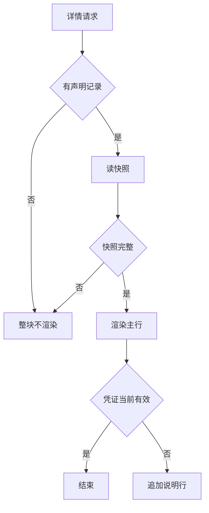

# 帖子凭证声明与快照 - Plan

## Goal Capsule

- **Objective:** 一条信息可以挂一张用户档案里的资质；详情页展示发布那一刻的快照，资质到期、被撤销或被删除时保留主行并追加一行中性说明。需求方打开详情页就能知道"这条信息示的是哪张证、什么时候有效"。
- **Means:** 挂载记录独立成条，每条帖子一条声明记录，自带冻结快照与声明时间；不采用给帖子加可空凭证字段的做法。
- **Product authority:** 本方案只覆盖「关联 + 快照 + 详情展示 + 补挂」。凭证元数据、类目资质要求分级、取消人工审核都不在本轮范围内。
- **Open blockers:** 无。

---

## Product Contract

### Summary

一条帖子可挂一张用户档案中的资质。挂载时把展示所需内容冻结成快照，详情页展示快照；资质到期、被撤销或被删除时，主行保留、下方加一行中性说明。发布表单提供一个可选、不阻断的挂载位，发布后也能补挂，补挂不改帖子时间。

### Problem Frame

现状有三处断裂，任何一处单独修都不足以让"资质提升可信度"成立。

**帖子与资质之间没有数据结构。** `post` 表没有任何凭证列（`src/main/resources/db/migration/V1__init_schema.sql:152-199`），发布 payload 不含资质字段（`lib/features/publish/publish_form_state.dart:372-396`），创建契约的 required 列表也不含（`docs/api/openapi.yaml:4786`）。资质只挂在用户身上，详情页无从知道"这条信息用了哪张证"。

**详情页的资质展示是写死的空列表。** 查询层以 `List.of()` 构造作者摘要（`src/main/java/com/s2s/server/post/PostQueryService.java:137-138`），前端取首项后塞进单行 `_TrustLine`（`lib/features/detail/post_detail_provider.dart:90-92`、`lib/features/detail/detail_screen.dart:587-593`）。领域模型里只有一个 label，没有有效期、没有来源。

**强制链路把资质做成了门槛而不是资产。** 类目打标加客户端硬编码再加服务端错误码，三处一起把"没有资质"变成"不能发布"。发布者因此没有动机去经营自己的资质档案，资质也从未成为可复用的资产。

三处叠加的结果是：即使凭证数据将来可用，详情页也只能说"这个发布者有一张证"，回答不了"这条信息凭什么可信"。需求方的判断成本不变，撮合没有增益。

### Key Decisions

- **挂载记录独立成条，不是帖子上的可空字段。** (session-settled: user-directed — chosen over 帖子字段 + 快照: 补挂不能碰帖子行，否则「不改帖子时间」只能靠约定守住。) Governs R2, R5
- **快照承载展示内容，另有一行实时状态说明。** (session-settled: user-directed — chosen over 失效即整行消失 / 跟随实时状态: 保历史可复现，又不展示一条实际已失效的资质。) Governs R3, R4
- **补挂不修改帖子时间，也不进入任何排序权重。** (session-settled: user-directed — chosen over 算一次编辑并参与时效打分: 避免补挂变成刷排名手段。) Governs R5
- **本轮只做最小闭环，不含凭证元数据列。** (session-settled: user-directed — chosen over 一次到位：签发方与核验来源需要隐私政策先改。) Governs R1, R2
- **失效文案用固定表加次级文字，不出现红标与警告图标。** 平台陈述事实，不替发布者下结论。 Governs R4

### Requirements

**关联与快照**

- R1. 每条帖子最多关联一张用户档案中的资质；未关联是合法状态，不产生任何提示、占位或拦截。
- R2. 关联以独立记录存在，携带冻结快照与声明时间。快照至少包含证名、有效期至、关联时的凭证状态，内容不随后续凭证变化而改写。
- R3. 详情页的资质主行只读快照，不因用户换证而改变；凭证的当前状态另取，仅用于判断是否追加说明行。

**展示**

- R4. 资质行由三部分组成：主行、归属行（恒显示）、状态说明行（仅失效时）。说明行使用 caption 字号与次级文字色，不加图标、不加色点、不加背景块、不加删除线；主行保持正常文字色，不因失效而降级。归属行固定为「由发布者提供，平台未核验」——本轮取消人工审核，资质是自述事实，展示必须能区分申报与核验（见 [资质证书上传与档案](file:///d:/developer/code/aicoding/s2s/docs/plans/2026-10-28-1444-feat-qualification-upload-plan.md)）。

| 状态 | 主行（快照，永不改写） | 归属行（恒显示） | 状态说明行（实时，中性） |
| --- | --- | --- | --- |
| 有效 | 家政服务资质 · 有效期至 2027-06 | 由发布者提供，平台未核验 | 无 |
| 已到期 | 家政服务资质 · 有效期至 2027-06 | 由发布者提供，平台未核验 | 该资质已于 2027-07 到期 |
| 被撤销 | 家政服务资质 · 有效期至 2027-06 | 由发布者提供，平台未核验 | 该资质已于 2026-11 失效 |
| 凭证被删除 | 家政服务资质 · 有效期至 2027-06 | 由发布者提供，平台未核验 | 该资质已不再有效 |

- R5. 补挂只新增或替换声明记录及其声明时间，不修改帖子的更新时间，不进入需求方与资源方任一侧的排序权重。
- R6. 发布表单提供可选挂载位：默认不选，不阻断提交，不产生 precheck 阻断码；候选只列本人当前有效（未过期、未撤销）的凭证。未选择的表达必须显式（"本次不展示"），使沉默不成为一次遗漏。

**发布与补挂**

- R7. 发布成功页与「我的发布」各提供一个补挂入口；补挂后详情页即时生效，无需重新发布或重新审核。
- R8. 详情页在未关联凭证时整块不渲染；关联后主行始终渲染，唯一的例外是 R9 的脏数据情形。

**兼容与迁移**

- R9. 关联时凭证就已失效的记录整块不展示——主行与说明行一起不渲染，不出现只有说明行没有主行的残句；这是 R4 展示规则之外唯一的不展示情形。
- R10. 新增存储结构以新版本迁移落地，不修改任何已应用的迁移文件。

### Key Flows

- F1. 发布时挂载
  - **Trigger:** 发布者填完表单，凭证档案中存在有效凭证。
  - **Actors:** 发布者。
  - **Steps:** 可选区块列出本人有效凭证 → 选一张或选"本次不展示" → 提交时一并写入声明记录与快照 → 发布成功。
  - **Outcome:** 帖子带一条声明记录，详情页出现资质主行。
  - **Covers:** R1, R2, R6

- F2. 发布后补挂
  - **Trigger:** 作者在发布成功页或「我的发布」点「加一份资质」。
  - **Actors:** 发布者。
  - **Steps:** 列出有效凭证 → 选择 → 写入声明记录 → 详情页即时出现资质主行。
  - **Outcome:** 帖子获得资质主行，帖子更新时间不变，排序得分不变。
  - **Covers:** R5, R7

- F3. 详情页读取
  - **Trigger:** 需求方打开详情页。
  - **Actors:** 需求方。
  - **Steps:** 读声明记录与快照 → 读凭证当前状态 → 组装主行与说明行 → 渲染。
  - **Outcome:** 主行恒为发布时事实；说明行仅在失效时出现。
  - **Covers:** R3, R4, R8

### Acceptance Examples

- AE1. 资质在有效期内
  - **Covers R4.**
  - **Given** 帖子挂了一张有效期至 2027-06 的家政服务资质。
  - **When** 需求方在 2027-06 打开详情页。
  - **Then** 显示主行「家政服务资质 · 有效期至 2027-06」与归属行「由发布者提供，平台未核验」，没有状态说明行。

- AE2. 资质到期
  - **Covers R4.**
  - **Given** 同 AE1。
  - **When** 在 2027-07 打开详情页。
  - **Then** 主行不变，说明行为「该资质已于 2027-07 到期」；主行颜色不降级，无红色、无删除线、无图标。

- AE3. 资质被撤销
  - **Covers R4.**
  - **Given** 凭证状态变为 rejected。
  - **When** 打开详情页。
  - **Then** 说明行为「该资质已于 YYYY-MM 失效」；用户侧文案不出现"撤销"二字。

- AE4. 凭证被用户删除
  - **Covers R4.**
  - **Given** 凭证记录被删除，声明记录与快照仍在。
  - **When** 打开详情页。
  - **Then** 说明行为「该资质已不再有效」。

- AE5. 关联时凭证已失效
  - **Covers R9.**
  - **Given** 一条声明记录指向的凭证在关联时就已过期。
  - **When** 打开详情页。
  - **Then** 资质整块不渲染，页面不出现只有说明行的残句。

- AE6. 未关联凭证
  - **Covers R1, R8.**
  - **Given** 帖子没有任何声明记录。
  - **When** 打开详情页。
  - **Then** 资质整块不渲染，不出现"暂无资质""未认证"之类占位文案。

- AE7. 补挂
  - **Covers R5, R7.**
  - **Given** 一条三个月前发布、未挂资质的帖子。
  - **When** 作者补挂一张有效凭证。
  - **Then** 详情页出现资质主行；帖子更新时间不变；该条信息在排序中的得分不变。

- AE8. 用户换证
  - **Covers R3.**
  - **Given** 帖子挂的是 A 证。
  - **When** 作者把档案里的凭证换成 B 证。
  - **Then** 详情页仍显示 A 证的快照与有效期，不出现 B 证，也不出现"可更新"提示。

### Scope Boundaries

- 签发方、核验来源、脱敏证号等凭证元数据列，以及"平台做了什么核验"的完整证据行。
- 类目资质要求三档化，以及拆掉现有发布硬拦截。
- 取消或弱化人工审核本身——它牵动 PRD、隐私政策、用户协议与契约的同步改写。
- 列表卡片、分享卡、搜索结果中的资质露出。
- 独立的资质档案页。
- 一帖多证。

<!-- ce-section: work-relationships -->

### How This Work Fits Together

本轮只拥有「关联 + 快照 + 详情展示 + 补挂」这一块。下面几块是当前理解，不是承诺路线图；后续可以各自修订、拆分或放弃。

- 凭证元数据与证据行 —— Can proceed independently of 本轮，但会占用同一个详情页位置，先做会与 R4 的文案冲突。
- 类目资质要求分级 —— Can proceed independently of 本轮；与本轮 Shares 同一批类目数据。
- 取消或弱化人工审核 —— Can proceed independently of 本轮的代码，但 Depends on 本轮范围之外的合规文本改写。
- 列表与分享卡露出 —— Depends on 本轮的声明记录，没有它就没有可展示的帖级凭证。

### Dependencies / Assumptions

- **假设：挂资质有助于撮合。** 目前没有证据，只有产品判断。用 Success Criteria 里的两把尺子验证，不当作已证事实。
- **依赖：凭证档案中存在当前有效的凭证。** 否则挂载位与补挂入口无候选可列；凭证如何产生不在本轮。
- **依赖不变更合规口径。** 本轮展示的是证名与有效期，不含证照原件；隐私政策把资质材料限定为"仅用于人工审核"，该限制针对原件，本方案不触发。将来若要展示原件或元数据，需先改政策。
- **约束：已应用的迁移不可改。** 新结构必须以新版本迁移落地。

### Success Criteria

- **挂载率**：发布时挂载的比例，以及补挂入口的转化率。
- **撮合信号**：挂了资质的条目与未挂条目在联系转化上的差异。若差异不显著，这个方向应当被重新评估，而不是继续加码。
- **表述可核对**：详情页任一句文案都能回答"这是发布时的事实还是当前状态"，不出现把用户声明写成平台认定的表述。

### Outstanding Questions

- **Deferred to Planning:** 快照的字段集与序列化形态。
- **Deferred to Planning:** 凭证记录被删除时，声明记录上的引用是置空还是保留原标识。
- **Deferred to Planning:** 一帖一证在结构上如何保证唯一（唯一约束或写入守卫）。

### Sources / Research

- 现状取证：`docs/PRD.md`（§4 认证、§5 发布、§7 详情）、`docs/api/openapi.yaml`（`/posts`、`PostCreateRequest`、`/cert/*`）。
- 数据形状：`src/main/resources/db/migration/V1__init_schema.sql`（`post`、`cert` 建表段）。
- 快照先例：`src/main/resources/db/migration/V9__post_contact_mask.sql`；`src/main/java/com/s2s/server/post/PostService.java`（写入）、`src/main/java/com/s2s/server/post/PostQueryService.java`（读取，不为展示解密）。
- 迁移纪律：`docs/solutions/workflow-issues/applied-flyway-migration-is-immutable-historical-artifact.md`。
- 数据模型预留：`docs/solutions/workflow-issues/data-model-reservation-for-deferred-features.md`。
- 上游构思与备选方向：`docs/ideation/2026-10-28-qualification-optional-ideation.html`。
