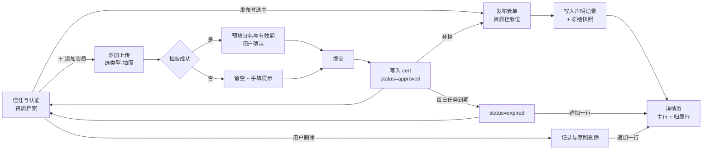
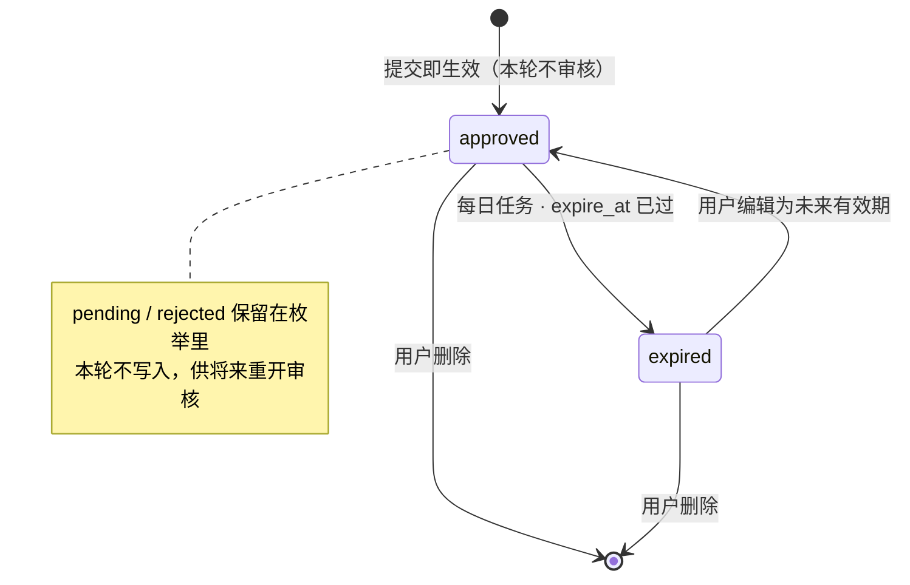

# 资质证书上传与档案 - Plan

## Goal Capsule

- **Objective:** 用户能自己把一张证书加进档案：拍图 → 自动读出证名与有效期 → 确认后提交 → 立即生效 → 发布时可挂到帖子上。不审核、不等待、不强制。
- **Means:** 走已有 `cert` 表 + 已有选图上传；新增证名与有效期来源两个字段；提交即 `approved`；过期由每日任务置 `expired`。
- **Product authority:** 本方案只覆盖「证书怎么进入档案、怎么失效、怎么删」。帖级挂载与详情页展示已由 [帖子凭证声明与快照](file:///d:/developer/code/aicoding/s2s/docs/plans/2026-10-28-1344-feat-post-credential-snapshot-plan.md) 定稿，本方案只补充它依赖的数据。
- **Open blockers:** 一条展示文案待确认（见 Outstanding Questions）；隐私政策与 PRD 三处留存口径必须同步改。

---

## Product Contract

### Summary

证书上传做成三步：选类型拍图 → 自动抽证名与有效期 → 确认提交。提交后立刻可用，没有审核队列。证书到期后自动失效，用户可以换证或删除；删除后已挂载的帖子会显示一行中性说明。

### Problem Frame

现有认证链路是一条半成品：入口、上传、落库都有，但整条链在提交那一秒就断了。

**结构上缺两个展示必需的字段。** `cert` 表有 `cert_type`、`status`、`ocr_image_ref`、`expire_at`，但**没有证名列**（[V1__init_schema.sql:307-322](file:///d:/developer/code/aicoding/s2s/src/main/resources/db/migration/V1__init_schema.sql#L307-L322)），`expire_at` 也从没被任何代码赋过值。详情页要展示「家政服务资质 · 有效期至 2027-06」，这两样东西今天都不存在。

**提交之后没有任何闭环。** `/cert/qualification` 只收 `cert_type + media_ids`，直接置 `pending` 并返回 2 小时 SLA（[CertService.java:246-260](file:///d:/developer/code/aicoding/s2s/src/main/java/com/s2s/server/cert/CertService.java#L246-L260)）；审核接口存在（`/admin/certs/{cert_id}/review`），但没有运营后台在跑。`/cert/status` 返回空列表（[CertService.java:229-231](file:///d:/developer/code/aicoding/s2s/src/main/java/com/s2s/server/cert/CertService.java#L229-L231)），前端三行永远显示「去认证」，「查看 / 管理」点进去是「本期内测版暂未开放」（[trust_screen.dart:109-113](file:///d:/developer/code/aicoding/s2s/lib/features/cert/trust_screen.dart#L109-L113)）。

**状态机只会进不会出。** `status` 有 `expired` 这个取值，但全仓没有任何地方写入它；唯一定时任务是删证照图的 `CertImageCleanupTask`，不动状态（[CertImageCleanupTask.java:67-70](file:///d:/developer/code/aicoding/s2s/src/main/java/com/s2s/server/task/CertImageCleanupTask.java#L67-L70)）。上一份方案里详情页的「该资质已于 2027-07 到期」这一行，正是靠这个状态判断的——没有它，说明行永远不会出现。

**留存规则和本轮目标相反。** 证照图 7 天后被删（`ocr_image_7d`，[NfrRetention.java:51-54](file:///d:/developer/code/aicoding/s2s/src/main/java/com/s2s/server/common/constants/NfrRetention.java#L51-L54)），隐私政策写的是「仅用于人工审核；核验完成后 7 天内自动删除」（[隐私政策（草稿）.md:49](file:///d:/developer/code/aicoding/s2s/docs/legal/隐私政策（草稿）.md#L49)）。取消审核之后，这条口径既失去前提，也与「用户不删就一直留着」相反。

### Key Decisions

- **取消人工审核，提交即生效。** (session-settled: user-directed — chosen over 保持 2h 人工审核 / 机审为主人工兜底 / 按证件类型分级：资质是可选加分项，审核队列会成为发布的第二道闸。) Governs R5
- **证名与有效期由 OCR 抽取，用户确认为准。** (session-settled: user-directed — chosen over 模板带出 / 纯手填 / 系统按类型推算：手填的名不归一，模板带出的名和证面不一致。) Governs R3, R4
- **有效期必填：优先读证件，读不出手填，可勾「长期有效」。** (session-settled: user-directed) Governs R2
- **证照原件不主动删除，用户删证书时才一起删。** (session-settled: user-directed — chosen over 7 天删除 / 留存至失效：过期也先留着，方便用户自己回看。) Governs R10
- **失效由每日任务写进 `expired`，不在读路径上算。** 读时计算会让「凭证当前状态」每次请求都要带时间判断，且详情页与档案页会各自实现一遍。 Governs R7
- **取消人工审核，展示必须标明来源。** (session-settled: user-directed — chosen over 主行后缀「· 自行申报」/ 只在提交页提示 / 分两档标记：资质行内固定一行「由发布者提供，平台未核验」，主行不变长，也不会在失效时丢掉归属。) Governs R13
- **图片上传、媒体校验、审计写入全部复用现有实现**，不新开一套上传通道。 Governs R2

### Requirements

**入口**

- R1. 三处入口都通向同一个添加流程：信任与认证页「资质认证」区的添加入口、发布表单资质位空态的「去添加资质」、我的发布行内补挂时的空态。后两处已在前一份方案定稿，本方案不重画。
- R2. 添加表单只有四件事：选证件类型、拍/选证照图、确认证名与有效期、提交。证照图走现有 ticket + commit 上传（[MediaController.java:42-57](file:///d:/developer/code/aicoding/s2s/src/main/java/com/s2s/server/media/MediaController.java#L42-L57)），张数与大小沿用既有上限，不新增常量。

**抽取与确认**

- R3. 提交前对首张图做一次抽取，取「证名」与「有效期至」。抽不出来不是错误：证名留空、有效期留空，用户手填即可，流程不阻断。
- R4. 抽取结果只是预填。用户改过的值以用户为准；用户没改，才用抽取值。表单在字段旁标明该值是「自动读取」还是「手工填写」，让用户知道自己在确认什么。
- R5. 有效期必填，但可选「长期有效」；选长期有效的记录不参与到期流转。

**生效与失效**

- R6. 提交即 `approved`，不落 `pending`，不返回 SLA。`pending`、`rejected` 两个取值保留在枚举里，供将来重开审核时使用，本轮不写入。
- R7. 每日任务把 `expire_at < 今天` 且 `status = approved` 的记录置为 `expired`；「长期有效」的记录跳过。到期不删记录、不删图、不改已挂载帖子的快照。
- R8. 同一用户可以有多张证，同类型也可以多张（例如两本不同工种的家政资质）；一帖仍只挂一张，由前一份方案的声明记录约束。

**修改与删除**

- R9. 证书可编辑（改名、改有效期、换图）；编辑只影响后续判断，已生成的帖级快照不回溯。
- R10. 证书可删除，删除是用户显式动作。删记录时一并删 OSS 原件；已挂载该证的帖子主行保留，说明行显示「该资质已不再有效」，与快照方案的 AE4 一致。删除入口放在编辑页底部，档案行只有「编辑 ›」，不给行内删除——减少误触。
- R14. 编辑时只有换图才重新抽取；只改名或只改有效期，不覆盖用户已经确认过的另一个字段。
- R15. 编辑把 `expired` 记录改成未来有效期时，状态回到 `approved`；改成已过去的时间则直接置 `expired`。改完当天就生效，不走次日任务。

**留存与合规**

- R11. 证照原件不再按 `ocr_image_7d` 自动清理。保留规则、清理任务、隐私政策、PRD 三处留存口径必须同批改，不允许代码先改而文本后补。
- R12. 新增存储以新版本迁移落地（当前最新 V21，本方案用 V22），不修改任何已应用的迁移文件。
- R13. 详情页资质行固定展示归属行「由发布者提供，平台未核验」。无审核不等于无归属：文案由本方案定，展示位置由快照方案 R4 定。该行的写入不依赖审核状态，任何 `approved` 或 `expired` 的证都显示。

### 文案表

上传表单与档案列表的固定文案，实现时逐字使用：

| 位置 | 文案 |
| --- | --- |
| 表单标题 | 添加资质 |
| 字段 · 类型 | 证件类型 |
| 字段 · 图片 | 证照照片 |
| 字段 · 证名 | 证书名称 |
| 字段 · 有效期 | 有效期至 |
| 抽取成功标记 | 已从照片读取，可修改 |
| 抽取失败提示 | 没读出来，请手动填写 |
| 长期有效开关 | 长期有效 |
| 提交按钮 | 提交 |
| 提交成功 | 已添加，发布时可以选择这张证 |
| 列表状态 · 有效 | 有效期至 YYYY-MM |
| 列表状态 · 长期 | 长期有效 |
| 列表状态 · 过期 | 已于 YYYY-MM 过期 |
| 编辑页标题 | 编辑资质 |
| 新增按钮 | ＋ 添加资质 |
| 行内入口 | 编辑 › |
| 上传失败 | 图片没传上去，请重试 |
| 删除确认 · 标题 | 删除这张资质？ |
| 删除确认 · 正文 | 删除后，用过它的信息会显示「该资质已不再有效」。这个操作不能撤销。 |
| 删除确认 · 主按钮 | 删除 |
| 删除确认 · 次按钮 | 取消 |
| 续期成功 | 已更新，新的有效期立即生效 |

### 端到端主流程

一条证从产生到被看到，跨两个方案的完整路径：

三个位置必须一致：档案里怎么写的、发布时选的是哪张、详情页显示的是什么。前两者用 `cert.id` 对齐，后者用快照对齐。

### Key Flows

- F1. 添加一张证
  - **Trigger:** 用户在信任与认证页点添加，或在发布表单空态点「去添加资质」。
  - **Steps:** 选类型 → 拍/选图并上传 → 系统抽证名与有效期 → 用户确认或修改 → 提交。
  - **Outcome:** 档案里多一张 `approved` 的证，立即可被帖子挂载。
  - **Covers:** R1, R2, R3, R4, R6

- F2. 抽取失败
  - **Trigger:** 图片模糊、非证件、模型不可用。
  - **Steps:** 两个字段留空并提示「没读出来，请手动填写」→ 用户填 → 提交。
  - **Outcome:** 证书照常添加，不因抽取失败被挡。
  - **Covers:** R3, R4

- F3. 换证
  - **Trigger:** 旧证到期，用户拿到新证。
  - **Steps:** 编辑原记录（改有效期与图）或新增一条再删旧条。
  - **Outcome:** 档案里是有效的证；已挂载该证的帖子仍显示旧快照，不出现新证。
  - **Covers:** R8, R9

- F4. 到期
  - **Trigger:** 每日任务发现 `expire_at` 已过。
  - **Steps:** 置 `expired` → 档案页该行显示「已于 YYYY-MM 过期」→ 已挂载帖子追加说明行。
  - **Outcome:** 记录与图都还在，用户可继续编辑续期。
  - **Covers:** R7, R10

- F5. 删除
  - **Trigger:** 用户在档案页删除一张证。
  - **Steps:** 二次确认 → 删记录与 OSS 原件 → 已挂载帖子说明行变为「该资质已不再有效」。
  - **Outcome:** 证书从档案消失，帖子主行保留。
  - **Covers:** R10

- F6. 编辑与续期
  - **Trigger:** 用户点档案行「编辑 ›」，可能是改错名、换图，或旧证到期换新证。
  - **Steps:** 打开同一张表单并回填现值 → 改证名 / 换图 / 改有效期 → 重新抽取（仅在换图时）→ 提交。
  - **Outcome:** 同一条记录被更新；若新有效期在未来且原状态为 `expired`，状态回到 `approved`；已生成的帖级快照不回溯。
  - **Covers:** R9, R7

- F7. 上传或抽取中断
  - **Trigger:** 图片超过大小上限、格式不支持、ticket 过期、模型超时。
  - **Steps:** 图未提交成功时提示重试并保留已填内容；上传成功但抽取失败时按 F2 处理，不报错。
  - **Outcome:** 不产生半条记录；用户不会丢失已填的证名与有效期。
  - **Covers:** R2, R3

- F8. 从挂载位回流
  - **Trigger:** 用户在发布表单空态点「去添加资质」，添加成功后返回。
  - **Steps:** 返回时重新拉候选 → 新证出现在选项里且不被自动选中 → 用户自行选择。
  - **Outcome:** 添加动作不会替用户做挂载决定。
  - **Covers:** R1, R6

### 状态机

`cert.status` 只有一次前进、一次回退，其余都是终态：

「长期有效」的记录不进入 `expired`；快照方案里那句「该资质已于 YYYY-MM 到期」只在这条边上出现。

### Acceptance Examples

- AE1. 正常添加
  - **Covers R2, R3, R6.**
  - **Given** 用户已实名，选「家政服务资质」并上传一张清晰证书照。
  - **When** 提交。
  - **Then** 表单预填「家政服务资质」与证件上的到期月份，两字段标注「已从照片读取，可修改」；提交后档案立即显示该证，可被发布表单选中。

- AE2. 抽取失败
  - **Covers R3.**
  - **Given** 上传的图是糊的。
  - **When** 抽取返回空。
  - **Then** 两个字段为空并提示「没读出来，请手动填写」，提交按钮仍可用；手填后能正常提交。

- AE3. 用户改写抽取结果
  - **Covers R4.**
  - **Given** 抽取出「养老护理员证」，用户改成「养老护理员（中级）」。
  - **When** 提交。
  - **Then** 落库的是用户改后的值，表单不再显示「自动读取」。

- AE4. 长期有效
  - **Covers R5.**
  - **Given** 用户勾选「长期有效」。
  - **When** 提交，且经过任意时长。
  - **Then** 该证不进入过期流转，档案与详情页都显示「长期有效」。

- AE5. 未实名提交
  - **Covers R6.**
  - **Given** 用户未完成实名。
  - **When** 提交资质。
  - **Then** 沿用既有 40302，不新增错误码。

- AE6. 到期流转
  - **Covers R7.**
  - **Given** 一张 `approved`、有效期至 2027-06 的证。
  - **When** 时间进入 2027-07 的第一次任务执行。
  - **Then** 该记录变为 `expired`；档案显示「已于 2027-07 过期」；已挂载它的帖子详情页出现「该资质已于 2027-07 到期」；快照主行不变。

- AE7. 换证后旧帖不变
  - **Covers R9.**
  - **Given** 帖子挂的是 A 证。
  - **When** 用户把 A 证的有效期改成新的，或新增 B 证并删除 A 证。
  - **Then** 详情页主行仍是 A 证当时的证名与有效期，不出现 B 证。

- AE8. 删除已挂载的证
  - **Covers R10.**
  - **Given** 一张证被 3 条帖子挂载。
  - **When** 用户删除该证。
  - **Then** 档案不再显示；3 条帖子的主行保留，说明行为「该资质已不再有效」。

- AE9. 多张同类型
  - **Covers R8.**
  - **Given** 用户已有 1 张家政服务资质。
  - **When** 再添加一张不同工种的。
  - **Then** 两张并存，发布时都能被选中。

- AE10. 原照留存
  - **Covers R11.**
  - **Given** 一张 8 天前添加、仍在有效期内的证。
  - **When** 用户查看该证。
  - **Then** 证照原件仍可访问，不被清理任务删除。

- AE11. 续期
  - **Covers R15, R7.**
  - **Given** 一张已 `expired`、有效期至 2026-08 的证，被 1 条帖子挂载。
  - **When** 用户编辑为 2027-08 并提交。
  - **Then** 状态当天回到 `approved`，档案显示「有效期至 2027-08」；该帖详情页的「已于 2026-08 过期」说明行消失，主行仍是 2026-08 的快照。

- AE12. 只改名不重抽取
  - **Covers R14.**
  - **Given** 用户已确认证名「家政服务资质」与有效期 2027-06。
  - **When** 只把证名改成「家政服务资质（高级）」并提交。
  - **Then** 有效期保持 2027-06，不被重新抽取覆盖。

- AE13. 上传失败
  - **Covers R2, F7.**
  - **Given** 用户选了一张 25 MB 的图。
  - **When** 上传被拒。
  - **Then** 提示「图片没传上去，请重试」，已填的证名与有效期不丢，可换图继续。

- AE14. 删除时取消
  - **Covers R10.**
  - **Given** 用户点删除。
  - **When** 在确认弹窗点「取消」。
  - **Then** 记录与原件都不删，档案与详情页无变化。

- AE15. 从挂载位回流
  - **Covers R1, F8.**
  - **Given** 用户从发布表单空态去添加完一张证，返回发布页。
  - **When** 返回。
  - **Then** 挂载位出现该证作为候选，但默认仍停在「本次不展示」，不替用户选择。

### Scope Boundaries

- 人工审核后台、驳回与申诉流程——本轮取消审核，不建设。
- 平台主动核验：权威数据库比对、电子证照查验、签发方信息。
- 到期前提醒推送（PRD §4 有「年审到期前 30 天提醒」的口径，牵动通知中心与本轮无关）。
- 证件类型的增删改（沿用现有四类，其中个人实名不是资质）。
- 帖级挂载、详情页六态展示、补挂入口——已在前一份方案定稿。
- 证件原件在详情页的展示（本轮只展示证名与有效期）。

### Dependencies / Assumptions

- **依赖：合规文本同批改。** 隐私政策「仅用于人工审核 / 7 天内删除」与 PRD 两处留存口径必须同步改成本方案口径，否则代码与承诺不一致。
- **依赖：OCR 走既有模型通道。** `QwenAiProvider` 已支持图文同框入参（`s2s.ai.omni-model`），本方案需在 `AiProvider` 上新增一个抽取方法，不引入新供应商；dry-run 模式下走兜底，用户手填即可跑通全流程。
- **依赖：AI 配额与费用台账。** 抽取计入既有调用通道，按现有计费口径记账。
- **假设：用户会如实填写。** 无审核意味着证名与有效期是自述事实，方案不假设其真实性；展示侧必须能区分「用户申报」与「平台核验」。
- **约束：一帖一证的结构不变**，本次只放宽档案侧的多张并存。

### Risks

- **取消审核后，详情页容易被读成平台背书。** 监管对资质审查有明确要求，展示若不标明来源，平台等于替用户作了认定。这是本方案最大的风险，处理方式见 Outstanding Questions 第 1 条。
- **留存从 7 天改为长期，敏感个人信息暴露面变大。** 证照图属敏感个人信息，须同步调整隐私政策并复核访问控制（当前仅管理员可经 `admin_cert_access_request` 取原件）。
- **OCR 只做预填，不做校验。** 用户可以把一张与他人无关的证书图配上任意名称，本轮不做一致性比对，属已知缺口。

### Success Criteria

- **添加完成率**：进入添加表单的用户中，成功提交的比例；抽取失败不得显著拉低该比例。
- **手填占比**：抽取值为空的字段比例，用于判断 OCR 是否值得继续投入。
- **挂载转化**：有有效证书的用户中，发布时选择挂载的比例。
- **表述可核对**：详情页任一句资质文案都能回答「这是用户申报还是平台核验」。

### Outstanding Questions

1. **是否保留驳回能力。** 本轮不审核，但若将来重开，`rejected` 的记录在档案页显示什么，未定。
2. **删除是否软删。** 当前 `cert` 表无删除标记；硬删会让审计日志失去可关联对象，倾向软删 + 保留标识，待定。
3. **归属行的字号与颜色。** 与状态说明行同规格（caption 11 / `#5b6672`）已在稿中落地，若与视觉规范冲突需回改。

### Sources / Research

- 数据形状：[V1__init_schema.sql:307-322](file:///d:/developer/code/aicoding/s2s/src/main/resources/db/migration/V1__init_schema.sql#L307-L322)（cert 表）、`:310`（类型枚举）、`:311`（状态枚举）、`:316`（`ocr_image_ref`）、`:314`（`expire_at`）。
- 提交链路：[CertService.java:246-260](file:///d:/developer/code/aicoding/s2s/src/main/java/com/s2s/server/cert/CertService.java#L246-L260)、[CertController.java:65-69](file:///d:/developer/code/aicoding/s2s/src/main/java/com/s2s/server/cert/CertController.java#L65-L69)、[openapi.yaml:4154-4174](file:///d:/developer/code/aicoding/s2s/docs/api/openapi.yaml#L4154-L4174)。
- 状态与审核：[CertService.java:319-326](file:///d:/developer/code/aicoding/s2s/src/main/java/com/s2s/server/cert/CertService.java#L319-L326)（`markReviewed`）、[CertService.java:229-231](file:///d:/developer/code/aicoding/s2s/src/main/java/com/s2s/server/cert/CertService.java#L229-L231)（`/cert/status` 恒空）、[CertImageCleanupTask.java:67-70](file:///d:/developer/code/aicoding/s2s/src/main/java/com/s2s/server/task/CertImageCleanupTask.java#L67-L70)。
- 前端：[trust_screen.dart:92-113, 339-376](file:///d:/developer/code/aicoding/s2s/lib/features/cert/trust_screen.dart#L92-L113)、[qualification_form_screen.dart:188-194](file:///d:/developer/code/aicoding/s2s/lib/features/cert/qualification_form_screen.dart#L188-L194)。
- 模型通道：[AiProvider.java:9-12](file:///d:/developer/code/aicoding/s2s/src/main/java/com/s2s/server/ai/AiProvider.java#L9-L12)、[QwenAiProvider.java:305-330](file:///d:/developer/code/aicoding/s2s/src/main/java/com/s2s/server/ai/QwenAiProvider.java#L305-L330)（image_url 部件）。
- 留存：[NfrRetention.java:51-54](file:///d:/developer/code/aicoding/s2s/src/main/java/com/s2s/server/common/constants/NfrRetention.java#L51-L54)、[RetentionRuleRegistry.java:45-46](file:///d:/developer/code/aicoding/s2s/src/main/java/com/s2s/server/common/retention/RetentionRuleRegistry.java#L45-L46)、[隐私政策（草稿）.md:49](file:///d:/developer/code/aicoding/s2s/docs/legal/隐私政策（草稿）.md#L49)。
- PRD 口径：[PRD.md:833](file:///d:/developer/code/aicoding/s2s/docs/PRD.md#L833)（人工审核 SLA ≤ 2h）、`:845-846`（审核后台与 7 天删除）、`:856`（到期提醒）。
- 上游：[帖子凭证声明与快照](file:///d:/developer/code/aicoding/s2s/docs/plans/2026-10-28-1344-feat-post-credential-snapshot-plan.md)、[资质认证可选化构思](file:///d:/developer/code/aicoding/s2s/docs/ideation/2026-10-28-qualification-optional-ideation.html)。
