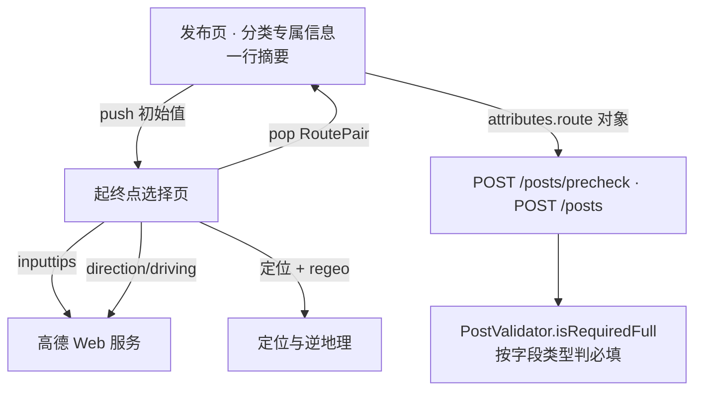
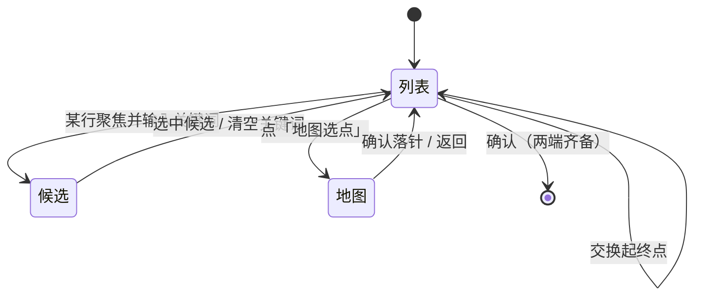

# 起终点双点采集 - Plan

## Goal Capsule

**Objective.** 拼车发帖人能在一次进入里选好起点与终点，看见这条路线的距离与耗时，方向填反时一键对调——而不是对着一个写着「如：回龙观 → 中关村」的文本框自己组织语言。

**Means.** 新建一个「起终点选择」页：顶部两行卡片（起点默认「我的位置」、终点待选），中间可交换，下方快捷项「我的位置 / 地图选点」，再下方是 POI 候选列表；地图作为页内切换而非默认。表单侧只保留一行摘要作为入口。

**Product authority.** 本计划只覆盖发布页拼车分类的起终点录入。发现侧的地图选点页、按路线/时段的匹配与索引、家/公司等地址簿能力都不在本计划的活动范围内。

## Product Contract

### Summary

把发布页「分类专属信息」里的「起点 → 终点」从自由文本改成一个入口，进入新建的起终点选择页；该页搜索优先、地图备选，选完回填一行摘要。同一改动顺带让拼车的「位置精确」不再依赖门牌号。

### Problem Frame

拼车模板里 `route` 是一个文本字段，靠 placeholder「如：回龙观 → 中关村」教用户写两个点。用户写出来的「回龙观 → 中关村」「回龙观到中关村」「回龙观-中关村」在库里是三条不相干的数据，既算不了距离，也筛不了时段。

更直接的成本在车主这一侧：他要先选起点、再进一次地图选终点，两次全屏进出之间没有任何东西告诉他「这两点凑起来是不是一条顺路的线」——而这正是他决定发不发这条帖的依据。填反方向是这类帖最常见的错误，而每次选点都是一次全屏 push–pop，纠错只能整段重来。

### Key Decisions

1. **新建一页，只服务发布。** `(session-settled: user-directed — 选于「改造现有选点页并两边共用」：本期不牵动发现侧)`
   Governs R1, R2.

2. **搜索优先、地图备选。** 顶部两行卡片加 POI 候选列表，地图是页内一个入口而不是默认形态。`(session-settled: user-approved — 参考高德起终点页的范式)`
   Governs R3, R4, R6.

3. **快捷项只做「我的位置 / 地图选点」。** 不做家、公司、最近使用——那三者要么依赖用户地址簿，要么依赖一套新的本地历史。`(session-settled: user-directed — 选于「加家/公司」「只留两个」)`
   Governs R5.

4. **去掉门牌号。** 现有选点页的门牌号输入在新页面不保留。`(session-settled: user-directed)`
   Governs R9, R10.

5. **「位置精确」改为「两点都选到具体 POI」。** 拼车分类不再以门牌号判定精确，改以起终点是否都选中了带坐标的 POI 判定；PRD §9.8 的口径修订随本计划同批提交。`(session-settled: user-approved — 依据是结构化两点确实比门牌号更精确)`
   Governs R10.

6. **距离用驾车里程与时长。** 走高德路径规划，与逆地理同一个 Key；不采用直线距离。`(session-settled: user-approved)`
   Governs R7.

7. **表单侧只留一行摘要。** 表单里不展开两行，点击整行进页面。`(session-settled: user-directed — 选于「表单两行」「各选各的」)`
   Governs R1.

8. **一期只做采集、交换与反馈。** 索引、按路线与时段匹配放到二期。`(session-settled: user-directed)`
   Governs 范围边界，见 Scope Boundaries。

### Requirements

**入口与页面结构**

R1. 发布页「分类专属信息」里的起终点显示为一行摘要：未选时是「选择起终点」，已选时是「起点名 → 终点名」；点击整行进入起终点选择页。
R2. 起终点选择页只服务发布流程；发现侧现有地图选点页的入口、参数与行为在本期保持不变。
R3. 页面顶部是一张两行卡片：起点行默认填「我的位置」，终点行留空并以占位提示可搜索。
R4. 卡片内提供「交换起终点」，一次点按互换两行的地点值，并重新计算距离与时长。

**采集与候选**

R5. 卡片下提供两个快捷项：「我的位置」「地图选点」；不提供家、公司、最近使用。
R6. 在某一行输入关键词时，下方展示 POI 候选列表，每条含名称与一句地址描述；点选某条即回填该行并收起列表。
R7. 起终点都有坐标后，卡片展示驾车里程与时长（形如「约 18 km · 约 35 分钟」）；只选了一端时不展示；地图态不展示这一段，回到列表态再展示。
R8. 地图模式是页内一个可切换形态：进入后可拖图落针，确认后回填当前聚焦的那一行；不新增独立的全屏选点页。

**与表单和完整度的衔接**

R9. 新页面不采集门牌号，发布载荷不新增门牌相关字段。
R10. 拼车分类的「位置精确」判定改为「起点与终点都选到具体 POI（带坐标）」，不再看门牌号。
R11. 确认按钮仅在起点与终点都有值时可用；只选一端时按钮禁用并说明缺哪一端。

**降级**

R12. 定位不可用或用户拒绝定位时，起点行留空并提示「选择起点」，不阻断进入页面。
R13. 距离或时长获取失败时，隐藏这一段信息且不弹错误提示，确认与回填不受影响。

**退出与告知**

R14. 取消或系统返回一律丢弃页面内的改动并退出，表单保留进入前的值；地图态左侧返回列表、右侧取消退出整页。
R15. 选择页显式告知「起点与终点将对所有看到这条信息的人可见」，与现有地图选点页的门牌号告知同一口径。

### Actors

- A1. 发帖人（车主）：在停车场或路边单手操作，需要快速确认一条他认识的路线。
- A2. 搭车人：不参与录入，但消费「距离与耗时」这组信息来判断是否顺路。

### Key Flows

F1. **首次选择起终点**
   **Trigger:** 发帖人点开表单里的「选择起终点」。 **Covers R1, R3, R5, R6, R7, R11.**
   进入页面时起点已填「我的位置」；发帖人点终点行、输入关键词、从候选里点选一条；卡片出现距离与时长；确认返回，表单摘要变为「起点名 → 终点名」。

F2. **改终点**
   **Trigger:** 已选好两点后想换终点。 **Covers R6, R7.**
   点终点行，输入新关键词或直接点「地图选点」，重选后卡片数值随之更新。

F3. **方向填反**
   **Trigger:** 发现起点与终点颠倒。 **Covers R4.**
   点「交换起终点」，两行互换，距离与时长重算；不发帖、不重进任何页面。

F4. **定位不可用**
   **Trigger:** 权限被拒或定位超时。 **Covers R12, R11.**
   起点行为空并提示「选择起点」；发帖人可搜索或走地图选点补齐；确认按钮在两端齐全前保持禁用。

### Acceptance Examples

AE1. **默认进入**
   **Covers R3, R11.**
   给定定位可用，进入页面 → 起点显示「我的位置」，终点为空，「确认」禁用并提示缺终点。

AE2. **交换**
   **Covers R4, R7.**
   给定起点「回龙观」、终点「中关村」、卡片显示「约 18 km · 约 35 分钟」；点交换 → 两行互换、数值重算为反方向的结果。

AE3. **只选一端**
   **Covers R11.**
   给定只填了终点，点「确认」→ 不可提交，页面指出缺少起点。

AE4. **距离失败**
   **Covers R13.**
   给定两点已选但路径规划请求失败 → 卡片不显示距离段，不出现错误弹窗，确认仍可用。

AE5. **定位被拒**
   **Covers R12.**
   给定定位权限为拒绝，进入页面 → 起点为空并提示「选择起点」，其余交互正常。

AE6. **门牌号下线**
   **Covers R9, R10.**
   给定一条用新页面发布的拼车帖，其「位置精确」为真当且仅当起终点都带坐标；与是否存在门牌号无关。

### Success Criteria

- 默认路径（起点用「我的位置」、终点搜一次）从进入页面到返回表单，点击不超过 6 次、中文键盘只弹一次。
- 方向填反的纠错成本从「重进两次地图」降为 1 次点按。
- 新发布的拼车帖中，起终点都带坐标的比例可作为二期能否进入索引与匹配的门槛。

### Scope Boundaries

**Deferred for later**

- 家、公司、最近使用三项快捷入口。
- 发现侧地图选点页与本页收敛为同一份交互。
- 按起终点坐标做索引、按路线与时段匹配推荐。
- 门牌号以其他形式回归（若二期需要精确到楼栋）。

**Outside this plan**

- 路线规划算法本身、POI 数据源选型。
- 拼车以外的分类是否也改用这一页。

### Dependencies / Assumptions

- 依赖现有高德 Web 服务 Key 能覆盖驾车路径规划，与逆地理同源。
- 假设模板字段能承载两个地点对象；一期把结构落在现有附加字段的 JSON 里，不改表结构（KTD1）。
- 服务端的必填判定需按字段类型识别「对象在、坐标空」（KTD4），并随本计划落地。
- PRD §9.8 的完整度口径修订由本计划同批提交，不单独排期。

### Outstanding Questions

**Resolved in planning:** Q1（字段拆法）→ KTD1；Q2（距离缓存与节流）→ KTD6；Q3（地图控件复用）→ KTD7。无遗留阻塞项。

**Deferred, non-blocking:** Q4. 拼车帖的 `post.lng`/`lat`（发现侧图钉）与 `attributes.route.origin`（路线起点）哪一套是权威坐标——本期两套并存，二期做索引与匹配时再定，不阻塞本计划。

### Sources / Research

- 参考形态：高德地图起终点选择页（两行卡片 + 快捷项 + POI 候选 + 键盘常驻，地图为页内切换）。
- 现状证据：`lib/features/publish/map_selector_screen.dart`（单点选点、门牌号、PIPL 告知）；`lib/features/publish/publish_form_state.dart`（`address_precise` 派生、`hasLocation` 判据）；`lib/domain/publish_template.dart`（`route` 为 text）；`lib/features/location/reverse_geocode.dart`（Key 缺失返回空串）。
- 口径来源：`docs/PRD.md` §9.8 完整度三档与三条件；§5.7 模板下发字段清单。
- 上游构想：`docs/ideation/2026-10-30-publish-vehicle-form-ideation.html`（第 1 条）。

<!-- ce-section: work-relationships -->
### How This Work Fits Together

本计划拥有的区域是**发布侧起终点的一次性双点采集**；下面是当前的理解，不是已承诺的路线图。

- **enables** 二期「按起终点与时段做匹配」——没有结构化两点，匹配只能比字符串。
- **shares** 与「发布页其余字段改造」（出发时间、人数、车型、车牌）共享同一处模板字段机制；本计划只动起终点，其余各自独立成计划。
- **can proceed independently of** 发现侧选点页收敛——本页新建后两边并存，收敛可以后做。
- **still to decide** 家/公司与最近使用是否进入地址簿能力，取决于二期是否需要「常用路线」。

---

## Planning Contract

**Product Contract preservation:** changed: R7 补地图态例外；新增 R14（退出语义）与 R15（位置可见性告知）。两处均为既有交互与 PIPL 告知的澄清，无范围扩张。

### Key Technical Decisions

KTD1. 起终点作为一个**结构化地点对**落进 `attributes.route`，不拆成两个字段。对象形态为 `{origin:{name,address,lng,lat}, destination:{...}, distance_m?, duration_s?}`。历史数据（AI 猜测、旧草稿、存量帖）里的 `route` 仍是字符串，读取端同时接受两种形态。 `(session-settled: user-directed — chosen over 拆成起点/终点两个独立字段：二期要按两端坐标建索引与匹配，嵌套对象可直接建表达式索引，字符串做不到)`

KTD2. 模板新增字段类型 `route_pair`，复用现有模板下发机制，不另造一套。服务端 Java DTO 的 `type` 是自由字符串，无需改动；但 `openapi.yaml` 的 `TemplateField.type` 是五值封闭枚举，必须补 `route_pair`，否则契约与真实响应分叉。客户端两侧枚举（`TemplateFieldTypeDto`、本地 `TemplateFieldType`）各加一个值并映射。拼车模板的 `route` 字段类型由 `text` 改为 `route_pair`，本地模板、数据库种子与契约枚举三处同源修改。 `(session-settled: user-approved — 与「拆成两个字段」一并确认：一个字段一个控件，版面与必填判定都不分叉)`

KTD3. 「位置精确」仍以上送单个 `address_precise` 布尔表达，不改契约、不改表结构。判定口径：模板含 `route_pair` 字段时 = 起终点都带坐标；其余分类维持门牌号非空。同一判据必须同时喂给 `postDraftPayload`、`PublishFormState.completeness`（否则应用内档位与落库档位相反）与条件二的展示文案。服务端 `computeDerived` 继续采用该布尔值。

KTD4. 必填判定按**字段类型**判，不再「非空即已填」。客户端 `PublishFormState.blocker` 对 `route_pair` 以两端齐全为准；服务端 `PostValidator.isRequiredFull` 校验对象结构与两端坐标。这是本计划唯一的后端行为改动。 `(session-settled: user-directed — chosen over 只做客户端：对象填一半会被服务端判成已填，完整度三档随之算错)`

KTD5. POI 候选与驾车里程/时长都由 App 直连高德 Web 服务（`/v3/assistant/inputtips`、`/v3/direction/driving`），复用 `kAmapWebServiceKeyDefine` 的构建期 Key 与逆地理的直连写法，不新增后端接口。列表态的两次出网都在隐私同意之后才发起，与地图态的合规闸门同一口径。若日后配额或 Key 治理不允许端内直连，改走代理时 UI 不变、只替换 U2 的实现（服务端已有 `AmapPoiClient` 可承接）。 `(session-settled: user-directed — chosen over 后端代理：与逆地理同源同 Key、失败降级一致，代理要多一张契约与一层限流)`

KTD6. 每次两端齐备（含换点、交换）都重新请求一次距离，输入过程中不请求，也不做客户端缓存。请求进行中距离行保持行高并显示「计算中…」，失败静默隐藏（R13）。

KTD7. 地图形态是**页内切换**，复用 `AMapWidget` + 中心准星 + `AMapInitGuard` 合规闸门，不新增第二个全屏选点页。发现侧的 `MapSelectorScreen` 本期不动（R2）。

KTD8. 「我的位置」= 一次 `locateForPublish` 取点 + 逆地理取地址；主值固定显示「我的位置」，逆地理结果写进副文与 `origin.address`，逆地理失败仍保留坐标。定位被拒时起点留空（R12）。

### High-Level Technical Design

数据从选点页一路走到服务端校验，中间不换模型；服务端只判结构与坐标，不重算距离。

页面自身只有三个形态，地图不是默认形态，也不是独立页面。

### Assumptions

- 高德 Key 已开通「输入提示」与「驾车路径规划」两个 Web 服务接口；当前只在逆地理与地点搜索上验证过。未开通时候选为空、距离隐藏，页面仍可完成采集。
- 隐私政策的第三方清单需在 U8 补齐「关键词与当前位置会发送给高德」这一条；协议门文案同批更新。这是披露动作，不改变技术实现。
- `post.attributes` 是 JSON 列，可存嵌套对象（`openapi.yaml` 的 `PostDraft.attributes` 声明 `additionalProperties: true`）。

### Implementation Constraints

- 超时、防抖、候选条数、最短关键词长度等阈值只引用 `NfrLocation` 常量，不写字面量。
- 不新增错误码；失败一律降级为空结果或隐藏，不占用错误码空间。
- 新增函数必须带函数级注释（功能、参数、返回值）。
- 不新增表结构与列；唯一的数据库改动是一条模板种子迁移。
- 高德 Web 服务 Key 的读取收敛到一处共享访问器，两个新客户端只依赖它；含 Key 的完整 URL 不得进入日志、异常文案与埋点。
- 解析失败返回空列表或 null，不走 `ApiException.parse` 工厂，避免触碰解析点数门禁基线。
- 新增 Dart 文件会推高 `test/gates/anti_redundancy_gate_test.dart` 的文件数基线，提交时同步更新基线并写明原因。

---

## Implementation Units

### U1. 地点对模型与阈值常量

**Goal:** 提供一个可解析、可序列化、能自判完整性的 `RoutePair` 值对象，并补齐本功能要用的 NFR 常量。

**Requirements:** R3, R7, R11

**Dependencies:** 无

**Files:**
- `lib/domain/route_pair.dart`（新建）
- `lib/nfr_constants.dart`
- `test/route_pair_test.dart`（新建）

**Approach:**
- `RoutePlace` 持有 `name`、`address`、`lng`、`lat`，提供 `isLocated`（坐标齐备）。
- `RoutePair` 持有 `origin`、`destination` 与可空 `distanceM`、`durationS`，提供 `isComplete`（两端 `isLocated`）。
- 解析分两个入口：`fromJson` 只认对象形态，字段缺失返回 null 而不抛错；`parseAttribute` 同时接受字符串（历史文本）与对象，字符串返回 null 交给调用方按文本渲染（KTD1）。
- 常量进 `NfrLocation`：候选搜索超时、输入防抖、最短关键词长度、候选条数上限、驾车路径超时。取值与现有逆地理同一量级。

**Patterns to follow:** `lib/features/location/reverse_geocode.dart` 的「不可用即空」降级；`lib/nfr_constants.dart` 的分组与注释习惯。

**Test scenarios:**
- 对象形态解析出两端名称与坐标，`isComplete` 为真
- 只给起点 → `isComplete` 为假
- `lat` 缺失或非数值 → 该端 `isLocated` 为假，解析不抛异常
- 字符串形态 → `parseAttribute` 返回 null
- `toJson` 往返保持名称、地址、坐标；没有距离时不写 `distance_m`

**Verification:** 单测通过；`flutter analyze` 无新增告警。

### U2. POI 候选与驾车路径客户端

**Goal:** 把关键词换成带坐标的候选，把两个坐标换成里程与时长；任何失败都退化为空结果。

**Requirements:** R6, R7, R13

**Dependencies:** U1

**Files:**
- `lib/features/location/amap_web_service_key.dart`（新建）
- `lib/features/location/poi_search.dart`（新建）
- `lib/features/location/driving_route.dart`（新建）
- `lib/features/location/reverse_geocode.dart`（改为引用共享访问器）
- `test/features/location/poi_search_test.dart`（新建）
- `test/features/location/driving_route_test.dart`（新建）

**Approach:**
1. 新增共享 Key 访问器（暴露 Key 与「是否已配置」），`reverse_geocode.dart` 改为引用它，全工程只留一处 `String.fromEnvironment`。
2. 解析与请求分离：`parseInputTips`、`parseDrivingSummary` 是纯函数，单独可测；请求函数只负责拼 URL、超时与异常归一；解析失败返回空结果，不抛 `ApiException.parse`。
3. 候选请求带当前定位作为排序偏置（有则带，无则全省），返回名称、地址描述、坐标、POI ID。
4. 驾车请求取第一条路径的 `distance` 与 `duration`；无路径、非 200、`status != 1`、JSON 异常均返回 null。
5. Key 未配置时两个函数都不发请求，直接返回空 / null，与逆地理一致（KTD5）。

**Patterns to follow:** `lib/features/location/reverse_geocode.dart`（`String.fromEnvironment` 取 Key、`HttpClient` 超时常量、`catch` 归一为空）。

**Test scenarios:**
- 正常响应解析出多个候选，每条含名称、地址描述与坐标
- 候选缺 `location` 或 `id` → 该条跳过，其余保留
- `status != 1` / 非 200 / 非 JSON → 空列表
- 驾车响应解析出米与秒；`paths` 为空 → null
- 未注入 Key → 不发请求，返回空列表 / null
- 超时不抛出到调用方

**Verification:** 两个纯函数单测通过；异常分支均无未捕获异常。

### U3. 起终点选择页

**Goal:** 一次进入即可把两个点选齐，能看见这条路线的距离与耗时，方向反了能一键对调。

**Requirements:** R1, R2, R3, R4, R5, R6, R7, R8, R11, R12, R13, R14, R15

**Dependencies:** U1, U2

**Files:**
- `lib/features/publish/route_pair_picker_screen.dart`（新建）
- `lib/router/app_router.dart`
- `test/features/publish/route_pair_picker_screen_test.dart`（新建）

**Approach:**
- 页面状态：两端各一个 `RoutePlace?`、一个「当前聚焦行」、一个搜索关键词与候选列表、一个地图形态开关、一个距离摘要。
- 顶部两行卡片：起点行默认预填「我的位置」（进入时发起一次定位 + 逆地理），终点行占位提示可搜索；交换按钮位于两行交界。未输入且未选齐时，中间区域展示空态（引导先搜终点、也可直接地图落针）；两端齐备后展示一行「起终点都已定位」的确认提示。卡片下方常驻位置可见性告知（R15）。
- 聚焦行输入时按防抖请求候选；点候选即回填该行并收起列表。
- 快捷项只有「我的位置」「地图选点」，且都作用于当前聚焦行（无聚焦行时填起点）。地图态复用 `AMapWidget` + 中心准星，确认后回填当前聚焦行、不展示距离段；未同意隐私协议或地图不可用时给降级提示，不阻断列表模式（KTD7）。列表态的候选与驾车请求同样只在隐私同意后发起（KTD5）。
- 两行卡片用语义标注读作「起点 / 终点」，交换按钮与两个快捷项带可读标签且热区不小于 44×44；确认按钮禁用时同时给出「还差起点」或「还差终点」的文字说明。
- 两端齐备、每次换点或交换后重新请求距离；请求中距离行保持行高显示「计算中…」，失败只隐藏距离段（KTD6）。
- 确认按钮在两端未齐时禁用并指出缺哪一端；确认后 `pop(RoutePair)`。取消或系统返回 `pop(null)`，丢弃页面内改动、表单保留进入前的值（R14）。
- 搜索与路径各留一个可覆盖的 provider，默认指向 U2 的真实现，供 widget 测试注入假实现。
- 路由登记 `AppRoutes.routePairPicker = '/publish/route-pair'`，入参携带初始 `RoutePair?`。

**Patterns to follow:** `lib/features/publish/map_selector_screen.dart` 的地图容器、准星与 `AMapInitGuard` 闸门；`lib/features/publish/publish_screen.dart` 的 `context.push` + `pop` 回传约定。

**Test scenarios:**
- Covers AE1. 有定位点时进入页面，起点行显示「我的位置」与地址描述，终点行为空且确认禁用
- Covers AE5. 定位被拒 → 起点留空并提示「选择起点」，其余控件可用
- 输入关键词后出现候选列表；点选一条 → 该行回填、列表收起
- 两端齐备 → 出现距离摘要；只选一端 → 不出现
- Covers AE2. 点交换 → 两行互换，距离按反方向重新请求
- Covers AE4. 路径请求失败 → 距离段隐藏，不弹错误，确认仍可用
- Covers AE3. 确认按钮在缺一端时禁用，并给出缺哪一端的说明
- Covers R14. 点击取消或系统返回 → 页面关闭且表单保持进入前的值
- 交换后请求进行中 → 距离行显示「计算中…」且行高不变
- 两行卡片读到「起点 / 终点」，交换按钮与快捷项有可读标签、热区不小于 44×44
- 未同意隐私协议 → 列表态不发候选与驾车请求，给出降级提示
- 地图态在未同意隐私协议时给出提示，返回列表后交互正常

**Verification:** widget 测试覆盖上述场景；真机上首次进入到返回表单不超过 6 次点击。

### U4. 表单接入：字段类型、摘要行、载荷与完整度

**Goal:** 拼车模板里的「起点 → 终点」从文本框换成一行摘要入口，提交出去的载荷是结构化两点。

**Requirements:** R1, R9, R10, R11

**Dependencies:** U1, U3

**Files:**
- `lib/domain/publish_template.dart`
- `lib/domain/publish_completeness.dart`
- `lib/features/category/category_dto.dart`
- `lib/features/publish/publish_template_provider.dart`
- `lib/features/publish/publish_form_state.dart`
- `lib/features/publish/publish_screen.dart`
- `lib/features/publish/publish_success_screen.dart`
- `lib/features/publish/ai_confirm_screen.dart`
- `test/publish_template_test.dart`
- `test/publish_form_state_test.dart`
- `test/publish_completeness_test.dart`
- `test/features/publish/publish_template_provider_test.dart`
- `test/features/publish/publish_screen_test.dart`

**Approach:**
1. 两侧枚举加 `routePair`（API 值 `route_pair`），映射处补齐分支；未知值仍降级 `text`（KTD2）。
2. 本地 301 模板的 `route` 字段类型改为 `route_pair`，label 与必填不变（KTD2）。
3. `PublishFormState` 增加 `routePair` 字段、`copyWith` 透传与一个可置空的入口；`withCategory` 是整体重建，须显式携带 `routePair`（位置与分类无关，换分类不丢两点）。`templateValues` 仍是 `Map<String, String>`，对象只出现在载荷的 `attributes` 里，避免把嵌套对象塞进只收字符串的草稿序列化。
4. `blocker` 的模板必填循环按字段类型分流：`route_pair` 以 `routePair?.isComplete` 判；`routePair` 为空但 `templateValues['route']` 非空时按已填放行（存量帖重发不能卡住），其余沿用手写值判空（KTD4）。
5. `postDraftPayload` 的 `attributes` 改为对象值：有 `routePair` 写对象，否则保留文本键（AI 猜测与旧草稿的兼容分支，KTD1）。
6. 「位置精确」抽成一个判据 getter：模板含 `route_pair` 时看两端坐标，否则看门牌号。`postDraftPayload` 的 `address_precise`、`PublishFormState.completeness` 与条件二的文案共用它，判据不写死类目号（KTD3）。`CompletenessCondition.doorNumber` 的 label 与 gapLabel 改成分类中立的「位置精确 / 把位置选到具体 POI」，避免拼车用户被提示「补到门牌号」。
7. `_TemplateField` 增加 `route_pair` 分支：渲染一行摘要（未选「选择起终点」，已选「起点名 → 终点名」），整行可点，点击 push 选择页并把回传写进表单；距离只在选择页展示，表单不多一行。

**Patterns to follow:** `_LocationRow` 的摘要行与整行点击；`_TemplateField` 现有 select 分支的「按类型分流」写法。

**Test scenarios:**
- 模板含 `route_pair` 且两端齐备 → `blocker` 不报模板必填缺失
- 模板含 `route_pair` 但只有起点 → `blocker` 报模板必填缺失
- Covers AE6. 载荷里 `attributes.route` 是含两端坐标的对象，且不含门牌相关字段
- 只有历史文本（AI 猜测）没有 `routePair` → 载荷里 `route` 仍是字符串
- 拼车模板：两端齐备时 `address_precise` 为真，缺一端为假
- 拼车模板两端齐备 → `completeness` 三项全达成，档位为绿；缺一端为黄或红
- 非拼车模板：`address_precise` 与 `completeness` 仍只看门牌号
- 只有历史文本、没有 `routePair` 的存量拼车帖 → `blocker` 不报模板必填缺失，可直接提交
- 选好两端后换分类 → `routePair` 仍在，摘要行随新模板显示或隐藏
- 摘要行未选时显示「选择起终点」，已选时显示「起点 → 终点」
- 点摘要行进入选择页，回传后表单值更新

**Verification:** 单测与 widget 测试通过；`POST /posts/precheck` 的载荷在 mock 服务端可被接受。

### U5. 回显与草稿兼容

**Goal:** 新结构不把详情页、编辑、重发与本地草稿弄坏。

**Requirements:** R1, R9

**Dependencies:** U1, U4

**Files:**
- `lib/features/detail/post_detail_provider.dart`
- `lib/features/post/my_publish_screen.dart`
- `lib/features/publish/draft_store.dart`
- `test/features/detail/post_detail_provider_test.dart`
- `test/features/post/my_publish_screen_test.dart`
- `test/features/publish/draft_store_test.dart`（新建）

**Approach:**
- 详情：属性值为对象且含 `origin`/`destination` 时渲染成「起点名 → 终点名」（有距离时附在下一行），其余键沿用现有直出。
- 编辑与重发：把 `route` 对象解析进 `routePair`，不再塞进 `templateValues`；解析失败回落到文本键。
- 草稿：快照新增 `route_pair` 键，旧草稿缺该键按 null 处理。

**Patterns to follow:** `_templateFieldsFromAttributes` 现有的 key→label 映射；`_stringAttributes` 的兼容处理位置。

**Test scenarios:**
- 详情属性含 route 对象 → 该行展示「起点 → 终点」，不出现花括号
- 详情属性含 route 字符串 → 原样展示
- 编辑态载入带对象的新帖 → 表单 `routePair` 有值，`templateValues` 无 `route` 键
- 重发态载入旧帖（字符串 route）→ 文本键保留，`routePair` 为 null
- 草稿保存再读取 → `routePair` 完整还原；缺键的旧草稿读取不报错

**Verification:** 对应单测通过；编辑一条新帖不丢失终点。

### U6. 服务端必填判定按字段类型

**Goal:** 结构化字段只填一半时，服务端不再判成已填。

**Requirements:** R10, R11

**Dependencies:** U4（字段类型约定）

**Files:**
- `src/main/java/com/s2s/server/post/PostValidator.java`
- `src/test/java/com/s2s/server/post/PostValidatorTest.java`（新建）

**Approach:**
- `isRequiredFull` 依据模板字段的 `type` 分流：`route_pair` 要求取值为对象且 `origin`、`destination` 各含数值 `lng`/`lat`；取值为非空字符串时按已填放行（存量帖兼容，与客户端同一口径）；其余类型维持「null 或空白字符串即缺失」（KTD4）。
- 不做通用「对象非空即已填」的放宽——那会把半截对象也放过去。

**Patterns to follow:** 同文件既有的 `TemplateFieldDto` 遍历；`AmapPoiClient` 的防御式解析风格（类型不符即判缺失）。

**Test scenarios:**
- 对象两端齐全 → 必填视为已填
- 对象缺终点 → 视为缺失
- 坐标为字符串或 null → 视为缺失
- 旧字符串形态的 route → 视为已填
- `attributes` 为 null → 视为缺失
- 非 `route_pair` 的必填字段行为不变

**Verification:** `mvn -q test` 中该测试全绿；`precheck` 对半截对象的 `required_full` 为 false。

### U7. 拼车模板种子迁移

**Goal:** 已部署环境拉到的拼车模板与新客户端一致。

**Requirements:** R1

**Dependencies:** U4

**Files:**
- `src/main/resources/db/migration/V26__template_route_pair.sql`（新建）

**Approach:**
- 只更新 `template` 表中 `leaf_category_id = 301` 的 `fields` JSON：把 `route` 字段的 `type` 改为 `route_pair`，其余三个字段逐字保留；`template_version` 加一。
- 注释写明与本文件对应的客户端本地模板是同一份口径。

**Patterns to follow:** `V4__seed_template.sql` 的字段 JSON 结构（`key/label/type/required/placeholder`）。

**Test expectation:** none — 种子数据迁移，不含行为分支；由 U4、U6 的测试与模板加载链路覆盖。

**Verification:** 迁移在空库与既有库上都能应用；`GET /templates/30101`（301 下的叶子）返回 `route_pair`。迁移行本身按 L2 键 301 存储，接口只接受叶子 ID。

### U8. PRD 与契约描述修订

**Goal:** 完整度口径与模板字段说明不再和实现打架。

**Requirements:** R9, R10

**Dependencies:** U4, U7

**Files:**
- `docs/PRD.md`
- `docs/api/openapi.yaml`
- `docs/legal/隐私政策（草稿）.md`

**Approach:**
- §9.8 三条件表的「位置到门牌号」行改成按分类分口径：拼车为「起终点都选到具体 POI」，其余分类仍为「位置到门牌号」；同表兜底列补一句拼车的达成方式。
- §9.8 🟡 档的升级引导文案按同一口径改写，拼车不再提示「差门牌号」。
- §9.8 的「位置可见」告知落点从地图选点页扩到起终点选择页（配合 R15）。
- §5.9 确认页的「再花 5 秒升 🟢」区块对拼车分类不再以门牌号作为冲刺项，与 §9.8 同一口径（对应改动落在 U4 的 `ai_confirm_screen.dart`）。
- §5.4.3 拼车附加字段的「起点 → 终点」注明为结构化选点，不再是自由文本；§5.7 的「地图选点」一行补上起终点选择页。
- `openapi.yaml`：`TemplateField.type` 的枚举补 `route_pair`（只加值、不改结构），并把 `address_precise` 的描述改成同时覆盖「门牌号」与「起终点 POI」两种口径。
- 隐私政策的第三方清单补一条「输入提示与路径规划会把关键词与当前位置发送给高德」；协议门文案同步。

**Test expectation:** none — 文档修订，无行为分支。

**Verification:** PRD 三处与实现一致；`flutter test test/gates` 的契约门禁仍通过。

---

## Verification Contract

| 范围 | 命令 | 说明 |
| --- | --- | --- |
| 前端静态检查 | `flutter analyze` | 零新增告警 |
| 前端单测与 widget 测试 | `flutter test` | 含 U1-U5 的新增用例 |
| 契约与质量门禁 | `flutter test test/gates test/architecture` | `openapi_contract_gate_test`、`quality_gate_test`、`anti_redundancy_gate_test`（文件数基线随新增文件更新）、`single_source_test` 必须全绿 |
| 后端测试 | `mvn -q test` | 含 U6 新增用例 |
| 真机冒烟 | `flutter run --dart-define=AMAP_WEBSERVICE_KEY=<key>` | 走首次选择、交换、定位被拒、断网四种情形 |

真机冒烟的判定口径：首次选择路径的点击数不超过 6；交换后距离数值随之改变；断网时距离段消失、确认仍可用。

---

## Definition of Done

- U1-U8 全部落地，没有遗留的半截字段或临时调试代码。
- `flutter analyze`、`flutter test`、`flutter test test/gates test/architecture`、`mvn -q test` 全部通过。
- `POST /posts` 落库的拼车帖，`attributes.route` 是对象且两端都有坐标；`address_precise` 与应用内完整度档位一致，拼车两端齐备即为绿档。
- 新帖能改、能重发、能在详情页正常显示为「起点 → 终点」；旧帖（字符串 route）能直接重发，不被客户端必填拦住。
- 选择页有位置可见性告知、交换按钮与快捷项有可读标签；取消与返回不丢表单原值。
- 阈值全部引用 `NfrLocation` 常量；没有新增错误码；新增函数都有函数级注释；Key 不出现在日志与异常文案里。
- PRD §9.8、§5.4.3、§5.7、`openapi.yaml` 的 `TemplateField.type` 枚举与 `address_precise` 描述、隐私政策第三方清单均与实现一致。
- 试错途中被放弃的代码路径已删除，不在 diff 里留残骸。
