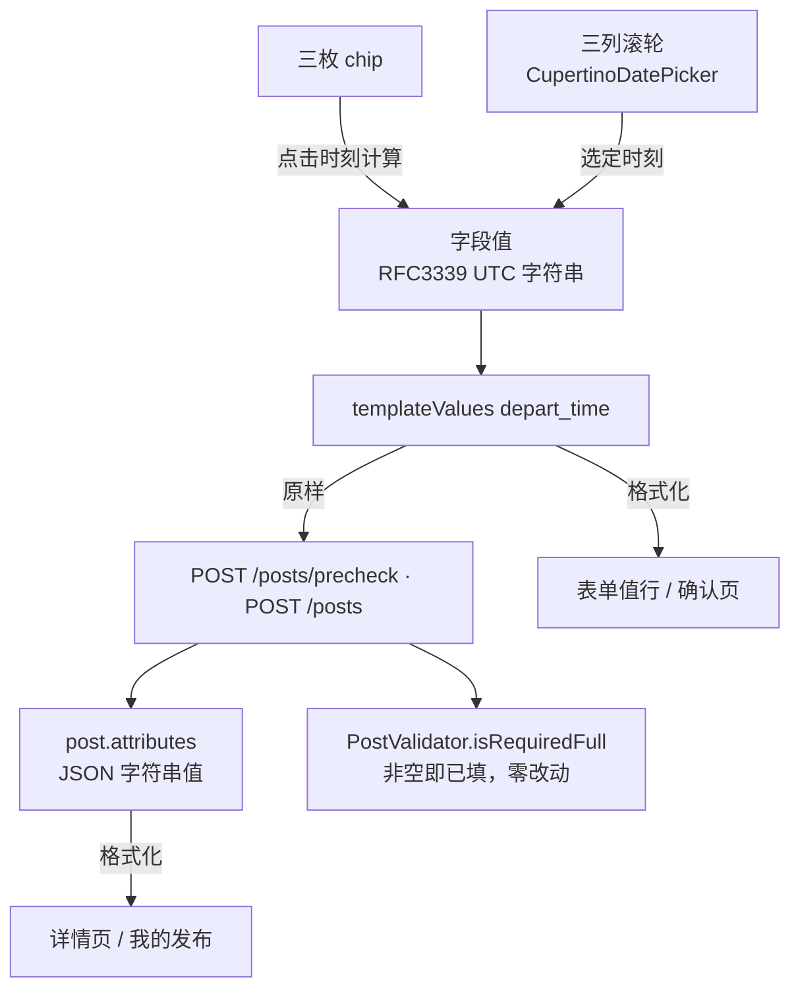
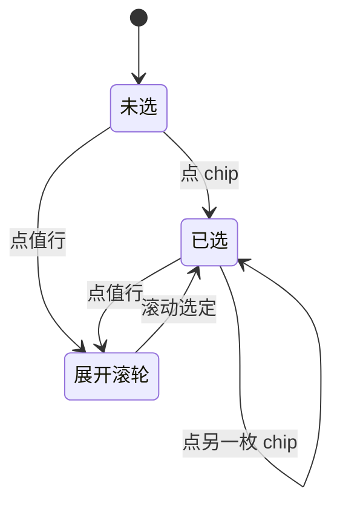

# 出发时间选择控件 - Plan

## Goal Capsule

**Objective.** 拼车发帖人选出发时间时，点一枚「明早 8:00」就完事，最多再滚两下滑轮——而不是对着「如：工作日 8:00」的文本框自己敲键盘。发出去的每条拼车帖，出发时间都是可比较、可排序的真实时刻。

**Means.** 拼车模板的 `depart_time` 从文本字段改为 `datetime` 类型：表单里渲染为一行值加三枚快捷 chip（现在出发 / 1 小时后 / 明早 8:00），点值行内联展开三列时间滚轮。上送统一 RFC3339 UTC 时刻串，落现有 `template_values` 字符串键，不动表结构。

**Product authority.** 本计划只覆盖发布页拼车分类的出发时间录入与该字段值在应用内各处的展示格式化。按时段匹配、时刻索引、周期性出行都不在本计划的活动范围内。

## Product Contract

### Summary

把发布页拼车模板里的「出发时间」从自由文本换成一个内联时间选择控件：三枚快捷 chip 覆盖最常见场景，点值行展开滚轮做精调。文本框时代的「工作日 8:00」「明早七点半」在库里互不相干；改造后每个值都是标准时刻，详情页与确认页统一格式化成「明天 08:00」这样的人话。

### Problem Frame

拼车模板里 `depart_time` 是文本字段，placeholder「如：工作日 8:00」教用户自己组织语言。写出来的值形态各异，既排不了序，也做不了「明早出发的车」这类筛选——二期想按出发时段匹配，库里是一堆自然语言。

发帖人侧的成本更直接：选一个确定时刻本来是一次点按的事，现在要唤起键盘、切数字、敲冒号。全仓没有任何时间/日期控件（构想文档 L169 证据），这是第一个，交互范式要一次立对。

### Key Decisions

1. **不预填默认时间。** 字段进页面时不带任何默认值，未选显示占位「选择出发时间」。`(session-settled: user-directed — 否决构想原文「默认下一整点」：预填算不算「用户已确认」会同时牵动必填判定与完整度口径，而默认值本身在设备时钟不准时错得悄无声息)` Governs R1, R6.

2. **本期不做「时间灵活」出口。** 出发时间必为一个确定时刻，不提供「时间灵活 / 面议」哨兵值或开关。`(session-settled: user-directed — 灵活出口的真价值要等需求侧能按时段筛选才成立，留到匹配二期)` Governs 范围边界。

3. **契约新增 `datetime` 类型，不复用 `date`。** `date` 是纯日期（被客户端降级文本），出发时间是「日期 + 时分」，语义不同各走各的。`(session-settled: user-directed — chosen over 复用 date 或塞进 text：枚举语义必须精确，否则服务端与其他分类复用时口径分叉)` Governs R5, R9.

4. **三枚 chip + 点值展开滚轮，控件内联不新开页面。** chip 覆盖「现在 / 1 小时后 / 明早 8:00」三个高频场景，滚轮处理其余一切。`(session-settled: user-approved — 构想原文保留部分)` Governs R1, R2, R3.

5. **值就是字符串，不升级结构化对象。** RFC3339 UTC 时刻串直接落 `template_values['depart_time']` 字符串键，草稿、编辑、重发链路零改动。`(session-settled: user-approved — chosen over route_pair 那样的对象：时刻是单值，没有结构)` Governs R5, R7.

### Requirements

**控件形态与交互**

R1. 拼车模板「出发时间」渲染为内联时间选择控件：一行值（未选显示占位「选择出发时间」），下方常显三枚 chip「现在出发 / 1 小时后 / 明早 8:00」。控件内联在表单里，不新开页面、不弹键盘。
R2. 点 chip 立即把对应时刻写入字段并展示：「现在出发」= 点击时刻；「1 小时后」= 点击时刻 +60 分钟；「明早 8:00」= 次日 08:00。chip 值精确到分钟，不受滚轮步长约束。
R3. 点值行内联展开/收起三列滚轮（日期 / 时 / 分），分钟步长 5 分钟；可选范围下限为当前时刻、上限为当前时刻起 7 天。展开时滚轮定位在当前已选值，未选时定位在当前时刻。
R4. 已选后值行显示本地化时刻：当天「今天 HH:mm」、次日「明天 HH:mm」、其余「M月d日 HH:mm」。chip 与滚轮都可覆盖重选；必填字段不提供清除入口。
R5. 字段上送为 RFC3339 UTC 时刻串（形如 `2026-10-30T10:30:00Z`），落 `template_values['depart_time']` 字符串键；设备时钟为采集源，以设备本地时区换算。

**校验与兼容**

R6. 必填判定维持「非空即已填」现状：datetime 不新增格式校验，历史文本值（如「工作日 8:00」）与 ISO 时刻串同样按已填放行；客户端 blocker、服务端 PostValidator、precheck 与完整度三档口径均零行为改动。
R7. 编辑 / 重发载入：值可解析为时刻则填进控件并格式化展示；不可解析的历史文本保留在 `templateValues` 原键、控件显示未选，用户未改动时原样上送。
R8. 一切把该字段值直出给用户的界面（详情页、AI 确认页、发布成功页、我的发布）对可解析时刻做 R4 同款本地化格式化；不可解析的历史文本原样展示。

**降级**

R9. 旧客户端收到 `datetime` 类型经 DTO 层未知值降级为文本框，手输文本可正常发布（服务端非空即放行）；新客户端遇到未迁移的服务端模板（`depart_time` 仍为 `text`）渲染文本框，行为与现状一致。

### Actors

- A1. 发帖人（车主或找车人）：单手操作，出发时间多为「现在」「一小时后」「明早上班」三类。
- A2. 看帖人：消费格式化后的出发时刻来判断顺不顺路、来不来得及。

### Key Flows

F1. **快捷出发**
   **Trigger:** 发帖人发布拼车帖，明早上班顺路带人。 **Covers R1, R2, R4, R5.**
   进入表单后点 chip「明早 8:00」→ 值行显示「明天 08:00」→ 提交，上送 ISO 时刻。全程 1 次点按，不弹键盘。

F2. **自定义时刻**
   **Trigger:** 后天下午两点半出发。 **Covers R3, R4.**
   点值行 → 滚轮展开定位当前时刻 → 日期滚到后天、时分滚到 14:30 → 值行显示「10月31日 14:30」。

F3. **旧帖重发**
   **Trigger:** 重发一条上一期的旧拼车帖，时间是「工作日 8:00」。 **Covers R6, R7.**
   载入后控件显示未选、原文保留在表单值里；必填不拦截，直接提交，载荷原样上送。

F4. **看帖核对**
   **Trigger:** 发帖后打开详情页核对。 **Covers R8.**
   出发时间一行显示「明天 08:00」，不是 ISO 串。

### Acceptance Examples

AE1. **chip 写入**
   **Covers R2, R4.**
   给定当前时刻 17:32，点「1 小时后」→ 值行显示「今天 18:32」，表单值为对应 UTC 时刻串。

AE2. **跨夜 chip**
   **Covers R2, R4.**
   给定当前时刻 23:10，点「1 小时后」→ 值行显示「明天 00:10」；点「明早 8:00」→ 无论当前是 07:00 还是 23:00，一律取次日 08:00。

AE3. **滚轮边界**
   **Covers R3.**
   展开滚轮 → 日期列最早为今天、最晚为今天 +7 天；时间列不可滚到早于当前时刻的值。

AE4. **历史文本放行**
   **Covers R6, R7.**
   给定旧帖 `depart_time = "工作日 8:00"`，重发 → 客户端 blocker 不报模板必填缺失，precheck 的 `required_full` 为 true，载荷原样为文本。

AE5. **展示格式化**
   **Covers R8.**
   详情页收到 `depart_time = "2026-10-31T00:00:00Z"` → 北京时间显示「10月31日 08:00」；收到 `"工作日 8:00"` → 原样显示。

AE6. **双向降级**
   **Covers R9.**
   模拟服务端下发 `type: "datetime"` 给不认识它的旧 DTO → 渲染文本框；模拟服务端仍下发 `type: "text"` → 渲染文本框，与新客户端互不阻塞。

### Success Criteria

- 快捷路径（任一枚 chip）选定出发时间 = 1 次点按、零键盘。
- 自定义路径从展开到选定 ≤ 3 次点按加滚动。
- 新发布拼车帖中 `depart_time` 为可解析时刻的比例可统计，作为二期按时段匹配的数据门槛。

### Scope Boundaries

**Deferred for later**

- 「时间灵活 / 面议」出口（待需求侧时段筛选有能力后再议）。
- 出发时段区间（「8:00–9:00 之间」）与周期性出发（「每周一三五」）。
- 按出发时刻建索引、按时段匹配推荐。
- 默认值预填（构想原方案，已被明确否决，不转入后续）。

**Outside this plan**

- 其他分类是否引入 datetime 字段；控件是否抽象为通用模板控件库。
- 服务端对时刻值做任何业务校验（如「不得早于发布时刻」）。

### Dependencies / Assumptions

- 依赖现有模板下发与本地降级链路（`publishTemplateProvider`），无新接口。
- 假设设备时钟基本可信：出发时间是用户声明的意图，天然是本地时刻语义，与契约全局纪律「帖子有效期倒计时允许本地时间」同一口径；时钟偏差由用户自担，不防呆。
- 唯一数据库改动是一条模板种子迁移（V27），不动表结构。

### Outstanding Questions

**Resolved in planning:** 默认值（→ Key Decision 1，否决）；灵活出口（→ Key Decision 2，本期不做）；契约路径（→ Key Decision 3，新增 datetime）。无遗留阻塞项。

**Deferred, non-blocking:** Q1. 「明早 8:00」的 08:00 是否应随用户历史发车时刻个性化——本期固定 08:00，待有使用数据再议。

### Sources / Research

- 上游构想：`docs/ideation/2026-10-30-publish-vehicle-form-ideation.html` 第 2 条（默认值与灵活出口两部分已被用户否决，其余保留）。
- 现状证据：`lib/domain/publish_template.dart`（`depart_time` 为 text，L229-236）；`lib/features/publish/publish_template_provider.dart`（DTO→本地枚举映射与 date 降级先例）；`lib/features/detail/post_detail_provider.dart`（attributes 直出渲染）；`src/main/resources/db/migration/V4__seed_template.sql`（种子现状）与 `V26__template_route_pair.sql`（改模板字段类型的迁移先例）。
- 口径来源：`docs/api/openapi.yaml` `TemplateField.type` 枚举与全局纪律第 5 条（时间统一 RFC3339 UTC）；`docs/PRD.md` :878（模板决定字段清单与默认值）、§9.8（完整度三档，本计划不触碰）。

<!-- ce-section: work-relationships -->
### How This Work Fits Together

本计划拥有的区域是**发布侧出发时间的时刻化采集与展示**；下面是当前的理解，不是已承诺的路线图。

- **enables** 二期「按出发时段匹配拼供需」——时刻值可比字符串可索引、可排序。
- **shares** 与「发布页其余字段改造」（人数、车型、车牌，构想 #3/#4/#5）共享同一处模板字段机制；本计划只动出发时间，其余各自独立成计划。
- **can proceed independently of** 「时间灵活」出口与默认值预填——两者均被否决或推迟，本计划的控件在它们缺席时完整成立。
- **still to decide** datetime 控件是否泛化到其他分类（如家政的上门服务时间），取决于那些分类是否提出时刻采集诉求。

---

## Planning Contract

**Product Contract preservation:** changed: 无新增需求；Key Decisions 1/2 是对构想原文的收紧而非扩张。Requirements 与构想保留部分（chip + 滚轮 + ISO 上送）一一对应。

### Key Technical Decisions

KTD1. `openapi.yaml` 的 `TemplateField.type` 枚举补 `datetime`（只加值、不改结构），与 route_pair 同先例并加日期注释。服务端 Java DTO 的 `type` 是自由字符串，无需改动；`date` 枚举保留，留作将来纯日期字段。 `(session-settled: user-directed)`

KTD2. 值形态为 RFC3339 UTC 时刻串落 `template_values['depart_time']` 字符串键，不做 route_pair 那样的结构化对象升级——时刻是单值，没有结构。`draft_store`、编辑、重发链路对字符串天然兼容，零改动；展示端（控件、详情、确认页）统一格式化为设备本地时区。 `(session-settled: user-approved)`

KTD3. datetime **不新增**服务端必填校验分支：值即字符串，现行「非空即已填」同时覆盖 ISO 时刻与历史文本，PostValidator 与 precheck 零行为改动。与 route_pair 的差异在于 datetime 不存在「半截对象」形态，无需按类型分流。历史文本按已填放行的兼容口径与 route_pair 一致。

KTD4. 三处同源修改：契约枚举（KTD1）、本地模板 `publish_template.dart`（`depart_time` 类型 text→datetime）、V27 种子迁移。`placeholder` 与 `memoryHint` 对 datetime 不再适用（占位文案由控件自带，记忆带入对时刻值无意义），从该字段两处移除。

KTD5. 控件形态 = 内联值行 + 三枚 chip + 内联展开的三列滚轮（包装 `CupertinoDatePicker`，`minuteInterval` 5 分钟、范围 [now, now+7天]、24 小时制），不新开页面。chip 值精确到分钟、绕过步长。步长、天数上限等阈值只引用 `NfrPublish` 常量。

KTD6. 无默认值预填、无灵活出口（Key Decision 1/2 的技术落地）：控件初始为空态，必填判定「非空即已填」因此不产生「预填算不算已确认」的争议，完整度三档口径（PRD §9.8）原样成立。 `(session-settled: user-directed)`

### High-Level Technical Design

值从控件一路走到落库，全程是字符串，中间不换模型；只有展示端做格式化。

控件自身三个状态，滚轮是值行的内联展开。

### Assumptions

- `CupertinoDatePicker` 的 `minimumDate`/`maximumDate`/`minuteInterval` 能满足滚轮边界与步长，无需自绘滚轮；样式与表单其余部分的融合（字号、配色）在 U4 内解决。
- 隐私政策无需变更：出发时间不离开本机与服务端，不涉及第三方外发。
- `post.attributes` 为 JSON 列，字符串值无需迁移历史数据——历史文本与新时刻串并存，读取端各自处理（KTD2/KTD3）。

### Implementation Constraints

- 滚轮步长、天数上限、chip 分钟偏移等阈值只引用 `NfrPublish` 常量，不写字面量。
- 不新增错误码；本功能无失败路径需要错误码（无外发请求）。
- 新增函数必须带函数级注释（功能、参数、返回值）。
- 不新增表结构与列；唯一数据库改动是 V27 模板种子迁移。
- 时刻解析失败一律返回 null（走「历史文本」分支），不抛异常、不占解析点数门禁基线。
- 新增 Dart 文件会推高 `test/gates/anti_redundancy_gate_test.dart` 的文件数基线，提交时同步更新基线并写明原因。
- 格式化（「今天/明天/M月d日 HH:mm」）与解析、chip 值计算必须是同一份纯函数实现，控件与详情端共同引用，不各写一份。

---

## Implementation Units

### U1. 时刻工具与阈值常量

**Goal:** 提供一份可解析、可格式化、能算出三枚 chip 值的纯函数工具，控件与所有展示端共用。

**Requirements:** R2, R4, R5, R8

**Dependencies:** 无

**Files:**
- `lib/domain/departure_time.dart`（新建）
- `lib/nfr_constants.dart`
- `test/departure_time_test.dart`（新建）

**Approach:**
- `tryParseDepartTime(String?) → DateTime?`：只认可解析的 RFC3339/ISO-8601 时刻串，其余（null、空串、历史文本）返回 null，不抛异常。
- `departTimeToWire(DateTime) → String`：转 UTC RFC3339（秒精度，形如 `2026-10-30T10:30:00Z`）。
- `formatDepartTime(DateTime, {required DateTime now}) → String`：与 `now` 同日「今天 HH:mm」、次日「明天 HH:mm」、其余「M月d日 HH:mm」；24 小时制、分钟两位补零。注入 `now` 参数保证纯函数可测。
- `departTimeQuickChips(DateTime now) → List<({String label, DateTime value})>`：三枚 chip 的文案与值——「现在出发」= now；「1 小时后」= now + 60 分钟；「明早 8:00」= 次日 08:00。
- `NfrPublish` 增补：滚轮可选天数上限（7 天）、滚轮分钟步长（5）、chip 小时偏移（1）。取值注明口径注释。

**Patterns to follow:** `lib/nfr_constants.dart` 的分组与注释习惯；`lib/domain/route_pair.dart` 的「解析失败返回 null 不抛错」风格。

**Test scenarios:**
- RFC3339 UTC 串解析成功；「工作日 8:00」、空串、null → null
- `departTimeToWire` 输出 UTC 秒精度串，与解析往返一致
- 同一天 → 「今天 18:32」；次日 → 「明天 08:00」；跨月 → 「11月2日 08:00」
- 23:10 取「1 小时后」→ 次日 00:10；07:00 与 23:00 取「明早 8:00」均为次日 08:00
- 分钟单位补零（08:05 不显示 08:5）

**Verification:** 单测通过；`flutter analyze` 无新增告警。

### U2. 契约枚举与种子迁移

**Goal:** 契约与已部署环境认识 `datetime`，与新客户端本地模板同源。

**Requirements:** R5, R9

**Dependencies:** 无

**Files:**
- `docs/api/openapi.yaml`
- `src/main/resources/db/migration/V27__template_depart_time.sql`（新建）

**Approach:**
- `openapi.yaml` 的 `TemplateField.type` 枚举补 `datetime`（只加值），附 2026-10-30 新增注释与「值为 RFC3339 UTC 时刻串」描述；`date` 注释补一句「纯日期，不含时分」，两者语义划清。
- V27 只更新 `template` 表 `leaf_category_id = 301` 的 `fields` JSON：`depart_time` 的 `type` 由 `text` 改为 `datetime`，删除该字段的 `placeholder`，其余字段逐字保留；`template_version` 加一。注释写明与客户端本地模板同一份口径。

**Patterns to follow:** `V26__template_route_pair.sql` 的迁移写法与注释；`V4__seed_template.sql` 的字段 JSON 结构。

**Test expectation:** none — 契约描述与种子数据迁移，不含行为分支；由 U3、U4 的测试与模板加载链路覆盖。

**Verification:** 迁移在空库与既有库上都能应用；`GET /templates/30101` 返回 `depart_time` 为 `datetime`；`flutter test test/gates` 的契约门禁通过。

### U3. 客户端枚举映射与本地模板

**Goal:** 客户端认识 `datetime`，本地拼车模板与服务端口径一致。

**Requirements:** R5, R9

**Dependencies:** U2（契约口径）

**Files:**
- `lib/domain/publish_template.dart`
- `lib/features/category/category_dto.dart`
- `lib/features/publish/publish_template_provider.dart`
- `test/publish_template_test.dart`
- `test/features/publish/publish_template_provider_test.dart`

**Approach:**
1. `TemplateFieldTypeDto` 与本地 `TemplateFieldType` 各加 `datetime`（API 值 `datetime`）；`templateFieldSpecFromDto` 补映射分支。DTO 层未知值仍降级 `text`（R9 的旧客户端降级链不变）。
2. 本地 301 模板 `depart_time` 类型改 `datetime`，label 与必填不变，移除 `placeholder` 与 `memoryHint`（KTD4）。

**Patterns to follow:** `publish_template_provider.dart` 现有 switch 映射写法（routePair 分支即先例）。

**Test scenarios:**
- DTO `type: "datetime"` → 本地 `datetime`；未知字符串 → `text`（既有行为不回归）
- 本地 301 模板 `depart_time` 为 `datetime`、必填、无 placeholder
- 服务端下发 datetime 模板 → 合成模板字段类型为 datetime；服务端拉取失败 → 本地降级模板同为 datetime（两端口径一致）

**Verification:** 单测通过；`flutter analyze` 无新增告警。

### U4. 时间选择控件与表单接线

**Goal:** 拼车表单里的「出发时间」从文本框换成「值行 + chip + 内联滚轮」，值进出都是字符串。

**Requirements:** R1, R2, R3, R4, R5, R6, R7

**Dependencies:** U1, U3

**Files:**
- `lib/features/publish/depart_time_field.dart`（新建）
- `lib/features/publish/publish_screen.dart`
- `test/features/publish/depart_time_field_test.dart`（新建）
- `test/features/publish/publish_screen_test.dart`

**Approach:**
- 控件拆成无状态展示与状态回调：输入为当前字符串值（可 null/历史文本）与 `required`，输出 `onChanged(String?)` 写回 `templateValues`。内部用 U1 的 `tryParseDepartTime` 决定控件显示「已选时刻」还是「未选」（KTD2/R7）。
- 值行：未选显示「选择出发时间」占位，已选显示 `formatDepartTime`；右侧指示可展开。点击切换滚轮展开态。
- chip 行常显三枚（U1 `departTimeQuickChips`），点按即 `onChanged(departTimeToWire(chip.value))` 并收起滚轮（若展开）。
- 滚轮包装 `CupertinoDatePicker`（`mode: dateAndTime`、24 小时制、`minuteInterval` 与天数上限引 `NfrPublish` 常量、`minimumDate` 当前时刻、`maximumDate` 当前时刻 + 天数上限），滚动停定即写回（不另设确认按钮，减少一次点按）；展开时初始值为已选值，未选时为当前时刻。
- `_TemplateField` 增加 `datetime` 分支渲染本控件；`blocker` 沿用「非空即已填」零改动（KTD3）。
- 语义与可达性：值行读作「出发时间」，三枚 chip 带可读标签，热区不小于 44×44。

**Patterns to follow:** `_TemplateField` 现有 select/routePair 分支的「按类型分流」写法；`_LocationRow` 的摘要行样式。

**Test scenarios:**
- Covers AE1. 注入固定当前时刻 17:32，点「1 小时后」→ 回调值为 18:32 对应 UTC 串，值行「今天 18:32」
- Covers AE2. 23:10 点「1 小时后」→ 「明天 00:10」；「明早 8:00」恒为次日 08:00
- Covers AE3. 展开滚轮 → 日期范围 [今天, 今天+7天]，不可选早于当前时刻
- 点值行展开、再点收起；点 chip 后滚轮若展开则收起
- 滚轮初始定位：已选值 / 未选时的当前时刻
- Covers R7. 传入历史文本「工作日 8:00」→ 控件显示未选，值不被清掉（不触发 onChanged）
- Covers AE6 前半. 模板下发未知类型降级 text 时表单渲染文本框（U3 链路）
- 值行与 chip 有可读标签、热区不小于 44×44

**Verification:** widget 测试覆盖上述场景；真机上快捷路径 1 次点按完成选定。

### U5. 展示格式化与编辑重发兼容

**Goal:** ISO 时刻串不在任何用户可见界面裸奔；旧帖编辑重发不丢值、不被拦。

**Requirements:** R7, R8

**Dependencies:** U1, U4

**Files:**
- `lib/features/detail/post_detail_provider.dart`
- `lib/features/publish/publish_form_state.dart`（编辑/重发载入路径）
- `lib/features/publish/ai_confirm_screen.dart`
- `lib/features/publish/publish_success_screen.dart`
- `lib/features/post/my_publish_screen.dart`
- `test/features/detail/post_detail_provider_test.dart`
- `test/publish_form_state_test.dart`

**Approach:**
- 详情与列表：渲染 `depart_time` 键时先过 `tryParseDepartTime`，可解析则 `formatDepartTime` 格式化，不可解析原样直出。格式化以设备当前时刻为 `now`。
- AI 确认页与发布成功页：同一份处理，先 grep 复核两处是否直出 `templateValues`，直出则接入同一工具函数。
- 编辑/重发载入：`templateValues['depart_time']` 原样保留（字符串键不动），控件侧按 U4 的 R7 逻辑自行决定显示已选或未选——载入逻辑零改动，兼容性由控件与判定两处兜住。
- 全部展示端只引用 U1 工具，不各写格式化（Implementation Constraints 末条）。

**Patterns to follow:** `post_detail_provider.dart` 的 `_templateFieldsFromAttributes` key→label 映射与单值处理函数；route_pair 详情分支的对象/字符串双形态处理位置。

**Test scenarios:**
- Covers AE5. 详情收到 ISO 串 → 显示「明天 08:00」样式；收到「工作日 8:00」→ 原样
- Covers AE4. 编辑态载入历史文本 → `templateValues` 原键原文保留，`blocker` 不报缺失，可直接提交
- 编辑态载入 ISO 值 → 控件显示已选时刻，可再改
- 重发链路保存再读取（草稿）→ 值逐字还原

**Verification:** 单测与 widget 测试通过；真机编辑一条新帖不丢出发时间。

### U6. PRD 描述修订

**Goal:** 文档口径与实现一致。

**Requirements:** R1, R5

**Dependencies:** U4

**Files:**
- `docs/PRD.md`

**Approach:**
- §5.4.3 拼车附加字段的「出发时间」注明为时间选择控件（chip + 滚轮），不再是自由文本；值为标准时刻。
- §5.7 模板字段说明如需列出类型清单，补 `datetime` 一行。
- §9.8 完整度口径本计划不触碰（KTD6：必填判定未变）；隐私政策不涉及（无外发数据）。

**Test expectation:** none — 文档修订，无行为分支。

**Verification:** PRD 描述与实现一致；`flutter test test/gates` 通过。

---

## Verification Contract

| 范围 | 命令 | 说明 |
| --- | --- | --- |
| 前端静态检查 | `flutter analyze` | 零新增告警 |
| 前端单测与 widget 测试 | `flutter test` | 含 U1/U3/U4/U5 新增用例 |
| 契约与质量门禁 | `flutter test test/gates test/architecture` | `openapi_contract_gate_test`、`quality_gate_test`、`anti_redundancy_gate_test`（文件数基线随新增文件更新）、`single_source_test` 必须全绿 |
| 后端测试 | `mvn -q test` | 本期无 Java 行为改动，回归确认 |
| 真机冒烟 | `flutter run --dart-define=AMAP_WEBSERVICE_KEY=<key>` | 走 chip 选定、滚轮自定义、旧帖重发、详情核对四种情形 |

真机冒烟的判定口径：点一枚 chip 后值行立即显示格式化时刻；滚轮选不到过去时刻；旧帖（文本时间）重发不被必填拦截；详情页不显示 ISO 串。

---

## Definition of Done

- U1-U6 全部落地，没有遗留的半截字段或临时调试代码。
- `flutter analyze`、`flutter test`、`flutter test test/gates test/architecture`、`mvn -q test` 全部通过。
- `POST /posts` 落库的新拼车帖，`attributes.depart_time` 为 RFC3339 UTC 时刻串；旧帖（文本时间）重发不被客户端必填拦住、precheck 不判缺失。
- 表单值行、AI 确认页、发布成功页、详情页、我的发布对该字段值统一本地格式化，任何界面不裸出 ISO 串；历史文本原样展示。
- 控件无默认值预填、无「时间灵活」出口；chip 与滚轮有可读标签、热区不小于 44×44。
- 阈值全部引用 `NfrPublish` 常量；没有新增错误码；新增函数都有函数级注释。
- `openapi.yaml` 枚举、本地模板、V27 种子三处口径一致；PRD §5.4.3 与实现一致。
- 试错途中被放弃的代码路径已删除，不在 diff 里留残骸。
