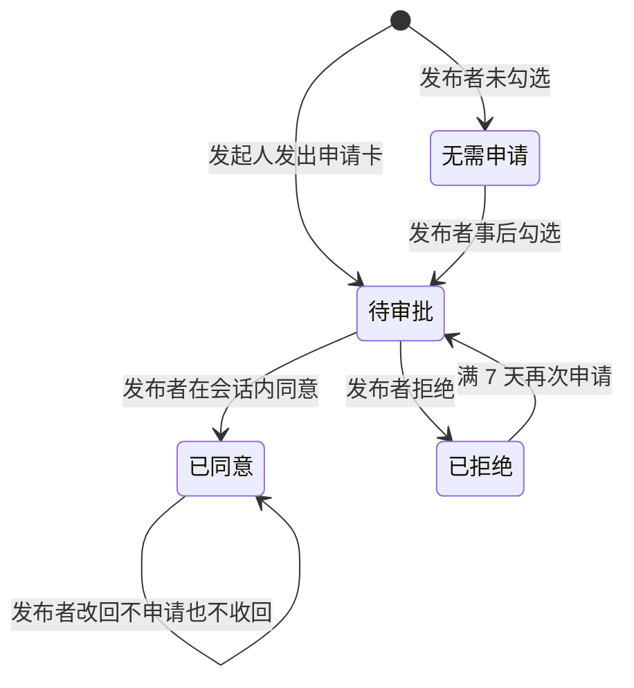
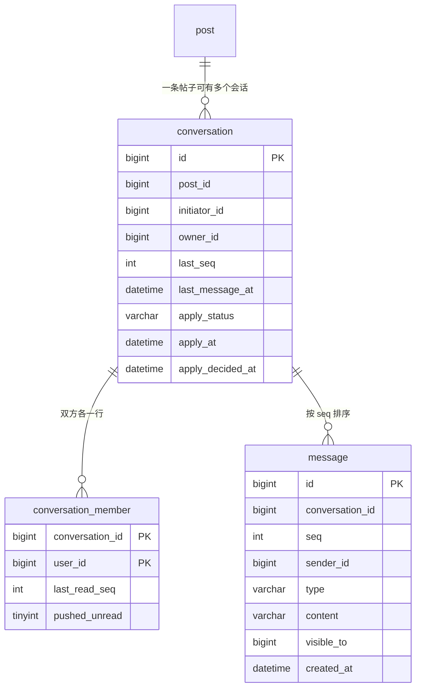
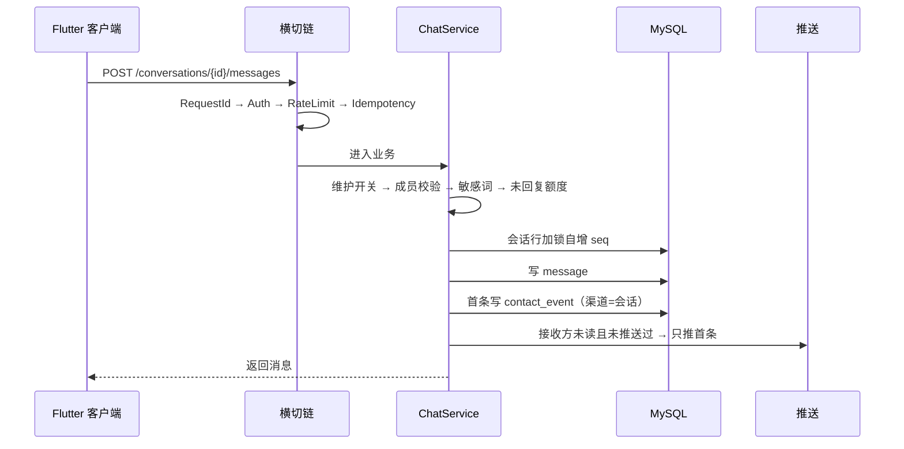
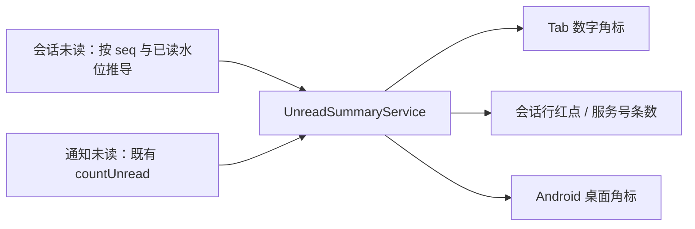
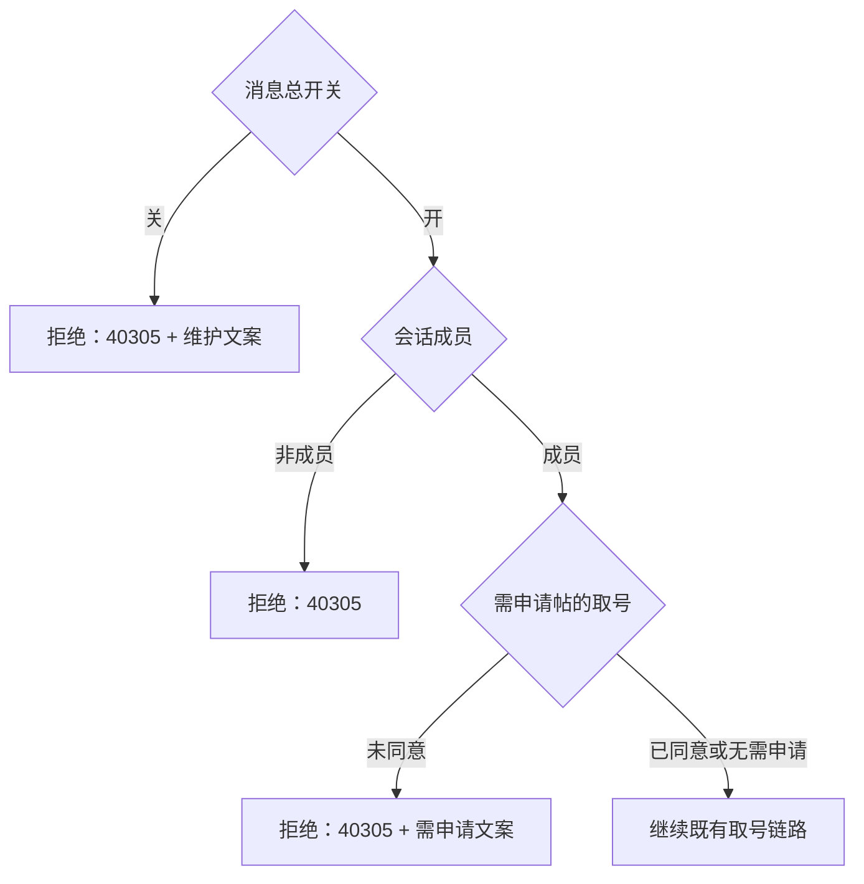

# 详情页会话与消息中心 - Plan

## Goal Capsule

- **Objective:** 用户看完一条资源/需求，能在站内把话说完并等到回应 —— 发起会话、收到提醒、知道对方读没读，不必先拿到手机号才能开始沟通。
- **Means:** 新增会话 / 会话成员 / 消息三张表与第 4 个底部 Tab「消息」，系统通知收成置顶「服务号」；未读以已读水位为唯一口径，在会话行、Tab、安卓桌面图标三处同源（KTD1、KTD9、KTD14）。
- **Product authority:** 产品负责人（刘杰）；PRD / BRD 中禁止站内 IM 的条款随本方案改写。
- **Open blockers:** 无。
- **Stop conditions:** 出现需要新增错误码、需要改动已应用的 Flyway 迁移、或与 Product Contract 的 R/K 冲突的实现选择时停止并回报，不在代码里自创口径。
- **Execution profile:** 后端先行（数据与主链），前端按已发布契约并行；端到端验收在两端合流后一次性完成。
- **Product Contract preservation:** 未改动 —— R1–R36、K1–K10、A1–A4、F1–F4 原样保留。

## Product Contract

### Summary

详情页增加站内 1:1 会话入口，会话集中到新的「消息」Tab，与系统通知合成一个未读口径。发布者可选择让联系方式先申请后可见，消息支持通知栏推送、可按维关闭，并显示已读 / 未读。

### Problem Frame

今天的联系是一条单向短路：详情页 → 中转页 → 拿到完整号码 → 沟通转到微信或电话。落库的只有「联系动作发生过」这一件事，之后谁回了、谈没谈成、有没有人一直在骚扰，平台都看不到。发布者能做的切换只有「填电话还是填微信」，没有「先别给号、先聊聊看」这一档。

这条短路还在另一头有代价：号码一旦给出就无法收回，发布者对陌生人的唯一屏障是脱敏展示那一层薄壳。想要更谨慎的人，只能用不发布来表达。

### Requirements

**会话与消息**

- R1. 登录用户可从资源/需求详情页发起与发布者的 1:1 会话；一个会话固定对应「一条帖子 + 一个发起人」。
- R2. 会话入口不替代详情页既有的「联系 TA / 响应需求」；需申请查看联系方式的帖子，中转页不再发号，改为发起或复用会话并发出申请卡（见 R20、R25）。
- R3. 会话列表按最后一条消息时间倒序；每行显示对方头像与昵称、最后一条消息摘要、时间、未读红点、帖子缩略图。
- R4. 帖子下架不影响会话可用；列表内该行缩略图置灰并标注「已下架」。
- R5. 双方连续 90 天无往来时，会话从列表隐藏，数据保留用于举报取证；再次从详情页发起或产生新往来时复用原会话并恢复可见，同一帖子与同一发起人永不出现第二条会话。
- R6. 会话详情按时间正序展示消息，跨日时按「今天 / 昨天 / 更早」分组。
- R7. 发送失败或离线时保留草稿；重发沿用同一幂等键，重复提交不产生重复消息。

**未读与角标**

- R8. 未读只有一个计算口径：我未读的消息数 + 我未读的通知数。
- R9. 普通会话行显示红点不显示条数；「服务号」行显示未读通知条数并沿用 99+ 规则；Tab 显示未读总数角标，超过 99 显示「99+」。
- R10. 打开会话即把该会话的全部消息标记为已读，不限于已滚动到的部分。
- R11. Android 桌面图标显示同一未读总数角标，上限同样为「99+」；iOS 本期不做。

**通知与推送**

- R12. 消息与既有三类通知统一进入「消息」Tab；「服务号」在列表永久置顶且不可删除、不可清空。
- R13. 点「服务号」进入现有通知中心页，三类分类与「全部已读」保持不变。
- R14. 新消息在接收方不处于该会话时触发推送，同一会话在未读期间只推首条；推送载荷只含会话标识与固定提示文案，不含消息正文、联系方式和对方以外的人名。
- R14a. 本期推送只在已接入通道的设备上生效（Android 侧依赖厂商通道与已配置凭据）；iOS 待 APNs 接入后启用，期间 iOS 用户以进入前台拉取兜底。
- R15. 设置页提供独立的「消息通知」开关；关闭后不推送但消息照常落库。原「消息通知」行改名为「接收通知」，仍是总开关。
- R16. 首次进入「消息」Tab 时申请 Android 通知权限；被拒后在列表顶部常驻一条可关闭的提示并给出跳转设置的入口，不重复拉起系统弹窗。
- R16a. 点击消息推送直接打开对应会话详情；会话已被隐藏时落到消息列表并提示。

**已读回执**

- R17. 我发出的最后一条消息下方显示「已读 / 未读」，判定依据是对方的已读水位是否覆盖该条消息；最后一条仍在本地时依次显示「发送中 / 发送失败（点击重发）」，不参与已读判定。
- R18. 已读回执不可关闭。

**联系方式申请**

- R19. 发布者在发布或编辑帖子时可勾选「查看联系方式需申请」，默认不勾选。
- R20. 需申请的帖子，详情页显示「申请查看联系方式」；点击后开启（或复用）会话并发出申请卡。
- R21. 同一会话始终只有一张申请卡；被拒后满 7 天可对同一张卡再次提交，卡状态回到待审批，不新增卡片；发出后 72 小时仍未被处理时同样允许再提交一次。
- R21a. 已拒绝的卡片显示「未同意 · 剩余 N 天可再次申请」，倒计时内入口置灰，期间会话内普通消息不受限制；倒计时结束恢复为可再次申请。
- R22. 发布者在会话内同意后，该会话出现联系方式卡，仅申请人可见；帖子后续下架不影响已给出的可见性。完整号码仍只由既有唯一联系方式出口返回，并继续受三维限频、帖子可见性与同事务审计约束，联系方式卡不自行落完整号码。
- R23. 发布者把勾选改回「不需要申请」时不收回已同意的人。
- R24. 已同意后，该申请人在中转页点「查看完整号码」直接出号，无需再次审批。
- R25. 未勾选的帖子维持现状：中转页一键取号，不计入会话额度。

**治理与额度**

- R26. 同一会话中，以对方最后一条文本消息为界，其后我方连续未获回复的文本消息累计达 3 条即拒发；对方每回复一次重新计数。申请卡与联系方式卡不计入该额度，达上限时输入区禁用并提示「等待对方回复后可继续发送」。
- R27. 每个用户每日最多主动发起 30 个新会话（含申请），超限复用既有 42902；该接口返回专用文案「今日发起会话数已达上限」，客户端只在联系方式接口收到 42902 时才清零看号剩余次数。
- R28. 消息正文命中敏感词即拒发（复用既有 40901），正文原样保留在输入框并以行内提示告知，提示语不暴露命中词；词表不包含手机号与微信号识别；提供「误拦反馈」入口，复用举报工单并以「误拦」原因标签区分处置。
- R29. 本期只支持举报对方用户，并关联到双方共同的那条帖子；不新增会话与单条消息两类举报对象，复用现有以帖子为锚的举报链路与后台处置，帖子已下架时仍可举报。
- R30. 全局「消息」开关关闭时，存量会话转为只读，顶部显示横幅，不做静默下线；同时拒绝新会话创建与申请卡发放，详情页申请入口置灰并复用同一横幅文案。发送拒绝复用既有 40305，接口返回专用文案「消息功能维护中，请稍后再试」。

**指标与口径**

- R31. 一个会话只写一条联系事件：首条消息写入，渠道为「会话」；申请被同意时把同一条事件的渠道升级为「申请」，不新增事件。「你的发布被联系了 × 次」沿用现有聚合口径，不额外多发通知。

**访问控制与基础态**

- R32. 会话、消息、未读与已读水位的任何读写，都由服务端按会话成员校验；非成员一律按不存在处理。
- R33. 消息 Tab 需覆盖空态（无任何会话）、首屏加载骨架与拉取失败重试三种基础态。
- R34. 详情页会话入口有三态：未登录点击拉起登录并回跳原详情页；已有会话时文案为「进入会话」并带未读点；无会话时为「发消息」。

**存量口径改写**

- R35. PRD / BRD 中禁止站内 IM 的条款按本方案改写；新增「底部 Tab 数字角标」「桌面图标角标」两条口径。
- R36. 通知中心入口扩为两处 ——「我的 › 通知中心」与「消息 Tab 的服务号」，两者指向同一页面。

### Actors

- A1. 浏览者 / 发起人：从详情页发起会话、发消息、发起联系方式申请。
- A2. 发布者 / 资源方：接收会话与申请，决定是否同意给出联系方式。
- A3. 运营：处置举报、维护敏感词库、操作全局消息开关。
- A4. 系统：写未读、下发推送、刷新桌面角标。

### Key Flows

- F1. 从详情页聊起来
  - **Trigger:** A1 在详情页点会话入口。
  - **Actors:** A1, A2, A4
  - **Steps:** 校验登录与额度 → 无会话则创建、有则复用 → 进入会话详情 → A1 发出首条消息 → 落库并写未读与联系事件 → 通知 A2（会话内不推、不在会话内则推送一次）。
  - **Outcome:** 会话出现在双方列表，A2 的未读三处同时 +1。
  - **Covers:** R1, R7, R14, R31

- F2. 申请查看联系方式
  - **Trigger:** A1 在「需申请」的帖子详情页点「申请查看联系方式」。
  - **Actors:** A1, A2
  - **Steps:** 开启或复用会话 → 发出申请卡（同会话始终一张）→ A2 在会话内同意或拒绝 → 同意则插入联系方式卡并升级联系事件渠道 → A1 在中转页直接出号。
  - **Outcome:** 只有 A1 看到号码；其他访客仍需各自申请。
  - **Covers:** R19–R24, R31

- F3. 未读与角标的同步
  - **Trigger:** App 回到前台、收到推送、或打开/关闭会话。
  - **Actors:** A1, A2, A4
  - **Steps:** 拉取增量消息与未读总数 → 更新会话行红点、Tab 数字、桌面角标 → 打开会话后按水位清掉该会话未读。
  - **Outcome:** 三处数字在同一时刻指向同一个值。
  - **Covers:** R8–R11, R17

- F4. 消息功能关闭后的只读态
  - **Trigger:** 运营关闭全局「消息」开关。
  - **Actors:** A3, A1, A2
  - **Steps:** 新发送一律拒绝 → 存量会话可读、可滚动、不可发 → 页面顶部展示横幅说明。
  - **Outcome:** 历史记录不丢失，无静默失败。
  - **Covers:** R30

### Key Decisions

- K1. **一次建齐会话、会话成员、消息三类实体，不先做临时结构。** 已读水位与消息序号要同时成立，拆开做会先垫一层假的已读逻辑再推倒。（session-settled: user-directed — chosen over 先做两表后补水位: 已读回执是本次必需项，不能后补）
- K2. **不做长连接，用推送唤醒 + 增量拉取。** 现状无任何长连接基建，且消息不是秒级强需求。（session-settled: user-directed — chosen over WebSocket/SSE: 为一档非实时聊天引入常驻连接不划算）
- K3. **额度分账：对方未回复前 3 条，每日主动发起 30 个新会话。** 前者防单点骚扰，后者只作脚本兜底、不应被正常人感知。（session-settled: user-directed — chosen over 不设上限或收紧到 10/日: 30 与既有看号额度同量级，收更紧会把用户推回看号）
- K4. **会话独立于帖子寿命，双方 90 天无往来才隐藏。** 帖子 7 天有效、14 天自动下架，聊到一半被掐断属于事故。（session-settled: user-directed — chosen over 随帖失效: 约看房、谈价格本来就跨得过 14 天）
- K5. **已读回执不可关闭。** 只有覆盖面足够才有意义，可关会退化成社交失礼。（session-settled: user-directed — chosen over WhatsApp 式互惠可关: 互惠会让「未读」同时表示没看和关了回执）
- K6. **通知并入消息 Tab，服务号置顶。** 未读必须同源。（session-settled: user-directed — chosen over 双栏或独立入口: 两个未读池会让用户不知道自己漏了什么）
- K7. **默认仍一键取号，勾选「需申请」才加审批。** 不拿全站联系效率换统一保护。（session-settled: user-directed — chosen over 全站默认需申请: 会让每一次联系都变成两步）
- K8. **申请走会话里的申请卡，不建独立申请单。** 拒绝也需要一个能接话的地方。（session-settled: user-directed — chosen over 独立申请单: 会多出第二个未读池）
- K9. **桌面角标只做 Android。** iOS 未接 APNs，双端都做等于先建推送基建。（session-settled: user-directed — chosen over 双端同做: 无推送通道时角标会长期停在旧值）
- K10. **会话正文不拦手机号与微信号。** 中转页本就给完整号码，拦号自相矛盾。（session-settled: user-directed — chosen over 闲鱼式硬拦: 要硬拦就得同时改掉中转页给号的口径）

### Scope Boundaries

**Deferred for later**

- iOS 桌面角标与 APNs 接入。
- 服务端下发、可运营配置的开场模板卡（本期只在输入框预填一句可编辑文案）。
- 消息全文搜索、附件 / 图片 / 语音消息。
- 输入中状态、在线状态、群聊。
- 独立的申请单页面。

**Outside this product's identity**

- 第三方 IM SDK。
- 交易订单、担保支付、成交后评价 —— 本产品的沟通仍然只服务于信息撮合。

### Dependencies / Assumptions

- 敏感词库由运营提供，本期以手工整理的初版词表起步；选词与更新节奏不影响发送链路的实现。
- 桌面角标只在 App 前台刷新未读时更新；App 未运行且没有推送到达时允许与实际未读不一致。
- 未实名用户同样可以发起会话（与看号额度不按实名分层的既有口径一致）。
- 消息正文不做定时物理删除，只做列表隐藏，以满足举报取证的保留要求；但须登记保留策略键与执行者，并在账号注销时对正文做删除或匿名化。
- 推送只在已接入通道并已配置凭据的设备上生效（现状仅小米有原生接收器）；其余 Android 机型与 iOS 以进入前台拉取兜底，本期不承诺送达率。
- Android 桌面角标依赖具体启动器支持，需从零接入厂商角标能力；不支持数字的启动器降级为小红点，功能不因此判定为失败。
- 后台处置举报时查看会话与消息正文须限定角色并逐次留痕，参照既有「查看用户脱敏信息」的审计口径。

### Success Criteria

- 前台刷新完成或推送到达后，会话行红点、Tab 数字、桌面角标指向同一个未读数；App 未运行且无推送到达时允许偏差。
- 从详情页到发出第一条消息不超过两次点击。
- 已读状态单向推进：同一会话不出现「已读」之后退回「未读」。
- 全局开关关闭后不产生任何新消息写入与推送，且不出现静默失败。
- 举报与误拦反馈都能落到同一处置队列，而不是只留一条日志。
- 站内联系事件占全部联系事件的比例可被观测，且能按渠道拆开。
- 「需要申请」的发布者占新增发布的比例可被观测，用于判断审批链路是否值得长期维护。
- 会话发起后 24 小时内发出过消息的会话占比可被观测。

### Outstanding Questions

**Resolve Before Planning**

- 无。

**Deferred to Planning**

- 敏感词初版词表的具体来源与更新责任人。
- 推送文案模板与「服务号」的展示摘要规则。
- 时间分组的具体边界与跨时区处理。
- 桌面角标在不支持数字角标的启动器上的降级判定方式。

---

## Planning Contract

### Key Technical Decisions

- KTD1. **三实体 + 水位式未读。** 只建 `conversation`、`conversation_member`、`message` 三张表；`conversation_member.last_read_seq` 是已读的唯一真源，未读由「消息 seq > 水位」推导，不存计数器。落地 K1。
- KTD2. **申请卡状态挂在会话行，卡片本身是消息行。** 一个会话只有一张申请卡，状态与时间记在 `conversation` 上；会话内以 `message.type=apply` 呈现。落地 K8。
- KTD3. **会话内 seq 单调递增，兼作增量游标与已读水位。** 发送时对会话行加锁自增 `last_seq`，消息写入该值；增量拉取用 `after_seq`，置已读写 `last_read_seq`。避免「按时间戳翻页」在并发下重复或漏条。
- KTD4. **接口专用文案走统一的文案覆盖口。** 在 `BizException` 增加可选的文案覆盖参数，`GlobalExceptionHandler` 改取异常自身文案；仅三处使用：会话日额度（42902）、维护只读（40305）、需申请帖的取号闸门（40305）。错误码数量、码值、HTTP 状态与 Retry-After 机制不变。（session-settled: user-directed — chosen over 保持全局文案: 三处提示与场景不匹配）
- KTD5. **40305 适用范围扩到 App 端两处。** 现规范写「40305 后台 RBAC 专用、App 端不返回」，本次改为「后台 RBAC 专用 + 消息维护只读与申请闸门」，同步修订规范正文与契约中 Forbidden 的描述文本；契约门禁要求该描述仍含「40305」与「后台」，措辞修订时保留这两个词。（session-settled: user-directed — chosen over 另选错误码: 错误码总数固定，禁新增占号）
- KTD6. **消息只推不入通知表。** 新增一条只推送、不写 `notification` 的路径，服务号继续只承载 system / interaction / cert 三类。否则同一条消息会同时进入会话未读与通知未读，与 R8 的口径冲突。（session-settled: user-directed — chosen over 同时写通知行: 未读会重复计同一条）
- KTD7. **未读期间只推首条，靠成员行的已推送标记。** 接收方 `pushed_unread` 为真时不再推送，读会话时复位；不用 Redis TTL，避免重启或过期后重复推送。
- KTD8. **90 天隐藏是查询条件，不是定时任务。** 列表与详情用 `last_message_at` 的下界过滤；新的往来写入后自然重新可见，无需状态翻转或补数据。落地 K4、R5。
- KTD9. **未读总数唯一出口。** `UnreadSummaryService` 把「会话未读」与「通知未读」相加，只此一处产出总数；Tab 角标、列表、桌面角标都消费同一接口，不做客户端二次汇总。
- KTD10. **举报复用既有工单表，新增「误拦」原因值。** 会话内举报以「会话所在帖子 + 对方用户」写入既有举报表，不走帖子可见性前置校验，因此下架帖仍可举报；误拦反馈用新增原因值区分，后台可按原因筛选。（session-settled: user-directed — chosen over 复用「其他」原因: 后台无法按原因筛选，处置只能人工翻查）
- KTD11. **联系事件一条会话一行。** 首条消息写 `contact_event`（渠道为「会话」）；申请被同意时更新同一条为「申请」，不插入第二条。渠道枚举需扩两个值，写入点仍只在 contact 域的既有聚合口径内。
- KTD12. **阈值全部落常量。** 未回复上限 3、每日新会话 30、隐藏窗口 90 天、申请冷却 7 天、重申窗口 72 小时、正文长度上限、分页上限：后端进 `ChatLimits` 与既有 `RateLimitThresholds`，前端进 `NfrChat`；业务代码只引常量名。
- KTD13. **安卓桌面角标原生自研。** 平台通道调用厂商角标 API，不新增三方插件；厂商接口失败或启动器不支持数字时降级为红点（值 1），并在返回结果里标注降级原因。（session-settled: user-directed — chosen over 引第三方插件: 降级行为受插件能力限制且依赖维护状态）
- KTD14. **前端未读唯一 Provider。** 一个未读汇总 Provider 供 Tab、会话行、服务号行与桌面角标桥接共用；各页面不自算，也不各自轮询。落地 R8 / R9 / R11。

### High-Level Technical Design

数据模型与本次涉及的既有表扩展：

发送一条消息的时序（横切链顺序不变，限流先于幂等）：

未读的唯一去向：

全局开关与申请闸门的判定顺序（先开关、再权限、后业务额度）：

### Assumptions

- 敏感词初版词表由运营手工整理，接入既有敏感词抽象；词表内容与更新节奏不在本期代码范围。
- 推送标题与摘要用固定模板，模板文案在产品定稿前以常量占位，不改协议字段。
- 「今天 / 昨天 / 更早」按设备本地时区切分，不做跨时区换算。
- 未在真机上验证的厂商角标接口一律按「不支持」处理，走红点降级，不计为失败。
- 消息正文长度上限取一个便于输入与存储的固定值并落常量；具体数值在实现时按常量类收敛，不在业务代码出现字面量。

### Implementation Constraints

- 横切链顺序 `RequestIdFilter → AuthInterceptor → RateLimitInterceptor → IdempotencyInterceptor → Controller` 不可调换；新接口的限流必须走既有注解轨道，不自写计数。
- 所有有写入副作用的新接口必须声明 `Idempotency-Key`；发送消息与会话创建均走既有幂等机制，重发靠幂等键去重而不是客户端判重。
- 不新增错误码；错误码枚举仍为 25 项。
- 阈值、窗口、上限一律引用常量（后端 `ChatLimits` / `RateLimitThresholds`，前端 `NfrChat`）。
- 不修改已应用的 Flyway 迁移，只追加新版本。
- 消息正文、联系方式、`Authorization` 不得进日志；后台查看正文按既有审计口径逐次留痕。
- 契约与单源门禁必须保持全绿；新增接口同步写入契约。

### Sequencing

- Phase A 后端地基：U1 → U2。
- Phase B 后端会话主链：U3 → U4 → U5。
- Phase C 后端治理与契约：U6 → U7 → U8 → U9 → U10。
- Phase D 前端：U11 → U12 → U13 → U14。
- Phase E 端到端验收：按 Definition of Done 的三处未读一致性与申请闭环做一次性联调。

### Deferred to Implementation

- 会话列表与未读汇总的具体聚合 SQL 写法，以及上线前的 EXPLAIN 结论。
- 各厂商角标接口的调用顺序与失败分类细节。
- 前端骨架屏与空态的像素级细节，以设计稿与设计 token 为准。

---

## Implementation Units

| U-ID | 标题 | 主要文件 | 依赖 |
| --- | --- | --- | --- |
| U1 | 数据模型与共享常量 | `src/main/resources/db/migration/`、`src/main/java/com/s2s/server/chat/` | — |
| U2 | 会话创建与复用 | `src/main/java/com/s2s/server/chat/`、`common/error/`、`common/ratelimit/` | U1 |
| U3 | 消息发送与治理 | `src/main/java/com/s2s/server/chat/`、`contact/`、`notify/` | U1, U2 |
| U4 | 消息列表、增量和已读 | `src/main/java/com/s2s/server/chat/` | U1, U2 |
| U5 | 未读汇总 | `src/main/java/com/s2s/server/chat/`、`notify/` | U4 |
| U6 | 联系方式申请链路 | `src/main/java/com/s2s/server/chat/`、`post/`、`contact/` | U2, U3 |
| U7 | 举报与误拦反馈 | `src/main/java/com/s2s/server/chat/`、`contact/`、`admin/report/` | U1, U3 |
| U8 | 通知设置与全局开关 | `src/main/java/com/s2s/server/auth/`、`admin/config/` | U1 |
| U9 | 推送接入与载荷 | `src/main/java/com/s2s/server/notify/`、`chat/` | U3, U8 |
| U10 | 契约与口径文档同步 | `docs/api/openapi.yaml`、`docs/PRD.md`、`docs/BRD.md` 等 | U2–U9 |
| U11 | 前端基础与第四 Tab | `lib/router/`、`lib/nfr_constants.dart`、`lib/features/message/` | U2, U5 |
| U12 | 消息列表页 | `lib/features/message/`、`lib/features/notify/` | U11 |
| U13 | 会话详情页 | `lib/features/message/` | U11, U3, U6 |
| U14 | 详情入口、中转页与角标 | `lib/features/detail/`、`lib/features/contact/`、`lib/features/settings/`、`android/` | U11, U6, U9 |

### U1. 数据模型与共享常量

- **Goal:** 建会话、会话成员、消息三张表，补齐本次涉及的枚举与列扩展，并把所有阈值收敛成常量。
- **Requirements:** R1, R5, R21, R26, R28, R31
- **Dependencies:** 无
- **Files:**
  - `src/main/resources/db/migration/V30__conversation_and_message.sql`（新建，编号接现有最大版本）
  - `src/main/java/com/s2s/server/common/constants/ChatLimits.java`（新建）
  - `src/main/java/com/s2s/server/chat/entity/ConversationEntity.java`、`ConversationMemberEntity.java`、`MessageEntity.java`（新建）
  - `src/main/java/com/s2s/server/chat/mapper/ConversationMapper.java`、`ConversationMemberMapper.java`、`MessageMapper.java`（新建）
  - `src/main/java/com/s2s/server/post/entity/PostEntity.java`、`src/main/java/com/s2s/server/contact/ReportReason.java`（扩展）
  - `src/test/java/com/s2s/server/chat/ChatSchemaTest.java`（新建）
- **Approach:**
  1. 三张表的唯一约束：会话以「帖子 + 发起人」唯一；成员以「会话 + 用户」唯一。
  2. 会话行带 `apply_status`、`apply_at`、`apply_decided_at`、`last_seq`、`last_message_at`；成员行带 `last_read_seq`、`pushed_unread`。
  3. 消息行带 `type`（文本 / 申请卡 / 联系方式卡）、`visible_to`（仅联系方式卡使用，非空即只对该用户可见）、`seq`。
  4. 既有表扩展：帖子加「需申请」布尔列；举报原因枚举加「误拦」值；联系事件渠道枚举加「会话」「申请」值；用户设置加「消息通知」列；系统配置加消息总开关种子值（默认开）。
  5. 常量类收纳未回复上限、隐藏窗口、申请冷却、重申窗口、正文长度上限；每日新会话额度进既有阈值常量。
- **Patterns to follow:** `src/main/resources/db/migration/V25__post_cert_multi.sql` 的迁移写法；`src/main/java/com/s2s/server/contact/entity/ReportEntity.java` 的实体风格；`src/main/java/com/s2s/server/common/constants/RateLimitThresholds.java` 的常量组织。
- **Test scenarios:**
  - 空库顺序执行全部迁移成功，三张表与全部新增列存在。
  - 同一帖子与同一发起人插入第二条会话被唯一键拒绝。
  - 同一会话与同一用户插入第二条成员被唯一键拒绝。
  - 举报原因取「误拦」值可正常写入并读回。
  - 联系事件渠道取「会话」与「申请」两个新值可正常写入并读回。
- **Verification:** `mvn test` 全绿，且新迁移在本地存量库上执行一次无报错。

### U2. 会话创建与复用

- **Goal:** 提供「从详情页开启会话」的唯一入口：复用优先、额度受控、维护态可拦、非成员不可见。
- **Requirements:** R1, R2, R5, R27, R30, R32, R34
- **Dependencies:** U1
- **Files:**
  - `src/main/java/com/s2s/server/chat/ChatController.java`、`ChatService.java`（新建）
  - `src/main/java/com/s2s/server/chat/dto/ConversationCreateRequest.java`、`ConversationCreateResponse.java`（新建）
  - `src/main/java/com/s2s/server/common/error/BizException.java`、`src/main/java/com/s2s/server/common/web/GlobalExceptionHandler.java`（扩展文案覆盖口）
  - `src/main/java/com/s2s/server/common/ratelimit/RateLimitTrack.java`、`src/main/java/com/s2s/server/common/constants/RateLimitThresholds.java`、`src/main/java/com/s2s/server/common/ratelimit/RateLimitKeys.java`（新增每日新会话轨道）
  - `src/test/java/com/s2s/server/chat/ChatCreateControllerTest.java`（新建）
- **Approach:**
  1. 请求体带帖子标识与意图（普通会话 / 申请查看联系方式），一次请求完成「开或复用会话」，申请意图在同一事务内发出申请卡。
  2. 先判维护开关，再判登录与成员，最后判每日额度；额度走既有轨道，超限返回 42902 并附剩余秒数与专用文案（KTD4）。
  3. 复用判定按「帖子 + 发起人」，命中已被隐藏的会话时刷新可见所需的最后往来时间，不新建第二条。
  4. 幂等键由客户端生成，重复提交返回同一会话。
- **Patterns to follow:** `src/main/java/com/s2s/server/contact/ContactController.java` 的登录校验与维度组装；`src/main/java/com/s2s/server/contact/ContactService.java` 的事务边界与限频调用顺序。
- **Test scenarios:**
  - 首次发起点同一帖子，返回新会话且创建标记为真。
  - 同一帖子同一发起人再次发起，返回既有会话且不新增行。
  - 90 天无往来的会话再次发起后重新出现在列表查询结果中。
  - 当日第 31 次发起被拒，返回 42902、整数秒 `Retry-After` 与专用文案。
  - 未登录返回 40101；维护开关关闭时创建被拒并返回维护文案。
  - 同一幂等键重复提交只产生一条会话。
  - 非会话成员访问会话详情返回 40305。
- **Verification:** 上述场景在服务层单测与控制器单测中全绿。

### U3. 消息发送与治理

- **Goal:** 会话内发送文本消息，落地未回复额度、敏感词、维护只读、联系事件与推送触发。
- **Requirements:** R7, R14, R26, R28, R30, R31, R32
- **Dependencies:** U1, U2
- **Files:**
  - `src/main/java/com/s2s/server/chat/ChatMessageService.java`、`ChatMessageController.java`（或并入 `ChatController`）
  - `src/main/java/com/s2s/server/chat/mapper/MessageMapper.java`、`src/main/resources/mapper/MessageMapper.xml`（扩展；接口与 XML 由 U1 建立）
  - `src/main/java/com/s2s/server/contact/mapper/ContactEventMapper.java`、`src/main/resources/mapper/ContactEventMapper.xml`（扩展渠道与升级）
  - `src/main/java/com/s2s/server/common/moderation/SensitiveWordChecker.java`（复用现有抽象，不新增检测实现）
  - `src/test/java/com/s2s/server/chat/ChatMessageServiceTest.java`（新建）
- **Approach:**
  1. 进入业务后按「维护开关 → 成员校验 → 敏感词 → 未回复额度」顺序判定，任一不过即抛既有错误码。
  2. 未回复额度以「对方最后一条文本消息的 seq」为界，统计我方其后的文本消息条数；申请卡与联系方式卡不计。
  3. 发送时对会话行加锁自增 seq 并写消息，同时更新会话的最后消息时间与摘要；接收方成员行不动水位，未读由水位自然推导。
  4. 会话内首条消息写入一条联系事件（渠道为会话），后续消息不再写。
  5. 发送成功后调用推送触发；接收方未读且未推送过时只推首条（KTD6、KTD7）。
  6. 幂等键命中时返回首次结果，不产生第二条消息。
- **Patterns to follow:** `src/main/java/com/s2s/server/contact/ContactService.java` 的逐步门禁与事务写法；`src/main/java/com/s2s/server/post/PostValidator.java` 的敏感词调用方式。
- **Test scenarios:**
  - 对方最后一条文本之后我方连发 3 条成功，第 4 条被拒并返回额度提示。
  - 对方回复一次后额度重置，可再连发 3 条。
  - 申请卡与联系方式卡不计入未回复额度。
  - 正文命中敏感词返回 40901，响应体不含命中词，正文不被截断落库。
  - 维护开关关闭时发送被拒并返回维护文案，会话仍可读。
  - 同一幂等键重复提交只落一条消息，seq 只自增一次。
  - 会话首条消息产生一条渠道为「会话」的联系事件；第二条消息不再产生。
  - 非成员发送返回 40305。
- **Verification:** 服务层单测覆盖上述场景，且发送链路不写任何含正文的日志。

### U4. 消息列表、增量与已读

- **Goal:** 提供会话列表、消息分页与增量拉取、置已读，并保证 90 天隐藏与下架帖展示口径。
- **Requirements:** R3, R4, R6, R10, R32
- **Dependencies:** U1, U2
- **Files:**
  - `src/main/java/com/s2s/server/chat/ChatQueryService.java`（新建）
  - `src/main/java/com/s2s/server/chat/dto/ConversationItem.java`、`ConversationPageResponse.java`、`MessageItem.java`、`MessagePageResponse.java`、`ReadRequest.java`（新建）
  - `src/main/resources/mapper/ConversationMapper.xml`、`src/main/resources/mapper/MessageMapper.xml`（扩展）
  - `src/test/java/com/s2s/server/chat/ChatQueryServiceTest.java`（新建）
- **Approach:**
  1. 列表按最后消息时间倒序，联表取对方昵称头像与帖子标题封面；帖子非在线状态时返回下架标记，由客户端置灰。
  2. 隐藏窗口作为查询下界，不写状态、不做定时任务。
  3. 消息分页按 seq 倒序取一页后正序返回；增量拉取用 `after_seq`，只返回该游标之后的消息。
  4. 置已读把成员行水位推到该会话当前最大 seq，一次覆盖全部消息，不受滚动位置影响。
  5. 联系方式卡按 `visible_to` 过滤，非目标用户查不到该行。
- **Patterns to follow:** `src/main/java/com/s2s/server/post/PostQueryService.java#listMine` 的分页钳制；`src/main/resources/mapper/NotificationMapper.xml` 的列白名单与排序写法。
- **Test scenarios:**
  - 列表按最后消息时间倒序，分页参数越界时按默认与上限钳制。
  - 帖子已下架时该行带下架标记且会话仍可打开。
  - 超过 90 天无往来的会话不出现在列表，产生新消息后重新出现。
  - `after_seq` 增量拉取只返回游标之后的消息，且不重复。
  - 打开会话后该会话未读归零，即使只滚动到第一屏。
  - 联系方式卡对非目标用户不可见。
  - 非成员访问消息列表返回 40305。
- **Verification:** 服务层单测全绿，列表与增量两条查询在本地库上执行 EXPLAIN 后记录结论。

### U5. 未读汇总

- **Goal:** 用唯一出口产出「消息未读 + 通知未读」的总数，供三处消费。
- **Requirements:** R8, R9, R11, R33
- **Dependencies:** U4
- **Files:**
  - `src/main/java/com/s2s/server/chat/UnreadSummaryService.java`、`src/main/java/com/s2s/server/chat/dto/UnreadSummaryResponse.java`（新建）
  - `src/main/java/com/s2s/server/notify/NotifyService.java`（复用现有未读计数）
  - `src/test/java/com/s2s/server/chat/UnreadSummaryServiceTest.java`（新建）
- **Approach:**
  1. 会话未读按「成员水位到会话最新 seq 之间、且对该用户可见」的消息条数汇总；通知未读沿用既有计数。
  2. 响应拆成总数、会话未读、通知未读三个字段，客户端与角标只读总数，服务号行只读通知未读。
  3. 不缓存，读路径直算，避免与写入路径产生第二个真源。
- **Patterns to follow:** `src/main/java/com/s2s/server/notify/NotifyService.java#countUnread`。
- **Test scenarios:**
  - 消息未读与通知未读相加等于总数。
  - 打开会话后总数减少对应条数。
  - 服务号行只统计通知未读，不含消息。
  - 无任何会话与通知时返回三个零值。
- **Verification:** 服务层单测全绿，且该接口是全仓唯一产出未读总数的地方。

### U6. 联系方式申请链路

- **Goal:** 把「需申请」从发布勾选贯通到会话内申请卡、审批、联系方式卡与中转页直出号。
- **Requirements:** R19, R20, R21, R21a, R22, R23, R24, R25, R31, R32
- **Dependencies:** U2, U3
- **Files:**
  - `src/main/java/com/s2s/server/chat/ContactApplyService.java`（新建）
  - `src/main/java/com/s2s/server/chat/dto/ApplyDecisionRequest.java`、`ApplyStateResponse.java`（新建）
  - `src/main/java/com/s2s/server/post/PostService.java`、`src/main/java/com/s2s/server/post/dto/`（发布与编辑入参、详情出参加需申请字段）
  - `src/main/java/com/s2s/server/contact/ContactService.java`（取号前增加申请闸门）
  - `src/main/java/com/s2s/server/contact/mapper/ContactEventMapper.java`（渠道升级）
  - `src/test/java/com/s2s/server/chat/ContactApplyServiceTest.java`、`src/test/java/com/s2s/server/contact/ContactApplyGateTest.java`（新建）
- **Approach:**
  1. 帖子发布与编辑接受「需申请」布尔值，默认关闭；改回关闭不回收已同意的人。
  2. 申请卡一会话一张：首次发出置为待审批；被拒后满冷却天数或待审批超过重申窗口可再次提交，仍复用同一张卡。
  3. 发布者同意时写入一条仅申请人可见的联系方式卡，并把同一会话的联系事件渠道升级为「申请」，不新增事件。
  4. 取号接口对「需申请」帖子增加闸门：非发布者且无已同意记录时拒绝，返回 40305 与专用文案；已同意者继续走既有三维限频、可见性与同事务审计。
  5. 联系方式卡不承载完整号码，号码仍只从既有唯一出口返回。
- **Patterns to follow:** `src/main/java/com/s2s/server/contact/ContactService.java#viewContact` 的门禁顺序；`src/main/java/com/s2s/server/contact/ContactRateGuard.java` 的剩余次数口径。
- **Test scenarios:**
  - 需申请帖未获同意时取号被拒，返回 40305 与需申请文案，且不写联系事件。
  - 同意后该申请人取号成功，仍受每日看号次数限制。
  - 被拒后冷却期内再次申请被拒，界面所需剩余天数可由接口返回。
  - 冷却期满后再次申请复用同一张卡，不新增卡片。
  - 待审批超过重申窗口后可再次提交一次。
  - 发布者改回「不需要申请」后，已同意的人仍可出号。
  - 申请同意只把联系事件渠道升级，不新增第二条事件。
  - 普通消息在申请被拒后不受限制。
- **Verification:** 申请闭环的服务层单测与取号闸门单测全绿。

### U7. 举报与误拦反馈

- **Goal:** 会话内可举报对方用户并关联双方帖子；敏感词误拦走同一处置队列。
- **Requirements:** R28, R29
- **Dependencies:** U1, U3
- **Files:**
  - `src/main/java/com/s2s/server/chat/ChatReportService.java`、`src/main/java/com/s2s/server/chat/dto/ConversationReportRequest.java`（新建）
  - `src/main/java/com/s2s/server/contact/ReportReason.java`（新增误拦值，U1 已扩表）
  - `src/main/java/com/s2s/server/admin/report/AdminReportService.java`、`src/main/java/com/s2s/server/admin/dto/AdminReportPageResponse.java`（原因展示）
  - `src/test/java/com/s2s/server/chat/ChatReportServiceTest.java`（新建）
- **Approach:**
  1. 会话内举报只接受「对方用户」一个对象，写入既有举报表：帖子取会话所在帖子，被举报人取对方成员，举报人为当前用户。
  2. 举报前不校验帖子是否在线，因此下架帖仍可举报；其余风控与权重沿用既有实现。
  3. 误拦反馈复用同一写入路径，原因取新增值，描述里带上被拦的原文摘要以便复核。
  4. 后台按原因筛选可见「误拦」；查看消息正文沿用既有审计口径，逐次留痕。
- **Patterns to follow:** `src/main/java/com/s2s/server/contact/ContactService.java#report` 的写入与风险分；`src/main/java/com/s2s/server/admin/report/AdminReportService.java` 的处置与审计。
- **Test scenarios:**
  - 发起人举报发布者，写入举报表的帖子与对方用户均正确。
  - 发布者举报发起人，被举报人是发起人而不是帖子作者本人。
  - 帖子已下架时举报仍成功落库。
  - 误拦反馈以新增原因落库，后台按原因筛选可命中。
  - 非会话成员举报返回 40305。
  - 后台查看被举报会话正文时写入一条审计记录。
- **Verification:** 服务层单测与后台筛选单测全绿。

### U8. 通知设置与全局开关

- **Goal:** 让「消息通知」可按维关闭，并让运营能一键把消息置为只读。
- **Requirements:** R15, R30
- **Dependencies:** U1
- **Files:**
  - `src/main/java/com/s2s/server/auth/SettingService.java`、`src/main/java/com/s2s/server/auth/dto/SettingsResponse.java`、`SettingsUpdateRequest.java`
  - `src/main/java/com/s2s/server/auth/mapper/UserSettingMapper.java`、`src/main/resources/mapper/UserSettingMapper.xml`
  - `src/main/java/com/s2s/server/admin/config/AdminConfigKeys.java`、`AdminConfigService.java`、`AdminConfigController.java`
  - `src/test/java/com/s2s/server/auth/SettingServiceTest.java`（扩展）
- **Approach:**
  1. 用户设置新增「消息通知」列，缺行时默认开启；总开关沿用既有列，语义改为「接收通知」。
  2. 关闭「消息通知」只影响推送，不影响消息落库与会话未读。
  3. 系统配置新增消息总开关种子值，默认开；后台开关接口沿用既有实现，写入同事务审计。
  4. 总开关关闭时，创建会话、发放申请卡与发送消息全部拒绝，读取路径不受影响。
- **Patterns to follow:** `src/main/java/com/s2s/server/common/config/SystemConfigService.java#isOn`；`src/main/java/com/s2s/server/admin/config/AdminConfigService.java` 的审计写法。
- **Test scenarios:**
  - 缺设置行时「消息通知」按开启返回。
  - 关闭「消息通知」后发送仍成功落库，但不触发推送。
  - 总开关关闭后创建会话与发送均被拒，且返回维护文案。
  - 总开关关闭时列表与消息仍可读。
  - 后台修改消息总开关后写入一条审计记录。
- **Verification:** 设置与开关的服务层单测全绿。

### U9. 推送接入与载荷

- **Goal:** 新消息在接收方不在会话内时推送一次，载荷只含会话标识与固定文案。
- **Requirements:** R14, R14a, R16a
- **Dependencies:** U3, U8
- **Files:**
  - `src/main/java/com/s2s/server/notify/PushDispatchService.java`（新增只推不落通知的入口）
  - `src/main/java/com/s2s/server/notify/PushMessage.java`（新增落点类型字段）
  - `src/main/java/com/s2s/server/chat/ChatPushService.java`（新建）
  - `src/test/java/com/s2s/server/chat/ChatPushServiceTest.java`（新建）
- **Approach:**
  1. 新增的推送入口复用既有设备查询、配额与厂商发送器，但不插入通知行（KTD6）。
  2. 推送载荷带落点类型「会话」与会话标识，标题摘要走固定模板，不含正文与联系方式。
  3. 同一会话在未读期间只推首条，读后复位；配额耗尽时静默转站内，不报错。
  4. 接收方「消息通知」关闭或总开关关闭时不推。
- **Patterns to follow:** `src/main/java/com/s2s/server/notify/PushDispatchService.java#dispatch` 的配额与发送器编排。
- **Test scenarios:**
  - 首次新消息触发一次推送，且通知表不新增行。
  - 未读期间第二条消息不推送，读会话后再来消息再次推送。
  - 配额用尽时不抛错、不推送，消息照常落库。
  - 关闭「消息通知」后不推送。
  - 载荷不含消息正文、联系方式与人名。
- **Verification:** 推送编排单测全绿，且至少一台已接入通道的真机收到一次可点击的推送。

### U10. 契约与口径文档同步

- **Goal:** 新增接口进契约，禁 IM 的存量口径按方案改写，规范与设计文档同步。
- **Requirements:** R27, R30, R35, R36
- **Dependencies:** U2, U3, U4, U5, U6, U7, U8, U9
- **Files:**
  - `docs/api/openapi.yaml`
  - `docs/PRD.md`、`docs/BRD.md`
  - `docs/database/数据库设计文档.md`、`docs/design/后端详细设计文档.md`、`docs/design/前端详细设计文档.md`
  - `docs/architecture/编码规范.md`
  - `test/gates/openapi_contract_gate_test.dart`（仅在措辞需要时调整断言文本）
- **Approach:**
  1. 契约补齐会话创建、列表、消息分页与增量、置已读、申请与审批、未读汇总、会话内举报、帖子需申请字段；所有写接口声明幂等键。
  2. 契约中错误响应示例保持「24 个错误码减后台专用」的承载口径；40305 以接口级示例承载，Forbidden 描述修订为「后台 RBAC 专用 + 消息维护与申请闸门」，保留「40305」与「后台」两个关键词。
  3. PRD / BRD 改写禁止站内 IM 的条款，新增底部 Tab 角标与桌面图标角标两条口径；补上「消息维护只读」「误拦反馈」「申请制取号」三处说明。
  4. 数据库与前后端设计文档补三表结构、接口清单、页面与状态表。
  5. 规范中「40305 后台专用」与「错误码文案全局固定」两条按 KTD4 / KTD5 修订，写明例外仅限本次三处。
- **Patterns to follow:** `docs/api/openapi.yaml` 现有路径与复用响应组织方式；`test/gates/openapi_contract_gate_test.dart` 的断言口径。
- **Test scenarios:**
  - `flutter test test/gates` 全绿，含错误码数量、码与 HTTP 对齐、写接口幂等头三条。
  - 新增的每个写接口在契约中都能被幂等头断言命中。
  - 契约中不出现新的业务错误码。
- **Verification:** 门禁全绿，且文档改动后可被评审逐条对照方案条款。

### U11. 前端基础与第四 Tab

- **Goal:** 建立消息域的前端骨架、常量与第 4 个 Tab，不改变「发布」中键的既有行为。
- **Requirements:** R12, R33, R34
- **Dependencies:** U2, U5
- **Files:**
  - `lib/nfr_constants.dart`（新增 `NfrChat`）
  - `lib/router/app_router.dart`、`lib/router/home_shell.dart`
  - `lib/features/message/message_dto.dart`、`message_repository.dart`、`message_list_provider.dart`（新建）
  - `test/features/message/message_repository_test.dart`（新建）
- **Approach:**
  1. 新增消息路由与分支，底部导航改为四项等分；「发布」仍为 push 形态，不占分支。
  2. 新增 `NfrChat`：未回复上限、隐藏窗口、申请冷却、重申窗口、正文长度上限、角标上限。
  3. 仓库层只做请求与 DTO 解析，错误处理走既有信封与异常拆包，不新增 HTTP 客户端。
  4. 为 Tab 角标留出唯一未读 Provider 的挂载点，列表与详情都从这里读。
- **Patterns to follow:** `lib/features/notify/notification_provider.dart` 的分页与 `AsyncValue` 三态；`lib/features/settings/` 的四件套结构。
- **Test scenarios:**
  - 四个导航项宽度相等，选中态与未选中态文案颜色正确。
  - 点「发布」仍为 push，返回后回到原 Tab。
  - 消息分支有独立返回栈，切 Tab 不丢状态。
  - 仓库层把服务端错误码映射为既有异常类型，未知码走解析失败。
- **Verification:** `flutter test test/features/message` 与导航相关 widget 测试全绿。

### U12. 消息列表页

- **Goal:** 消息 Tab 首页：服务号置顶 + 会话列表 + 三种基础态 + 通知权限提示。
- **Requirements:** R3, R4, R9, R12, R13, R16, R33, R36
- **Dependencies:** U11
- **Files:**
  - `lib/features/message/message_list_screen.dart`、`message_list_provider.dart`（新建/扩展）
  - `lib/features/notify/notification_screen.dart`（服务号入口复用，不改页面行为）
  - `test/features/message/message_list_screen_test.dart`（新建）
- **Approach:**
  1. 服务号行固定第一行，显示通知未读条数并沿用 99+ 规则；不可滑动删除、不可清空。
  2. 会话行展示对方头像昵称、最后消息摘要、时间、未读红点与帖子缩略图；下架帖缩略图置灰并标注。
  3. 覆盖空态、骨架、失败重试三态；失败态提供重试按钮，复用既有重试入口而不在页面里写循环。
  4. 首次进入申请 Android 通知权限；被拒后顶部常驻可关闭提示，附跳系统设置入口。
- **Patterns to follow:** `lib/features/notify/notification_screen.dart` 的分页与触底加载；`lib/features/notify/push_service.dart#requestPermission`。
- **Test scenarios:**
  - 无会话时显示空态文案。
  - 首屏加载显示骨架，失败显示重试并可恢复。
  - 服务号行固定在首位且无删除手势。
  - 未读会话显示红点，服务号显示条数并超过 99 显示 99+。
  - 下架帖会话行显示置灰缩略图与下架标注。
  - 拒绝通知权限后显示顶部提示，关闭后不再出现，且不重复拉起系统弹窗。
- **Verification:** `flutter test test/features/message` 全绿。

### U13. 会话详情页

- **Goal:** 会话内把消息、已读回执、申请卡、联系方式卡、输入区三态与举报入口做完整。
- **Requirements:** R6, R7, R10, R17, R18, R20, R21a, R22, R26, R28, R29, R30, R32
- **Dependencies:** U11, U3, U6
- **Files:**
  - `lib/features/message/conversation_screen.dart`、`conversation_provider.dart`（新建）
  - `lib/features/message/widgets/message_bubble.dart`、`apply_card.dart`、`contact_card.dart`、`composer.dart`（新建）
  - `test/features/message/conversation_screen_test.dart`（新建）
- **Approach:**
  1. 消息正序展示，跨日按「今天 / 昨天 / 更早」分组。
  2. 我发出的最后一条在对方水位覆盖时显示「已读」，否则「未读」；仅在本地未落库时显示「发送中 / 发送失败（点击重发）」，重发沿用同一幂等键。
  3. 输入区三态：正常、未回复达上限置灰并提示、维护只读时整体禁用并在顶部显示横幅。
  4. 敏感词命中时保留原文并做行内提示，提示不展示命中词，附「误拦反馈」入口。
  5. 申请卡按状态展示：待审批、已同意、已拒绝含剩余天数倒计时；倒计时内入口置灰。
  6. 联系方式卡只对申请人可见，卡上不展示完整号码，点「查看完整号码」跳中转页。
  7. 举报入口只允许举报对方用户，提交后回到会话。
- **Patterns to follow:** `lib/features/contact/contact_screen.dart` 的登录与绑定手机号前置跳转；`lib/features/settings/settings_provider.dart` 的响应体覆盖式更新。
- **Test scenarios:**
  - 消息按时间正序渲染，跨日出现分组标题。
  - 对方已读后最后一条显示「已读」，且不会回退为「未读」。
  - 发送失败保留草稿，点击重发不产生重复消息。
  - 未回复达上限时输入框禁用并显示等待提示。
  - 敏感词拒发后原文保留，行内提示不暴露命中词。
  - 申请卡在被拒后显示剩余天数，倒计时内按钮置灰。
  - 联系方式卡只对申请人可见。
  - 维护开关关闭时出现横幅且输入禁用。
  - 已读回执没有开关入口。
- **Verification:** `flutter test test/features/message` 全绿，且上述场景在真机走查中逐条确认。

### U14. 详情入口、中转页与未读角标

- **Goal:** 详情页会话入口三态、中转页申请与直出号、设置页开关、Tab 与桌面角标接通。
- **Requirements:** R2, R11, R15, R24, R34, R36
- **Dependencies:** U11, U6, U9
- **Files:**
  - `lib/features/detail/detail_screen.dart`、`lib/features/detail/post_detail_provider.dart`
  - `lib/features/contact/contact_screen.dart`、`lib/features/contact/contact_repository.dart`
  - `lib/features/settings/settings_screen.dart`、`settings_dto.dart`、`settings_provider.dart`、`settings_repository.dart`
  - `lib/core/badge/app_badge.dart`（新建）、`android/app/src/main/kotlin/com/s2s/zhaoyazhao/badge/BadgeMethodHandler.kt`、`MainActivity.kt`、`android/app/src/main/AndroidManifest.xml`
  - `test/features/message/unread_badge_test.dart`、`test/features/contact/contact_apply_entry_test.dart`（新建）
- **Approach:**
  1. 详情页入口三态：未登录拉起登录并回跳；已有会话显示「进入会话」并带未读点；无会话显示「发消息」。需申请帖改为「申请查看联系方式」。
  2. 中转页对需申请帖：未同意时跳会话并发申请卡；已同意时直接出号；一键取号帖维持现状。
  3. 42902 只在联系方式接口收到时清空看号剩余次数，会话额度提示不触发该清零。
  4. 设置页把原「消息通知」行改为「接收通知」，新增独立的「消息通知」开关。
  5. 未读 Provider 同时驱动 Tab 数字与桌面角标；角标上限 99+，厂商接口不可用时降级红点；iOS 分支不调用。
  6. 推送点击带会话标识直达会话；会话已隐藏时落到消息列表并提示。
  7. Android 清单补通知权限声明。
- **Patterns to follow:** `lib/features/detail/detail_screen.dart#_ContactBar` 的按钮态；`lib/features/contact/contact_repository.dart#contactFailureOf` 的错误映射；`lib/core/network/interceptors/retry_interceptor.dart` 之外的唯一重试点约束。
- **Test scenarios:**
  - 未登录点入口跳登录，登录后回到原详情页。
  - 已有会话时入口文案为「进入会话」并显示未读点。
  - 需申请帖点入口跳会话并发出申请卡。
  - 已同意后中转页点「查看完整号码」直接出号。
  - 会话额度超限不清空看号剩余次数，看号超限才清空。
  - 设置页两个开关分别落库且互不影响。
  - 未读总数变化时 Tab 数字与角标同时更新，超过 99 显示 99+。
  - 角标厂商接口失败时降级红点。
  - 推送点击直达对应会话；会话隐藏时落到列表。
- **Verification:** `flutter test` 相关用例全绿，并在至少一台支持数字角标的 Android 真机与一台不支持的真机上各验证一次。

---

## Verification Contract

| 检查 | 命令 | 通过标准 |
| --- | --- | --- |
| 后端单测 | `mvn test` | 全绿，含新增 chat 域用例 |
| 后端完整校验 | `mvn verify` | 全绿 |
| 前端单测 | `flutter test` | 全绿 |
| 契约门禁 | `flutter test test/gates/openapi_contract_gate_test.dart` | 错误码仍 25 项、码与 HTTP 对齐、写接口幂等头齐全 |
| 全部门禁 | `flutter test test/gates` | 全绿 |
| 单源与架构门禁 | `flutter test test/architecture` | 全绿 |
| 静态分析 | `flutter analyze` | 无新增告警 |
| 端到端未读一致性 | 双端登录两个账号，互发消息后回前台 | 会话行、Tab、桌面角标同值 |
| 申请闭环 | 需申请帖走一次申请、拒绝、冷却、同意、出号 | 每一步与方案条款一致 |
| 只读态 | 后台关闭消息总开关后发送 | 拒绝且返回维护文案，历史可读 |

验收口径以 `docs/architecture/完成定义DoD.md` 为通用基线，本计划只补充上表与下列完成条件。

## Definition of Done

- 后端：三表与全部新增列在空库与存量库上迁移成功；会话创建、发送、列表、增量、置已读、申请审批、未读汇总、举报八条链路均有服务层用例覆盖。
- 前端：第 4 个 Tab 上线，消息列表与详情三态齐全，详情页入口三态与中转页申请闭环可用。
- 未读：会话行、Tab、桌面角标三处在同一时刻指向同一个值；服务号条数只统计通知。
- 治理：维护只读、未回复上限、每日新会话额度、敏感词拒发、已读回执不可关闭逐条可演示。
- 契约与文档：契约新增接口齐全且门禁全绿；PRD / BRD 的禁 IM 条款已改写，两条角标口径已登记。
- 安全：消息正文与联系方式不进日志；后台查看正文留痕；解密入口未被绕过。
- 清理：不保留实验性代码、临时开关、调试输出与已废弃分支；`lib/features/` 内无循环重试实现。
- 交付物：本计划的 U1–U14 全部落地，或对未落地项在本文件外明确登记为后续工作。

## Appendix

### Sources

- 高保真设计稿：`docs/design/ui/message-center.html`（9 屏，含组件清单与状态表，色板与字阶映射 `lib/design_tokens.dart`）。
- 后端样例链路：`src/main/java/com/s2s/server/contact/ContactController.java` 与 `ContactService.java`（登录校验、限频、事务、审计）。
- 通知链路：`src/main/java/com/s2s/server/notify/PushDispatchService.java`（先落通知再推送，本次需拆分出只推不落库的入口）。
- 配置开关先例：`src/main/java/com/s2s/server/common/config/SystemConfigService.java` 与 `src/main/java/com/s2s/server/admin/config/AdminConfigKeys.java`。
- 敏感词抽象：`src/main/java/com/s2s/server/common/moderation/SensitiveWordChecker.java`（接口已存在，实现为桩）。
- 前端结构样例：`lib/features/notify/`（分页 Provider + 仓库 + DTO）与 `lib/router/home_shell.dart`（底部导航）。
- 契约门禁：`test/gates/openapi_contract_gate_test.dart`（错误码承载口径、幂等头、Retry-After 三类断言）。
- 迁移纪律：`docs/solutions/workflow-issues/applied-flyway-migration-is-immutable-historical-artifact.md`（只追加、不改历史迁移）。
