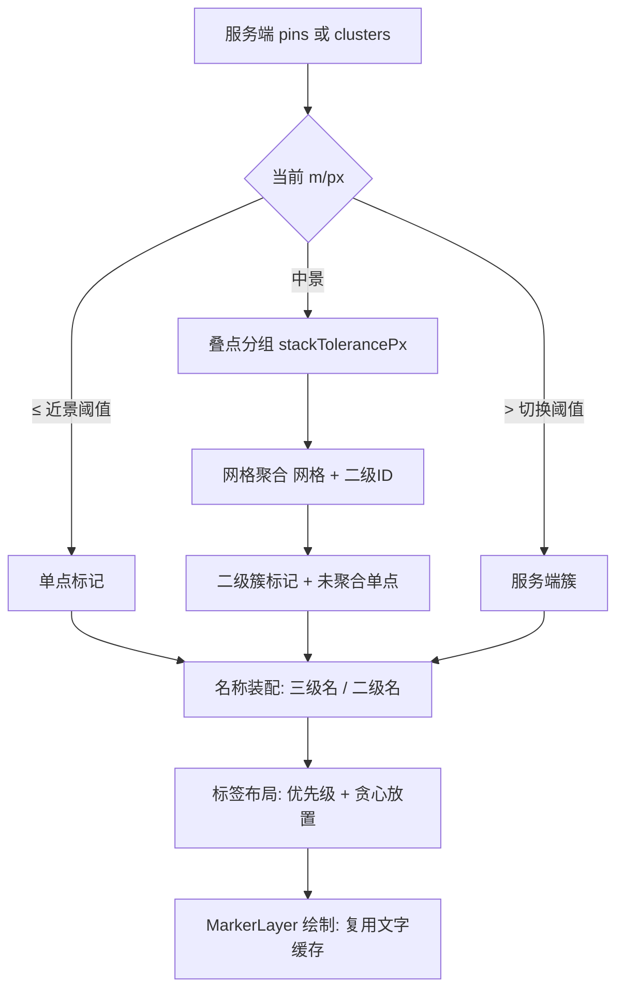

## Goal Capsule

- **Objective:** 用户在默认 5 km 视野下，不点开任何 Pin 就能说出屏上主要是什么类目；近景能看到记录的三级类目名（同名去重、放不下不标）。
- **Means:** 按地面分辨率分三档披露：近景单点标三级名，中景保留单点层并把名称挂到二级聚合簇上，远景沿用服务端簇（KTD1、KTD2）。
- **Authority:** 产品口径以本计划 Requirements 与 PRD §6.4.2 为准；实现机制冲突时 KTD 优先，单位不得自行改口径。
- **Stop conditions:** 若中景档单点与命名簇混排在真机上不可读，停止并回到方案讨论，不得自行加第四种视觉元素。
- **Execution profile:** 前端 Dart 改动 + 文档同步，不动后端与契约。

---

## Product Contract

### Summary

地图 Pin 现在只画一级色 + 二级图标，用户无法判断一条记录属于哪个三级类目。本计划给 Pin 与聚合簇增加类目名称，并规定名称在什么视野、以什么粒度出现。

### Problem Frame

分类树在 2026-11-08 扩到 25 个二级、120 个三级叶子。用户在默认 5 km 视野看到的是大片二级图标：同一个「整租/合租」图标下混着主卧、次卧、整租三类记录。用户只能逐条点开信息卡确认类目，而一屏可能有几十条。加三级图标不可行：20px 图标在去色后已无法在同族内再分出 120 个字形（PRD §6.4.2 二级验收口径已把辨识责任交给文字）。

问题因此不是“图标不够”，而是“地图上没有字”。

### Requirements

**视野分档与聚合**

- R1. 名称与聚合粒度由当前地面分辨率（m/px）决定，阈值取 `lib/nfr_constants.dart` 常量；不读取半径筛选档。
- R2. 近景档（m/px ≤ 近景阈值）：保留单点，标注三级类目名；同一名称在一屏内只标一处。
- R3. 中景档（近景阈值 < m/px ≤ `NfrPerf.clusterModeSwitchMetersPerPixel`）：保留单点层；未显式选择叶子时按二级类目聚合成簇。每个二级类目只在其最大的渲染单元上显示一次名称，簇附条数；未被聚合的记录仍以单点存在并可点中。
- R4. 远景档（m/px > 切换阈值）：沿用服务端预聚合簇；仅当簇携带类目 ID 时显示二级名，缺失则不标。

**名称布局**

- R5. 标签按优先级放置：选中记录优先，其次离屏幕中心近的。放不下就不标，不缩小字号、不裁切。
- R6. 标签左侧带该类别色点；标签不遮住任何 Pin、不超出屏幕、不与其他标签重叠。
- R7. 名称取自本地分类树；查不到名称的记录不标，不显示“未知”占位。

**筛选联动**

- R8. 生效筛选只剩单一叶子类目时，Pin 与簇都不标名称；类目名由条件带的类目 chip 承担。该抑制对所有档位生效。
- R9. 条件带中带叶子 ID 的类目 chip 显示该叶子的二级图标；由搜索意图产生、无叶子 ID 的 chip 保持现状。

**口径与性能**

- R10. 标签重排只在相机停稳后发生；拖动过程中标签随图层整体平移，不重排、不闪烁。
- R11. 判定阈值与数量上限进 `lib/nfr_constants.dart`；标签几何量（内边距、间距、色点尺寸）放在布局模块的私有常量里；`lib/design_tokens.dart` 是生成文件，只读引用。业务代码不写字面量。
- R12. 不改接口契约、不新增错误码；远景档的名称缺失按降级处理，不报错。

### Key Decisions

- KD1. **不引入三级图标，名称承担三级辨识**。(session-settled: user-directed — chosen over 为 120 个叶子各配图标: 20px 去色后同族不可分，且与 PRD 二级图标验收口径冲突) Governs R2, R3.
- KD2. **5 km 主战场保留单点层，名称挂到二级簇**。(session-settled: user-directed — chosen over 全簇化去掉单点: 用户要求记录仍可直接点中) Governs R3.
- KD3. **单一叶子筛选时不标 Pin 名**。(session-settled: user-approved — 同屏同名会变成重复噪声，由条件带 chip 声明类目) Governs R8.
- KD4. **半径档不参与名称判定**。(session-settled: user-directed — chosen over 用 1/3/5/10 km 半径分档: 半径只筛数据不控相机，用户一捏缩放即脱钩) Governs R1.
- KD5. **显式选择叶子时关闭二级聚合。** 用户刚选了多个叶子，按二级合并会把这份区分抹掉；此时保留单点并按三级名去重标注。Governs R3.
- KD6. **远景档无名称作为已知降级。** (session-settled: user-directed — chosen over 把客户端聚合范围上推到 10 km: 请求体量与帧耗时都会上升，且后端补簇类目 ID 即可根治) Governs R4.

### Success Criteria

- 默认 5 km 视野、造数 80 条记录时，每个出现的二级类目至少有一处名称可见，名称带类目色点且互不重叠。
- 近景档下同名的多条记录只出现一个名称标签。
- 500 个 Pin 造数下，标签布局与绘制使单帧仍满足 `NfrPerf.frameBudgetMs`；图层切换 P95 不高于 `NfrPerf.layerSwitchP95Ms`。
- 真机走查：中景档能区分“命名簇”与“单点”两种单元，不出现误读为同一种的反馈。

### Scope Boundaries

- 不改后端 `/map/pins`，不要求簇回传类目 ID；远景档名称作为已知降级。
- 不实现“本屏条数”并入类目 chip；命中数继续由左下角承担。
- 不做标签碰撞避让算法以外的排版实验（如标签引线、边缘吸附）。
- 不改现有聚合阈值语义（一级大类 3/5/8 条起聚），只在中景档增加按二级的聚合维度。

### Assumptions

- 默认 5 km 视野落在中景档：初始 `_kInitialMetersPerPixel = 12`；按半径 5 km 适配约 27.8 m/px（短边按 360dp 计），低于切换阈值但余量只有约 2 m/px。
- 标签字号取 `AppTypeScale.small`（12px）；`AppTypeScale.caption` 是 11px，不采用。
- 服务端簇的 `category_id` 仍是 `null`，远景档本次不会出现名称。

### Risks

| 风险 | 影响 | 缓解 |
|---|---|---|
| 远景档没有任何名称 | 5 km 适配约 27.8 m/px，只比切换阈值低约 2；用户往外一捏，名称整屏消失 | 按 KD6 接受：远景靠分类色与数量表达，后端补簇类目 ID 后加名；上线前只走查边界不突跳 |
| 单点与命名簇两种图形混排 | 用户可能把彩色小圆与白底簇读成同一类 | 真机走查；必要时只调整簇的文字位，不新增第四种图形 |
| 标签压住高德底图 POI 名称 | 双套文字叠加，读不清 | 标签带实底胶囊；同区域标签数量受碰撞闸门限制 |
| 双指缩放每帧重排风险 | 帧耗时抖动 | 缩放过程中复用上一次布局，停稳后重排（R10、KTD4） |

### Open Questions

- 远景档（> 切换阈值）名称依赖后端补 `category_id`，已按 KD6 接受为本次降级。
- 标签胶囊底色与地图底色的区分度是否需要微调，留待真机走查。非阻塞。

---

## Planning Contract

### Key Technical Decisions

- KTD1. **分档判据用 `_metersPerPixel`，阈值常量落在 `NfrPerf`。** 新增 `labelDetailMetersPerPixel`（近景上界）与 `labelMidTierClusterMinPoints`；远景上界复用 `clusterModeSwitchMetersPerPixel`。理由：分档必须跟随实际视野，跟随半径会在手捏缩放后失真（KD4）。
- KTD2. **中景档聚合键扩为「网格 + 二级类目」，并保持「先叠点、后网格」顺序。** 现有键为 `gx:gy:一级大类`（`lib/features/map/clustering/grid_cluster.dart`）；中景档改为 `gx:gy:二级ID`，使每簇类目同质、簇名不说谎。分桶维度由参数控制，默认仍按一级大类，既有测试语义不变。叠点分组必须先于网格聚合，否则同坐标多条会被拆散（`docs/solutions/ui-bugs/overlapping-pins-only-top-tappable.md`）。常量改动须在同一 PR 内同步 PRD 对应行（`lib/nfr_constants.dart` 文件头纪律）。
- KTD3. **名称在装配期解析并写入 Marker 字段，渲染层不查分类树。** `MarkerLayer` 只吃 `List<MapMarker>`；让它反向查 `categoryTree` 会把渲染层与领域层耦合，也会让每帧多一次查表。
- KTD4. **标签布局在相机停稳后算一次，产出可复用的布局结果。** 绘制每帧全量重画（`_MarkerPainter`），若把贪心布局放进 `paint` 会按帧重复计算；拖动时复用上一次布局，随图层平移。这与现有「拖动降级渲染」同一思路。
- KTD5. **文字测量复用 `marker_layer.dart` 的 `_textCache`。** 缓存键已含文本、颜色、字号、字重、字体族；新增标签沿用该入口，不新建第二份缓存。
- KTD6. **名称去重按「名称」而不是按「类目节点」。** 近景档同名只标一处，选中记录优先；中景档每个二级只在其最大的渲染单元（簇或单点）标一次。理由：用户读到的是字，不是类目 ID。
- KTD7. **类目 chip 的图标走 `l2CategoryIcon(leafCategoryId)`。** 与 Pin 的中心字形同一真源，不新增图标映射；查不到时退回一级图标。
- KTD8. **标签布局计入图层切换的装配段计时。** 布局与 `_buildMarkersFor` 同处 `beginAgg/endAgg` 之间，不新增第五段计时，也不由总时长减出（`docs/architecture/编码规范.md` §5.8）。

### High-Level Technical Design

分档与产出的对应关系：

| 档位 | 判据 | 单元 | 名称 |
|---|---|---|---|
| 近景 | m/px ≤ 近景阈值 | 单点 | 三级名，同名只标一处 |
| 中景 | 近景阈值 < m/px ≤ `clusterModeSwitchMetersPerPixel` | 二级簇 + 未聚合单点 | 二级名 + 条数，挂最大单元 |
| 远景 | m/px > `clusterModeSwitchMetersPerPixel` | 服务端簇 | 有类目 ID 才标二级名，否则不标 |

### Sequencing

U1 → U2 → U3 → U4 为一条链（聚合维度决定名称装配，名称装配决定布局，布局决定绘制）。U5 独立。U6 最后，依赖 U1–U5 的最终口径。

---

## Implementation Units

### U1. 聚合层支持二级维度

- **Goal:** 网格聚合可按二级类目分桶，同时保留现有叠点与阈值语义。
- **Requirements:** R3, R11
- **Dependencies:** 无
- **Files:** `lib/features/map/clustering/grid_cluster.dart`, `lib/features/map/clustering/marker_builder.dart`, `lib/nfr_constants.dart`, `test/grid_cluster_test.dart`, `test/marker_builder_test.dart`, `test/map_overlap_test.dart`
- **Approach:**
  - `ClusterPoint` 增加二级 ID 字段，由调用方传入（叶子 ID 经 `midCategoryIdOf` 换算）。
  - 分桶键在现有网格键后追加二级 ID；`Cluster` 与 `ClusterMarker` 携带同一二级 ID。
  - 聚合阈值仍取所属一级大类的 `clusterThreshold`；中景档的最小条数用新常量 `NfrPerf.labelMidTierClusterMinPoints`。
  - 保持 `groupOverlappingPoints` 在网格聚合之前执行。
  - 分桶维度由参数切换：默认按一级大类，只有中景档传二级；不改默认路径的行为。
  - 新常量与 PRD 常量表在同一 PR 内一起改。
- **Patterns to follow:** 现有 `clusterByGrid` 的空间哈希与 `floor` 分桶写法；`_PinsDerived` 的按引用缓存思路。
- **Test scenarios:**
  - 同一网格内同二级、不同三级的点聚成一簇，簇的二级 ID 正确。
  - 同一网格内不同二级的点不聚合，分别成簇或成单点。
  - 先叠点后网格：同坐标两条同二级记录先成叠点堆，不因网格分桶被拆开。
  - 二级 ID 为 null 的点自成一桶，不与其他未知类目混合。
  - 聚合总数守恒：输入 N 条，输出成员数之和等于 N。
  - 阈值边界：恰好等于最小条数时聚簇，少一条时保持单点。
- **Verification:** 默认分桶路径下三个既有聚合测试文件全绿；中景分桶用例按上述边界新增并通过。

### U2. 名称字段与标签布局

- **Goal:** 为标记提供类目名，并按优先级与碰撞产出可绘制的标签位置。
- **Requirements:** R2, R5, R6
- **Dependencies:** U1
- **Files:** `lib/features/map/marker_label_layout.dart`（新建）, `lib/features/map/clustering/marker_builder.dart`, `lib/features/map/marker_layer.dart`, `test/features/map/marker_label_layout_test.dart`（新建）
- **Approach:**
  - `MapMarker` 增加可空的 `label`，由装配期写入；`ClusterMarker` 同时带条数用于拼“名称 + 条数”。
  - 新建纯函数式布局：输入标记列表、屏幕矩形、文字测量回调，输出放置成功的标签列表。
  - 优先级：选中 → 离屏幕中心距离升序 → 完整度降序；先到先占位。
  - 判交对象包括已放置标签与所有标记的圆形占位；相交即跳过，不缩字号。
  - 标签左侧预留类目色点，色值取所属一级的 `deepColor`，让标签与 Pin 同源可辨。
  - 布局结果按标记列表引用缓存，相机停稳才重算；拖动与双指缩放过程中复用上一次布局，停稳后重排（R10）。
- **Technical design:** 方向性示意，不是实现规格——按优先级遍历候选，为每个候选生成候选矩形（Pin 下方居中），与已占用矩形集合判交，成功则加入集合。
- **Patterns to follow:** `test/features/map/marker_layer_gesture_test.dart` 的纯逻辑测试风格；`_textCache` 的测量入口。
- **Test scenarios:**
  - 两个标签空间充足时都放下，位置在各自 Pin 下方。
  - 第二个标签会压住第一个时被跳过，仅保留优先级更高者。
  - 标签会超出屏幕右边界时被跳过。
  - 标签会压住另一个 Pin 时被跳过。
  - 选中记录即使离中心更远也优先获得标签。
  - 无名称为空的标记不产生标签。
  - 相同名称在同一批输入里只产生一个标签。
- **Verification:** 新增测试全绿；布局函数不依赖 Flutter 逐帧状态，可直接单测。

### U3. 渲染层绘制标签

- **Goal:** 把布局结果画到地图上，且不影响命中测试与拖动性能。
- **Requirements:** R6, R10, R11
- **Dependencies:** U2
- **Files:** `lib/features/map/marker_layer.dart`, `test/features/map/marker_layer_label_test.dart`（新建）
- **Approach:**
  - 在标记绘制之后绘制标签：先画底色胶囊、再画类目色点、最后画文字，保证压住底图 POI 名称时仍可读。
  - 字号取 `AppTypeScale.small`；内边距、圆角、与 Pin 的间距、色点尺寸放在 `lib/features/map/marker_label_layout.dart` 的私有常量里。`lib/design_tokens.dart` 由 Figma 生成，不手改。
  - `_MarkerPainter` 增加标签布局入参，`shouldRepaint` 同时比较布局对象引用，避免布局变了画面不刷新。
  - 标签不进入命中测试，点击仍落在原 Pin 或簇上。
  - 为带标签的标记补语义节点，读屏播报「类目名 + 条数」；系统字号放大时标签只放大不换行。
- **Patterns to follow:** `_paintCenteredText` + `_cachedPainter`；`_paintCountBadge` 的胶囊画法。
- **Test scenarios:**
  - 有标签的标记与无标签的标记混合时，两者都按要求绘制（记录绘制调用顺序）。
  - 标签布局为空时，绘制结果与改动前一致。
  - 同一标记被选中时，选中态尺寸与标签同时生效，不互相裁切。
  - 拖动平移下标签与 Pin 保持相对位置一致。
- **Verification:** 组件测试可断言绘制顺序与命中结果；真机拖动无标签闪烁。

### U4. 地图装配分档与筛选抑制

- **Goal:** 按当前 m/px 选择档位、装配名称，并在单一叶子筛选时抑制 Pin 名称。
- **Requirements:** R1, R2, R3, R4, R7, R8
- **Dependencies:** U1, U2, U3
- **Files:** `lib/features/map/map_screen.dart`, `lib/features/map/marker_disclosure.dart`（新建）, `lib/nfr_constants.dart`, `test/features/map/marker_disclosure_test.dart`（新建）
- **Approach:**
  - 新建纯函数分档判定与名称装配策略，输入为 m/px、选中 ID、生效筛选、分类树查询结果；输出档位、需要的中景聚合开关、是否抑制 Pin 名。
  - 分档判定与 `PinsQuery` 的 zoom 各自独立：档位跟随渲染视野，请求仍用请求视口。
  - 中景档开启二级聚合；显式选择了叶子时关闭（KD5）；近景档关闭；远景档不做任何聚合改动。
  - 单一叶子筛选时 Pin 名称置空；多叶子或未筛时按 R2/R3 标名。
  - 名称解析优先用 `leafCategoryById(id)?.name`，取不到时再走 `categoryPathOf`；解析失败置空（R7）。
  - 标签布局与 `_buildMarkersFor` 同处装配段，使 `beginAgg/endAgg` 覆盖它（KTD8）。
- **Patterns to follow:** `effective_filter.dart` 的纯函数投影与「生效筛选」单一来源；`_PinsDerived` 的引用缓存。
- **Test scenarios:**
  - 三种 m/px 输入分别落到正确档位，边界值按闭区间规则处理。
  - 单一叶子筛选时装配结果不含 Pin 名称。
  - 多叶子筛选时保留名称，且同名只保留一个。
  - 分类树查不到的叶子不产生名称，不抛异常。
  - 选中 ID 变化不改变档位，但改变标签优先级顺序。
- **Verification:** 纯函数测试覆盖三档与抑制规则；地图页真机走查三档视觉。

### U5. 条件带类目 chip 补图标

- **Goal:** 筛选后类目 chip 同时给出类目名与图标，承担 R8 中被抑制的 Pin 名称。
- **Requirements:** R9
- **Dependencies:** 无
- **Files:** `lib/features/discovery/effective_filter.dart`, `lib/features/discovery/condition_band.dart`, `test/features/discovery/effective_filter_test.dart`
- **Approach:**
  - `ConditionChip` 增加可空的二级图标字段，由叶子 ID 经 `l2CategoryIcon` 解析；只对已带 `leafCategoryId` 的持久叶子 chip 生效，意图来源 chip 保持纯文字。
  - 渲染层在类目标签左侧画圆形底 + 图标，尺寸与筛选面板的二级图标一致。
  - 查不到图标时退回一级图标，不改变 chip 文本。
- **Patterns to follow:** 筛选面板 `_CategoryChip` 的「图标 + 文字并排」写法；`listing_category_style.dart` 的唯一解析入口。
- **Test scenarios:**
  - 持久叶子 chip 携带正确二级图标。
  - 一级大类 chip 仍只有分类色圆点，不误加二级图标。
  - 未登记叶子退回一级图标。
  - 意图来源的类目 chip 不产生图标，文本与改动前一致。
  - chip 文本与改动前一致（无图标泄漏进 label）。
- **Verification:** `effective_filter_test` 全绿；筛选后真机确认 chip 图标与地图 Pin 字形一致。

### U6. 口径文档与性能取证

- **Goal:** 把名称披露写成正式口径，并留下性能证据。
- **Requirements:** R11, R12
- **Dependencies:** U1, U2, U3, U4, U5
- **Files:** `docs/PRD.md`, `docs/design/前端详细设计文档.md`, `docs/backlog/Batch2-启动清单.md`, `docs/plans/2026-11-11-0747-feat-map-category-labels-plan.md`
- **Approach:**
  - 在 PRD §6.4.2 增加判定记录：名称为类目维度的换通道表达，不是第三类信息维度；仅在近景/中景档出现，且不常驻于每条记录。
  - 在前端详细设计补「分档披露」与“标签不参与命中”两条实现约定。
  - 在 Batch2 启动清单新立条目，标注会话属性与任务类型，并引用本计划。
  - 用保真造数（默认 5 km、500 Pin）记录帧耗时与图层切换耗时；结论写入计划附录。
- **Patterns to follow:** PRD §6.4.2 既有「判定记录 · Marker 上不印价格」的写法；`docs/solutions/workflow-issues/test-data-fidelity-for-performance-claims.md` 的造数要求。
- **Test expectation:** none — 纯文档与取证，无行为变更。

---

## Verification Contract

| 检查 | 命令 / 方式 | 适用范围 |
|---|---|---|
| 静态检查 | `flutter analyze` 0 issue | 全部单位 |
| 聚合语义 | `flutter test test/grid_cluster_test.dart test/map_overlap_test.dart test/marker_builder_test.dart` | U1 |
| 标签布局 | `flutter test test/features/map/marker_label_layout_test.dart` | U2 |
| 渲染与命中 | `flutter test test/features/map/marker_layer_label_test.dart test/features/map/marker_layer_gesture_test.dart` | U3 |
| 分档与抑制 | `flutter test test/features/map/marker_disclosure_test.dart` | U4 |
| 筛选 chip | `flutter test test/features/discovery/effective_filter_test.dart` | U5 |
| 帧预算 | `flutter test test/frame_metrics_test.dart` + 真机 500 Pin 造数 | U3, U4 |
| 图层切换 SLA | 真机埋点，P95 ≤ `NfrPerf.layerSwitchP95Ms`，含标签布局（KTD8） | U4 |
| 真机走查 | 三档各截一张图，核对名称不重叠、不出屏、不压 Pin | 全部 |

## Definition of Done

- 三档在真机上均可复现，且与本文分档表一致。
- 默认 5 km 视野下，出现的每个二级类目都有可见名称；同名不重复标注。
- 单一叶子筛选时 Pin 无名称，条件带 chip 同时显示图标与三级名。
- `flutter analyze` 0 issue；本文列出的测试全绿，且未删除既有断言。
- 500 Pin 造数下单帧不超 `NfrPerf.frameBudgetMs`，图层切换 P95 不高于 `NfrPerf.layerSwitchP95Ms`。
- PRD 判定记录、前端详细设计、Batch2 条目三处口径一致，且与本计划的 R/KTD 编号可互相追溯。
- 未使用的实验代码、临时打印与一次性探针已删除。

---

## 实施附录（2026-11-11）

### 实施偏差记录

两处与 U2 / U5 字面不同的落地方式，均保持 R/KTD 的产品与分层意图不变：

1. **`MapMarker` 未新增 `label` 字段。** 标签改由装配期产出的 `MarkerLabelCandidate`（marker + 文本 + 色点）承载，渲染层只吃 `MarkerLabelPlacement`。原因：给 sealed class 三个子类各加 `label` 需要一条 `withLabel` 拷贝链，而标签本来只在一帧内使用；「渲染层不查分类树」（KTD3）与「名称在装配期解析」两条约束均满足。
2. **`ConditionChip` 未新增图标字段。** 持久叶子 chip 已携带 `leafCategoryId`，条件带在渲染时用 `l2CategoryIcon(leafCategoryId)` 解析即可（R9）。在纯 Dart 的 `effective_filter.dart` 里放 `IconData` 会引入 Flutter 依赖，得不偿失。

### 已完成的取证

| 项 | 结果 |
|---|---|
| `flutter analyze` | 0 issue |
| `test/grid_cluster_test.dart` / `test/map_overlap_test.dart` / `test/marker_builder_test.dart` | 全绿（含新增中景分桶与叠点顺序用例） |
| `test/features/map/marker_label_layout_test.dart` | 全绿（8 条：边界、碰撞、同名去重、条数优先） |
| `test/features/map/marker_disclosure_test.dart` | 全绿（三档边界、抑制、聚合开关、名称降级） |
| `test/features/map/marker_layer_label_test.dart` + `marker_layer_gesture_test.dart` | 全绿（标签不参与命中、语义节点、手势回归） |
| `test/features/discovery/effective_filter_test.dart` | 全绿（新增显式叶子口径与 chip 叶子 ID） |

### 待真机取证（未执行，不得写成达标）

以下两项依赖真机与保真造数，本轮未执行，**不接受用开发机或小样本替代**：

1. **单帧预算**：默认 5 km 视野、500 Pin 造数，标签布局 + 绘制后单帧 P95 ≤ `NfrPerf.frameBudgetMs`；
2. **图层切换 SLA**：真机埋点 P95 ≤ `NfrPerf.layerSwitchP95Ms`，且聚合段包含标签布局（KTD8）；同时确认拖动过程中标签随层平移、不重排、不闪烁（R10）。

走查口径：三档各截一图，核对名称不重叠、不出屏、不压 Pin；中景档能区分「命名簇」与「单点」。
