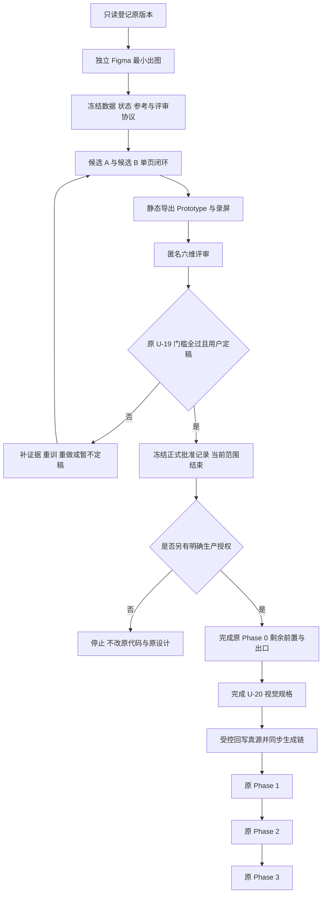
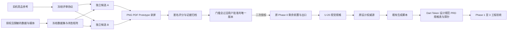
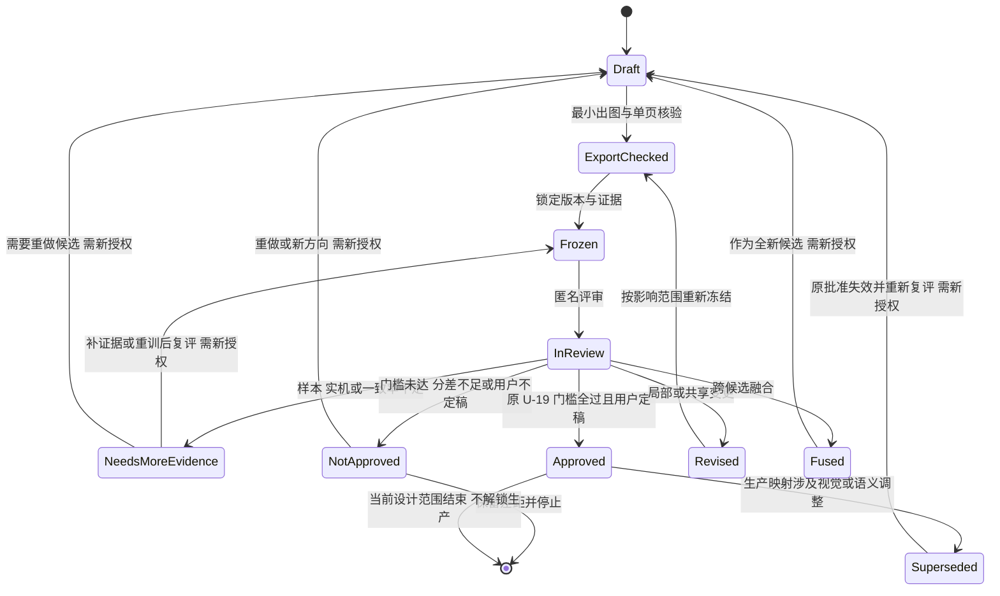

# UIUX 独立 Figma 设计稿优先实施 - Plan

## Goal Capsule

| 项目 | 约定 |
| --- | --- |
| Objective | 先交付可查看、可走查、可评审的高保真 UI/UX 候选设计稿，由用户亲自定稿，并使六维视觉与内容目标具备可信证据；在用户再次明确授权前，原代码与原设计保持不动。 |
| Means | 使用独立 Figma 探索文件和隔离的本地评审记录，完成两个候选方向、核心屏与状态、可见导出、匿名评审和用户定稿（KTD1、KTD2、KTD3）。 |
| Authority | 产品与验收口径由 `docs/PRD.md`、`docs/plans/2026-11-16-UIUX整体优化方案.md` 的 G1～G6、Q1～Q11 和原 U 条目拥有；本计划只拥有隔离、顺序、批准门与回写触发，不复制为第二口径源。 |
| Execution profile | 当前授权仅覆盖 U1～U6；U7～U11 是二次授权后的工程前置、视觉规格、受控回写与分阶段实施，不得被设计批准自动解锁。 |
| Stop conditions | 出图必须触碰原文件、Figma 写画布或所需导出能力均不可用、无法只读访问外部生产 Figma 取得版本基线、竞品实机采集不可得、材料未脱敏、证据不足以支持追平结论、口径超出既有设计文档，或缺少二次授权时立即停止对应路径并报告。 |
| Tail ownership | U6 只有在原 U-19 门槛全部通过后才由用户签署正式定稿；U8 完成原 Phase 0 剩余前置，U7 完成 U-20 与真源生成链，U9～U11 分别承接原 Phase 1～3，不能倒序借工程实施补设计。 |

---

## Product Contract

### Summary

先建立与生产设计真源隔离的 Figma 探索环境，以同一套冻结、脱敏数据制作至少两个高保真候选方向，覆盖首页地图、列表、详情、发布和零结果等核心界面及关键退化状态。
候选稿通过 PNG/PDF、Figma prototype 和关键路径录屏接受走查，经六维匿名评审后由用户定稿。
定稿只冻结设计方向；原 Figma/JS 真源、Dart Token、业务代码及测试的任何变更均须再次获得用户明确授权。

### Problem Frame

当前方案已明确六维追平目标，但若直接进入 Token 或业务实现，用户无法在实施前判断视觉方向，且现行生成器包含清空页面节点的行为，不能安全地用于原文件探索。
原 Phase 0 同时包含设计定稿和后端封面链路，若混在一个出口中，会把“设计方向获批”误报为“工程前置已完成”。
因此需要先解决可见设计、原真源零触碰、证据可信和阶段授权四个问题，再决定是否回写与实施。

### Key Decisions

- KD1. **先设计稿、后生产实施**（session-settled: user-directed — chosen over 直接修改原代码与原设计: 先看见并批准方向，避免未评审改动）。Governs R1, R2, R4, R12, R13, R14
- KD2. **六维追平，不退化为工程合规**（session-settled: user-directed — chosen over 仅做 Token 与规范合规: 必须直接回应页面素、视觉弱和缺少亮点的问题）。Governs R5, R6, R16
- KD3. **真实内容与可核验证据优先**。视觉丰富不能通过假供给、假热度或不可复核的竞品截图获得。Governs R7, R8, R9, R10, R15

### Requirements

**隔离与授权**

- R1. 设计探索必须发生在新的独立 Figma 文件中，评审记录和导出物进入新的隔离目录，不成为生产库依赖。
- R2. U1～U6 不得修改、发布、合并、分支或破坏性重建原业务代码、Dart Token、`prototype-figma` 真源、生产 Figma 文件及既有设计资产。
- R3. 至少两个候选方向必须使用同一冻结数据集、相同视口和相同状态矩阵，并提供可查看的静态导出与可走查的交互证据。
- R4. 用户定稿仅批准设计方向；任何生产回写或工程实施都必须另行取得明确授权，且授权范围必须可核对。

**视觉与内容目标**

- R5. 候选稿必须分别呈现视觉风格、配色审美、版式节奏、插画/IP/图形语言、内容观感与真实供给密度、界面热闹程度六个维度，并按原方案 G1～G6 对标 58 同城、闲鱼、啄木鸟家庭维修。
- R6. 候选稿必须覆盖核心屏、关键任务路径和本计划状态矩阵，同时保留“地图即信息流”“实心为有资源、空心为有需求”“信息完整度不是人的信誉”的产品语义。
- R7. 设计和评审材料不得伪造卡片、封面、数量、在线状态或热度，不得把图片改为发布必填，不得公开展示未审核媒体，不得静默丢弃上传中或失败的已选媒体。产品未上线阶段允许使用明确标注的演示样本，但不得伪造浏览／收藏／成交数量与在线状态，也不得暗示真实供给规模。
- R8. 追平结论只能使用带来源与时间戳的实机参考和按原方案 Q8/Q10 预登记的评审证据；证据不足必须记为“未验证”，商店宣传图只能用于方向参考。

**评审保真与纪律**

- R9. 评审稿的视口、数据、几何和字体必须来自同一冻结版本，放大只允许最近邻；离线 mock 不得替代 Figma 实际几何与真实渲染结果。评审稿与全部导出物必须使用生产字体栈（Inter 加明确列出的中文字体回退），字体名称与字重回退清单写入状态矩阵和评审协议，不得用缺失中文字形的字体出稿。
- R10. 候选版本评审期间必须锁定，跨候选融合视为新候选；局部变更复评受影响屏，共享母版或变量变更触发全量复评。
- R11. 探索变量、组件和图形只服务于候选表达，不得直接导出为 Dart Token，也不得通过手改生成物绕过生产真源。

**获批后的衔接**

- R12. 二次授权后只能把获批方向受控映射回原设计真源，再经既有生成链同步派生产物，禁止直接从未知版本探索稿覆盖生产文件。
- R13. 原方案 Phase 0 只有在设计定稿及 U-00、U-23、U-24 等原前置均完成后才可宣告完成，设计批准本身不等于 Phase 0 完成。
- R14. 工程阶段必须沿用原方案的 G1～G6、Q1～Q11、测试与发布门禁，不以设计评审替代 Flutter、Java、契约、实机或安全验证。

**证据、外部分享与生产漂移**

- R15. 评审数据须在冻结前完成昵称头像占位、正文联系方式打码、标题与正文中的街道／小区／楼栋门牌模糊或删除、坐标降级到区县；进入评审包的图片须做电话、微信、二维码、门牌与车牌的 OCR 检查，命中即换图或遮挡。授权记录须覆盖 Figma 云端、外部评阅与本地导出边界；样本级授权记录与评阅人身份映射不放在交付目录，与含令牌链接同级限权保存，仓库只留样本／批次编号、评阅人编号、授权结论与日期。外部分享默认仅登记评阅人只读访问，并预登记访问名单、外发件编号与格式、留存期、销毁责任人、回收责任和到期处置；留存与销毁范围同时覆盖独立 Figma 文件与本地证据包。
- R16. 正式定稿必须同时满足原 U-19 的六维逐维门槛、总分与分差规则、样本量、评分者一致率、实机覆盖和 G5 首屏几何门槛。G5 须三条同时成立：① 390×844 首屏可视区内非文字视觉块合计 ≥8%；② 首屏至少含一张真实内容图，无图时以同骨架的大尺寸分类字形占位；③ 插画、IP、分类字形与供需符号同源同画风。G5 记录逐块标注类型与所属容器，纯装饰块不计入。任何未验证或未达标项都阻止生产解锁，用户可否决或暂不定稿但不能人工豁免。
- R17. 二次授权后的生产目标版本漂移或映射差异若涉及视觉、内容、交互或产品语义，必须使原批准失效并按影响范围重新评审；纯技术映射修复只有在获批稿完全不变且派生差异重新核验后才可继续。
- R18. **未上线阶段的评审口径**。产品未上线、无真实供给时：视觉风格、配色审美、版式节奏、插画／IP／图形语言四项仍按原 U-19 门槛评审；内容观感（含真实供给密度）、界面热闹程度两项改为“演示数据下的表达质量”评审，不得据演示样本推断真实供给密度、热度或竞争地位。所有评审材料与批准记录必须标注“演示数据（非真实供给）”，批准结论写作“视觉方向获批，供给未验证”，不得宣称六维追平；这两项维度对应的真实指标留到上线后按原 G6 口径复测。

### Actors

- A1. **用户／最终裁定者**：查看候选稿和证据，亲自定稿，并决定是否发出第二次生产修改授权。
- A2. **设计执行者**：维护隔离环境、冻结数据、候选稿、导出物和版本记录，不接触未授权生产写入。
- A3. **评审者／评分者**：按匿名候选和预登记口径评分，只根据可追溯证据作结论。
- A4. **工程执行者**：仅在二次授权后按 U8 → U7 → U9 → U10 → U11 执行，并遵守现有编码规范和生成链。

### Key Flows

- F1. **独立设计与批准**
  - **Trigger:** 用户要求先看到设计稿且不改原代码和设计。
  - **Actors:** A1, A2, A3
  - **Steps:** 验证隔离出图通道 → 冻结脱敏数据与状态 → 制作两个候选 → 导出与走查 → 匿名评审 → 用户定稿。
  - **Outcome:** 获得可追溯的设计方向批准记录；生产代码与设计仍未改变。
  - **Covers:** R1, R2, R3, R5, R6, R7, R8, R9, R10, R11, R15, R16
- F2. **二次授权后的回写与实施**
  - **Trigger:** 用户在定稿后另行明确授权具体生产修改范围。
  - **Actors:** A1, A4
  - **Steps:** 核对批准版本 → 完成原 Phase 0 剩余工程前置与出口 → 完成 U-20 视觉规格 → 回写原设计真源并重新生成派生产物 → 按原 Phase 1～3 实施与验收。
  - **Outcome:** 获批设计以可追溯方式进入生产，并保留原方案全部工程门禁。
  - **Covers:** R4, R12, R13, R14, R17

### Acceptance Examples

- AE1. **原生成器保护**
  - **Given:** 设计执行者准备试跑现行 `batchSetup()`。
  - **When:** 发现其会清空原生成页顶层节点。
  - **Then:** 不得在原文件执行，改为独立文件内的最小出图验证。
  - **Covers:** R1, R2
- AE2. **设计批准不等于实施授权**
  - **Given:** 用户已在 U6 选定候选方向。
  - **When:** 执行者准备修改 `prototype-figma/code.js` 或 `lib/`。
  - **Then:** 必须停止并等待另一次明确授权。
  - **Covers:** R4, R12
- AE3. **证据不足不得宣称追平**
  - **Given:** 某竞品只有商店宣传图或实机样本不足。
  - **When:** 汇总六维评分。
  - **Then:** 对应维度记为“未验证”，不得用推测补成达标，也不得签署可解锁生产的正式定稿。
  - **Covers:** R8, R16
- AE4. **融合方向重新评审**
  - **Given:** 候选甲的配色与候选乙的版式分别领先。
  - **When:** 评审后把两者合并。
  - **Then:** 合并结果作为新候选重新冻结和复评，不得直接宣称为原评审胜者。
  - **Covers:** R3, R10
- AE5. **未就绪流程只能模拟标注**
  - **Given:** S2 零结果视觉流程依赖的 B2-7/B2-9 尚未就绪。
  - **When:** 制作 0/1/10/30 秒流程稿。
  - **Then:** 页面与评审记录标注“流程模拟”，不得宣称真实业务链路已经可用。
  - **Covers:** R6, R7
- AE6. **共享变更扩大复评范围**
  - **Given:** 候选已冻结并完成一轮评分。
  - **When:** 修改共享卡片母版、公共变量或字体栈。
  - **Then:** 原评分失效并对全部受影响候选屏重新导出和复评。
  - **Covers:** R9, R10

### Success Criteria

- 用户在任何生产修改之前即可查看并走查至少两个高保真候选方向，而不是只阅读规范或查看 Token 表。
- 六维评审能够回溯到同一数据、同一状态、同一版本和实机参考；不能验证的项目被明确保留为未验证。
- 用户定稿后存在唯一获批版本和决策记录，U1～U6 的原代码、原设计真源与既有设计资产无变更。
- 后续工程执行者能够区分“方向获批”“原 Phase 0 完成”“G1～G6 工程达标”三个不同结论。

### Scope Boundaries

**当前授权范围**

- 独立 Figma 探索文件、必要的本地评审记录、候选稿、导出物、走查材料、评审报告和用户批准记录。
- 只读核对现有设计、代码、契约与测试位置，用于保证设计不虚构业务能力。

**Deferred to Follow-Up Work**

- U8 的原 Phase 0 剩余工程前置、当前构建六维基线和阶段出口。
- U7 的 U-20 视觉规格、生产设计真源回写、Token 再生成、设计规范与探针同步。
- U9～U11 的 Flutter/Java 业务实现、测试补充及原 Phase 1～3 验收。

**明确非目标**

- 不用独立 HTML 稿替代 Figma 高保真稿，不在授权边界内创建 Flutter 验证工程或提前决定生产依赖。
- 不通过假数据、过度装饰或宣传图制造“热闹”和“供给密度”。
- 不新增错误码、不重写产品业务口径、不创建 git 提交、不发版。

### System-Wide Impact

U1～U6 不改变运行时、数据库、API、Token 或组件消费关系，只新增隔离的设计与评审交付物。
U7 之后才会影响 `prototype-figma` → 导出脚本 → Dart Token／设计规范／探针的生产传导链，因此必须单独核对批准版本、写入面和派生差异。
真实内容、媒体审核、签名 URL 和隐私红线贯穿所有阶段，设计阶段也不能以“只是稿子”为由放宽。

---

## Planning Contract

### Key Technical Decisions

- KTD1. **独立 Figma 文件加本地隔离证据包**（session-settled: user-directed — chosen over 独立 HTML 稿或直接修改原 Figma: 用户要求先看高保真稿且原代码与原设计零触碰）。采用新建文件而非 Figma Branch，避免在主文件留下检查点或扩大权限；原页面仅以只读参考或扁平快照进入探索，不建立生产组件依赖。落实 R1, R2, R3, R11。
- KTD2. **冻结候选与匿名评审证据链**。同一脱敏数据、实机参考、视口和状态矩阵驱动全部候选，版本锁定后再评分；访问权限、留存回收、质量硬门与决策记录独立归档，不依赖 Drafts/Starter 的有限版本历史。落实 R3, R8, R9, R10, R15, R16。
- KTD3. **先最小出图，再单页闭环**。正式绘制前先导出最小空产物，之后按“写一页 → 出一页图 → 定稿一页”推进，并以 Figma 实际几何核验字体、布局和导出保真。落实 R9。
- KTD4. **批准版本到生产真源的单向受控回写**。二次授权后在 U7 内先完成 U-20，再记录源版本与目标版本，只修改权威源并重新生成派生产物；探索变量不直接转换为生产 Token，视觉或语义差异返回复评。落实 R4, R11, R12, R17。
- KTD5. **设计批准门与原 Phase 0 工程出口分离**。U6 只完成 U-19 方向定稿；二次授权后由 U8 完成原 Phase 0 剩余前置，U7 完成 U-20 与真源生成链，U9～U11 分别执行原 Phase 1～3，避免提前生成 Token 或误报阶段完成。落实 R4, R13, R14。

### High-Level Technical Design

以下结构只规定隔离、证据和授权关系，不预设具体 Figma 插件、MCP 写法或生产代码实现。

**授权与阶段顺序**

**产物与证据数据流**

**候选版本生命周期**

### Output Structure

拟新增的隔离交付目录为 `docs/design/uiux-exploration/`，只在执行对应单元时创建：

- `manifest.md`：独立 Figma 文件、原版本只读登记、权限、导出和依赖边界、样本抽取口径与限权记录位置。
- `dataset/`：脱敏数据说明、边界样本标记、样本／批次编号与授权结论；授权签署件、评阅人身份与账号映射与含令牌链接同级限权保存，不进入交付目录，也不存原始用户照片、签名 URL 或凭证。
- `references/`：实机参考的来源、时间戳、设备与可用性边界；原始截图限权保存，对外只使用登记过的脱敏派生件。
- `state-matrix.md`：核心屏、状态、数据、业务依赖、模拟标记、字体栈与中文回退清单。
- `review-protocol.md`：六维逐维门槛、总分与分差规则、G5 几何判据与计数清单、匿名规则、样本与评分者预登记、评阅人编号、访问名单、外发件登记、留存销毁和复评规则。
- `candidates/<编号>/`（初始 A、B；融合后新增编号）：冻结版本说明、PNG/PDF、交互走查索引、G5 几何记录和自检记录。
- `review/`：匿名评分、证据缺口、复评记录、访问回收记录和用户决定（`Approved`／`NeedsMoreEvidence`／`NotApproved` 三态）；评阅人使用编号，含访问令牌或签名参数的链接只保存在限权记录，不进入仓库、公开导出或日志。

临时工具放在系统临时目录，路径仅登记于当次 manifest，不入仓；工具不得演变为生产工程，使用后按验证脚手架规则清理。

### Assumptions and Constraints

- Figma 写画布、组件 variants、prototype、云端 REST PNG、插件导出、PDF 和分享权限以 U1 分项实测为准；单一通道失败只切换已验证的同目标备用通道，不得把插件故障等同于全部导出不可用。只有写画布不可用，或静态导出、交互走查等必需能力均无可行通道时，才停止对应路径并报告，不擅自切换为 HTML 或本地 mock。
- 真实供给密度是内容与运营结果，视觉稿只能诚实呈现冻结样本，不能用设计手段承诺补出实际供给。
- 合成边界数据只能用于长标题、极端比例、失败态等鲁棒性检查，不得用于供给密度、热度或内容真实感评分。
- 原始用户照片和未脱敏数据不得进入仓库；只有授权、审核通过并完成必要脱敏的媒体才可进入评审导出物。
- 设计能力库的既有 HTML 模板门禁结果不得冒充 Flutter 或 Figma 通过；只记录实际执行的判据，Flutter 桥接门禁留到原方案对应阶段。
- 后续 Java 与 Dart 修改必须重新读取 `docs/architecture/编码规范.md` 的对应章节，本计划不豁免任何编码红线。

### Sequencing

U1 → U2 → U3 → U4 → U5 → U6 是当前唯一可执行路径。
U3 的两个候选可交替推进，但必须共享 U2 冻结输入；U4 按单页闭环完成，不等待全部页面画完后才首次出图。
U6 可能形成正式批准、补证据或暂不定稿三种结果；只有正式批准才能申请生产授权，当前授权在任一结果归档后均停止。此后的补样、重训、重做、融合或进入下一候选，均须重新取得授权后才能继续。
二次授权后的唯一顺序为 U8 原 Phase 0 剩余前置与出口 → U7 内先完成 U-20 再回写真源及生成链 → U9 原 Phase 1 其余实施 → U10 原 Phase 2 → U11 原 Phase 3；任一阶段出口未过不得进入下一阶段。

### Sources / Research

- `docs/plans/2026-11-16-UIUX整体优化方案.md`：G1～G6、Q1～Q11、原 Phase 0～3 与原 U 条目的唯一产品口径来源。
- `CONCEPTS.md`：权威源、派生交付件、评审载体、单页闭环、相邻对照、实机核验、验证脚手架、可判定门禁和保真维度。
- `docs/solutions/workflow-issues/visual-feedback-loop-latency.md`：先打通最小出图，再按单页闭环推进，禁止以离线几何替代真实 Figma。
- `docs/solutions/workflow-issues/phase-boundary-verification-scaffolding.md`：设计阶段不得借验证之名提前创建生产工程结构。
- `prototype-figma/code.js`：`resetPage()` 删除页面顶层节点，`batchSetup()` 调用该重置逻辑，因此现行生成器只能作为获批后的生产真源，不作为原文件探索工具。
- Figma 官方关于 Drafts、文件复制、组件 variants、prototype、版本历史、静态导出、Branch 与 MCP 的能力说明：具体席位、权限和写画布可用性必须在 U1 以当前账号实测。

### Risks & Dependencies

| 风险或依赖 | 影响 | 计划内控制 |
| --- | --- | --- |
| 当前 Figma 席位、写画布或导出权限未知 | 无法形成真实高保真稿或可见评审包 | U1 先建能力矩阵并验证最小产物；只允许同目标备用通道，不以 HTML／离线 mock 冒充 |
| 历史插件截图或 `exportAsync` 故障被当作当前事实 | 误判所有通道不可用，或反复走已知失败路径 | 当前版本逐项复测并留存结果；历史经验只用于确定测试顺序 |
| 原生成器 `resetPage()` 删除顶层节点 | 在原文件试跑会破坏既有设计 | U1～U6 禁止在原文件运行；U7 仅在授权、登记写入面并建立恢复点后运行 |
| 工作树开工前已有修改，或外部生产 Figma 在评审期间漂移 | 无法证明本次零修改，或获批方向不再适配目标版本 | U1 登记同一受保护路径集和生产文件基线，U6 复核；不得还原他人改动，差异先分类并阻塞对应结论 |
| B2-7 动态半径引擎与 B2-9 邀请／代发布未就绪 | 零结果动态流程不能作为真实业务链路验收 | U2～U5 明示“流程模拟”；后续只在依赖就绪后验收运行链路，不新建第二套引擎 |
| 真实供给、封面或实机竞品样本不足 | 内容观感、热闹程度和追平结论不可判定 | 保留“未验证”，补真实样本或重训评分者；不以合成数据、宣传图或用户人工豁免补齐 |
| 外部评阅、云端文件与本地导出扩大隐私面 | 坐标、身份、联系方式、账号或访问令牌泄露 | U2 冻结授权与脱敏，U5 检查画布及非画布元数据，U6 按名单和留存期回收 |
| Token、规范、PRD 设计规格表和探针跨批次漂移 | 生成链假绿或产物不同源 | U7 将真源、生成脚本、派生物、条件性 PRD 规格表与探针作为同一批次核验 |
| 设计批准与原 Phase 0 工程出口混淆 | 未完成后端封面链路和基线就进入 Token 或 Phase 1 | U6 与 U8 分门；二次授权后严格按 U8 → U7 → U9 → U10 → U11 执行 |
| 列表卡等定向测试当前不存在 | 计划误报已有覆盖或实施时漏测 | U9 只把已核实文件列为复用项；缺口测试在实际实施时新建并列明，不伪称现成 |

---

## Implementation Units

### Unit Index

| 单元 | 交付主题 | 当前／二次授权 | 直接依赖 |
| --- | --- | --- | --- |
| U1 | 独立 Figma 隔离、保护基线与最小出图 | 当前 | 无 |
| U2 | 脱敏数据、实机参考、状态与评审协议冻结 | 当前 | U1 |
| U3 | 两个候选视觉语言与组件状态 | 当前 | U2 |
| U4 | 核心屏、退化状态与 Prototype | 当前 | U3 |
| U5 | 冻结评审包、G5 几何证据与自检 | 当前 | U4 |
| U6 | 六维匿名评审、三态结论与用户决定 | 当前 | U5 |
| U8 | 原 Phase 0 剩余前置与工程出口 | 二次授权 | U6 正式批准 + 明确授权 |
| U7 | U-20、U-01～U-03 与真源生成链 | 二次授权 | U8 |
| U9 | 原 Phase 1 其余实施与出口 | 二次授权 | U7 |
| U10 | 原 Phase 2 地图视觉、性能与出口 | 二次授权 | U9 |
| U11 | 原 Phase 3 六维验收、度量与视觉回归 | 二次授权 | U10 |

> U8 与 U7 不重编号，以保留深化评审前已建立的单元引用；执行顺序只以 Unit Index、Sequencing 和依赖字段为准。原 U-16／U-17 对应原方案的 Phase 3 后条件项，不属于本计划自动解锁范围。

### U1. 建立独立 Figma 隔离环境并验证最小出图

- **Goal:** 在不触碰原文件的前提下获得一个能实际写入、导出和受控分享的最小 Figma 探索闭环，并建立后续零修改证明的基线。
- **Requirements:** R1, R2, R9, R11, R15；KTD1, KTD2, KTD3
- **Dependencies:** 无前置单元；但需用户提供外部生产 Figma 的只读访问与 Figma 账号席位，以及可用于竞品实机采集的设备（三款应用可安装可登录）。
- **Files:** 拟新建 `docs/design/uiux-exploration/manifest.md` 与探针画板导出记录；`prototype-figma/code.js`、原 Figma 文件、`lib/design_tokens.dart` 和既有设计资产仅只读核对；临时工具仅放系统临时目录。
- **Approach:** 先登记受保护仓库路径集在开工前的工作树状态，以及未暂存、已暂存变更基线，保留开工前已有修改且不得还原；同时登记外部生产 Figma 的版本、页面、组件依赖和可用的发布／Branch 证据。随后新建无生产库依赖的独立 Design 文件，以探针画板分项验证写画布、字体与中文回退、组件 variants、云端 REST PNG、插件导出、带文字 PDF、prototype 与只读分享，形成主用／备用能力矩阵；同时登记竞品实机采集能力（设备机型、三款应用可安装可登录、同版本同机型每款核心屏至少一张）。Figma 访问令牌只从环境变量或系统凭据存储读取，禁止写入 manifest、临时脚本、命令行历史与日志，仅授予独立探索文件所需的最小范围，U1 出口与 U6 结束时吊销并在 manifest 登记吊销时间。
- **Test Scenarios:**
  - 390×844 探针画板含中英文混排文本、两帧可点击 prototype 与一页带文字 PDF，导出后能够以目标视口打开，文件非空且几何与 Figma 读数一致；正式组件必须在探针画板成功后才开始绘制。
  - 竞品实机采集能力已登记：设备机型、三款应用可安装可登录、同版本同机型每款核心屏至少一张；不可得时按停止条件报告，不进入 U3。
  - Figma 访问令牌未出现在 manifest、临时脚本、命令行历史或日志中，且已按登记时间吊销。
  - 每项能力分别记录可用、不可用、主用通道、备用通道和证据；插件导出失败时仍须复测云端 REST 等其他通道，不得笼统判定“Figma 不能出图”。
  - 写画布不可用，或静态导出、交互走查等必需能力均无可行通道时停止对应路径；单项非关键通道失败只登记限制，不擅自改成 HTML 或离线 mock。
  - 操作前后原生产文件版本、页面和组件依赖无变化，未产生 Branch、发布或合并记录；无法取得外部未变证据时记“未验证”，不能记通过。
  - 分享默认非公开，仅登记评阅人只读访问；含访问令牌或签名参数的链接不得写入仓库、公开导出或日志。
  - 需要临时自动化时只操作独立文件，失败参数不得指向原文件；临时目录与清理责任在 manifest 登记。
- **Verification:** manifest 同时包含受保护路径及仓库基线、外部生产 Figma 基线、独立文件标识、能力矩阵、探针画板导出、竞品实机采集能力、凭据吊销记录、访问权限和清理记录；无法取得外部生产 Figma 只读基线时记“未验证”并阻塞 U6 的零修改结论；任一必需证据缺失则 U1 不通过。

### U2. 冻结脱敏数据、实机参考、状态矩阵与评审协议

- **Goal:** 让两个候选和后续评分共享同一组可复核输入，并在出图前冻结全部质量硬门、授权边界与回收责任。
- **Requirements:** R3, R5, R6, R7, R8, R9, R10, R15, R16, R18；KTD2
- **Dependencies:** U1。
- **Files:** 拟新建 `docs/design/uiux-exploration/dataset/`、`references/`、`state-matrix.md`、`review-protocol.md`；原方案 U-19、G5、Q8/Q10 只读引用。
- **Approach:** 先确定冻结数据集来源与可用样本数：产品未上线阶段以“演示样本集”为准（授权素材、脱敏历史样本或明确标注的演示内容），使用真实照片须取得授权。登记样本生成方式、素材授权与样本数，并在数据说明及所有评审材料中标注“演示数据（非真实供给）”；不得从演示样本推断供给密度、热度或竞争地位。按样本／批次绑定 Figma 云端、外部评阅和本地导出权限，单列合成边界样本，并登记样本抽取口径与预期生产分布（用于说明差距，不作为达标证据）。采集竞品实机参考并登记来源、设备与时间。冻结核心屏状态、390×844 评审视口、六维逐维门槛（按 R18 区分四项原门槛与两项表达评审）、总分与总分差规则、G5 首屏几何算法与计数清单、匿名规则、样本量、评分者一致率、实机覆盖、字体栈与中文回退清单、访问名单、外发件登记、留存销毁和复评规则；评阅人只使用编号。`state-matrix.md` 按 U4 已点名的状态逐屏成行，每行标注冻结样本引用与模拟标记。
- **Test Scenarios:**
  - 两个候选的数据清单、顺序、数量、媒体、状态和视口完全一致，仅视觉表达不同。
  - 长标题、极端比例等合成样本带“边界样本”标记，不进入真实供给密度或热度评分。
  - 昵称头像使用占位，正文联系方式打码，坐标降级到区县；出现精确坐标、完整联系方式、签名 URL、`Authorization`、未脱敏人脸或原始用户照片时不得进入云端文件或评审包。
  - 竞品仅有宣传图或实机证据不足时，相应比较项预登记为不可判定而非默认可达标；样本与一致率不足时的补样、重训或更换评分者路径已写明。
  - 原 U-19 的任一逐维门槛、总分差、样本、实机覆盖或 G5 判据未登记时不得开始正式评分；G5 使用 Figma 实际几何、390×844 可视区分母及原规定的图形位置范围。
  - 访问名单、只读权限、留存期、回收责任或到期处置任一项缺失时不得外发；公开链接和未登记评阅人访问一律禁止。
  - B2-7/B2-9 未就绪的零结果流程在矩阵中标记“流程模拟”；带真实封面的列表状态标记“封面链路依赖 U-00（未就绪）”。
  - 数据集来源、授权责任人与已授权可用样本数已登记；产品未上线时数据集为标注清楚的演示样本集，未登记时不得开始候选制作。
  - 演示样本集在所有评审材料中标注“演示数据（非真实供给）”；未出现被当作真实的浏览／收藏／成交数量、在线状态或供给规模推断。
  - 六维门槛已按 R18 区分：四项为原门槛，两项为表达评审，且这两项对应的真实指标登记为“上线后按 G6 复测”。
  - G5 计数清单明确计入与排除的图层类型（地图底图、整屏背景、阴影、分隔线是否计入），并登记扣除系统栏后的可视区矩形；与竞品截图比较前已按卡片数与图文比例对齐。
  - `review-protocol.md` 的样本量、评分者一致率下限、评阅人名单（含是否外部）与留存期已由用户签字确认；未确认不得冻结候选或进入 U3。
- **Verification:** 数据、参考、状态、授权和协议均有冻结版本；数据集标注“演示数据（非真实供给）”且未暗示真实供给规模；`state-matrix.md` 已逐屏逐状态成行并与 U4 状态一致；G5 计数清单与分母口径可复算；六维、U-19、G5 及 Q8/Q10 所需输入可追溯，访问与敏感信息清单无未处理项。

### U3. 制作两个候选方向的视觉语言与组件状态

- **Goal:** 形成真正可比较的两套高保真视觉方向，而非同一模板换色。
- **Requirements:** R1, R2, R3, R5, R6, R7, R11；KTD1, KTD2, KTD3
- **Dependencies:** U2。
- **Files:** 独立 Figma 文件内的探索变量、样式、组件与图形；拟新建 `candidates/<编号>/` 的版本说明和单页导出记录；不改生产 Token 与组件库。
- **Approach:** 每个候选独立定义色彩、字阶、间距、圆角、层次、插画/IP/图形语言、地图标记和内容卡表达，用 variants 覆盖组件状态；字阶、色板、间距、卡片母版与变量先各自冻结并各出一张代表页核验，之后才扩展其余页面；扩展期不再改动共享母版与字体栈，改动即按 R10 全量重出。每完成一个代表页即导出并核验，再扩展到其余组件。
- **Test Scenarios:**
  - 两个候选在六维至少呈现可说明的方向差异，且都保留实心/空心地图语义与信息完整度非信誉语义。
  - 有图、无图、面议、长标题、加载、失败和禁用等组件状态来自同一组件变体体系，不靠页面散落副本拼凑。
  - 探索变量和组件没有生产库发布关系，未生成或手改 `lib/design_tokens.dart`。
  - 内容卡数量、媒体和状态只来自冻结数据，不为丰富画面额外编造供给。
  - 两候选的共享母版、变量与字体栈在扩展期未再变更；如需变更，已按 R10 全量重出并作废旧评分。
- **Verification:** 两个候选各有代表页实际导出、组件状态清单、六维设计说明和无生产依赖核对；缺任一完整方向则不得进入 U4。

### U4. 完成核心屏、退化状态与关键任务 Prototype

- **Goal:** 把候选视觉语言落实到完整核心任务和异常路径，避免只评审理想状态的美化首页。
- **Requirements:** R3, R5, R6, R7, R9；KTD2, KTD3
- **Dependencies:** U3。
- **Files:** 独立 Figma 核心屏、components/variants 与 prototype flows；`candidates/<编号>/` 的单页 PNG 和走查索引。
- **Approach:** 按单页闭环覆盖首页地图、列表、详情、发布、零结果和原方案关键路径；所有业务状态沿用既有 PRD 与错误码，未具备后端依赖的视觉流程明确标注模拟。开工前冻结可走查的关键路径清单：定位→地图→Pin→卡片→详情；列表筛选→失败重试→详情；发布选图或无图→提交→成功或失败；零结果→引导或换条件。每条记录起点、冻结样本、终点与录屏编号。
- **Test Scenarios:**
  - 首页覆盖原方案定位授权 A/B/C、定位中、定位失败、手动选城、Pin 加载失败与重试，地图标记含义不随候选改变。
  - 列表覆盖有图/无图、面议、长标题、极端比例、大字体、首屏/分页失败、旧结果刷新、封面失败与换签，失败封面不伪装为成功图片。
  - 详情覆盖加载、通用失败、`41001`、`40301` 和媒体失败，已下架与无权限不画成普通网络重试。
  - 发布覆盖无图发布、上传中/失败、移除继续、提交中、传输失败、草稿与恢复；不出现自动重试或承诺恢复未上传字节的文案。
  - 零结果区分现有静态空态与 S2 的 0/1/10/30 秒视觉流程，历史/全城结果标注来源，未就绪依赖标注模拟。
  - 每个候选的 prototype 使用同一任务起点、数据与终点，可走查路径无断点。
- **Verification:** 状态矩阵逐项映射到两个候选的实际页面或明确模拟稿；所有页面均已单页导出核验，缺项不得留到评审时口头解释。

### U5. 导出可见评审包并完成设计自检

- **Goal:** 让用户和评分者获得不失真、可打开、可走查、可判定 G5 且不泄露非画布信息的冻结评审材料。
- **Requirements:** R3, R5, R6, R7, R8, R9, R10, R15, R16, R18；KTD2, KTD3
- **Dependencies:** U4。
- **Files:** `candidates/<编号>/` 下的冻结 PNG/PDF、prototype 链接索引、关键路径录屏、G5 几何记录、U-20 与无障碍自检值和自检记录；不改 `gates.config.json` 以伪造通过结果。
- **Approach:** 冻结候选版本后统一导出，按真实视口检查字体、溢出、对比、相邻对照、图片裁剪和六维表达；从 Figma 实际节点读取逐候选、逐核心首屏的非文字视觉块面积和位置，按 R16 的三条 G5 判据逐块标注类型与所属容器形成证据，并按 U2 计数清单与分母复算。同时逐候选实测 U-20 的五项量化约束（字阶恰 7 档、字重 ≤4、主色面积上下限、高饱和色相 ≤2、行高落 4px 基线）、字体栈与中文回退渲染、≥4.5:1 对比、≥44 命中区、系统字号放大重排稿与“减弱动态”终态稿。静态材料与交互材料分别承担版式和流程评审，外发前同时检查画布与文件元数据。
- **Test Scenarios:**
  - PNG/PDF 在目标视口可打开，页序、数据、版本与 Figma 一致，放大审阅使用最近邻。
  - G5 记录能够由节点标识、尺寸、坐标和可视区裁剪复算；合计面积未达到原门槛或图形超出卡片、图例、信息区、空态内部时，该候选不得通过正式定稿门槛。
  - G5 三条判据逐候选逐首屏齐全：面积与容器范围、真实内容图或同骨架分类字形占位、插画与 IP 与分类字形与供需符号同源同画风；缺任一条不得进入正式定稿门槛。
  - U-20 五项量化约束、字体栈与中文回退、≥4.5:1 对比、≥44 命中区、系统字号放大重排与“减弱动态”终态逐屏有实测值或稿件，任一缺失不得进入 U6 评分。
  - 外发前按评阅人登记外发件编号与格式，交付渠道与访问名单一致。
  - 所有评审材料（PNG／PDF／原型／录屏首页）均带“演示数据（非真实供给）”标注；评审页不出现被当作真实的浏览／收藏／成交数量或供给规模。
  - prototype 覆盖关键路径，录屏能够证明点击、状态转换和最终结果，不以静态截图冒充交互验证。
  - 两候选同一屏的尺寸、缩放、数据和内容顺序一致，评审页不暴露候选作者、评阅人真实账号或方向偏好。
  - 评论、历史版本名称、文件／页面／图层名称、PDF 元数据、分享链接查询串、录屏通知与账号头像均完成敏感信息检查；访问令牌或签名参数只限权保存，公开链接、精确坐标和完整联系方式出现时阻塞外发。
  - 自检发现共享母版或变量变更时，相关候选全部重新导出、重算 G5 并使旧评分失效。
  - 设计能力库只记录实际执行结果，Flutter 桥接未跑通时不得写“七步门禁已通过”。
- **Verification:** 每个冻结候选均具备完整静态件、交互件、版本清单、逐首屏三条 G5 证据、U-20 与无障碍自检值、访问名单和非画布敏感信息检查；任何不可打开、版本不一致或未处理泄露项阻塞评审。

### U6. 完成六维匿名评审、证据归档与用户定稿

- **Goal:** 用预登记证据形成正式批准、补证据或暂不定稿三态结论，并把“设计获批”和“生产授权”清晰分开。
- **Requirements:** R2, R3, R4, R5, R8, R9, R10, R15, R16, R18；KTD2, KTD5
- **Dependencies:** U5。
- **Files:** 拟新建 `review/` 下的匿名评分、证据缺口、复评记录、访问回收记录和用户决定；独立 Figma 冻结版本只读保存。
- **Approach:** 隐去候选身份后按六维评分，结合实机参考与 Q8/Q10 预登记口径汇总，处理复评和证据缺口。只有按 R18 口径的 U-19 硬门全部通过时才向用户提交正式定稿；否则进入补证据或暂不定稿路径。复核 U1 的仓库与外部生产 Figma 基线，并按预登记留存期回收或登记访问回收责任；评审结束时逐评阅人收集外发件删除确认，无法取得时保持回收未闭环并登记责任人与到期日。三态结论归档即结束当前授权。
- **Test Scenarios:**
  - 按 R18 口径的六维门槛（四项按原门槛、两项按演示数据下的表达评审）、总分与总分差、样本量、评分者一致率、实机覆盖、G5 三条判据与 U-20 五项量化约束全部通过，且用户亲自定稿，结果才记为 `Approved` 并冻结唯一批准版本；批准记录写作“视觉方向获批，供给未验证”。
  - 批准记录、六维评分表与评审材料均标注“演示数据（非真实供给）”，且未宣称六维追平；这两项维度对应的真实指标登记为“上线后按 G6 复测”。
  - 样本量、评分者一致率或实机参考不足时记为 `NeedsMoreEvidence`，对应项保留“未验证”；不得同时存在“唯一正式批准版本”，用户只能确认补样、重训或重做方向。
  - 逐维门槛、总分差或 G5 未达标，或用户不定稿时记为 `NotApproved`；可保留用户偏好用于下一候选，但不能豁免硬门或申请生产解锁。
  - 评分者一致率不足时先按 Q8/Q10 重训或更换评分者，再对同一冻结版本复评，不通过选择性删分制造一致。
  - 评审期间收到修改时停止当前评分，按局部或共享影响范围建立新版本并复评；跨候选融合形成新候选并重新导出、重算 G5 和评分，不拼接原分数。
  - 正式批准后只生成设计批准记录，不自动修改生产文件、Token、业务代码或原 Phase 0 状态；生产授权仍须用户另行明确发出。
  - 外部评阅结束时按留存期执行访问回收，或登记未到期链接的责任人和到期处置；参与外部评阅的每位评阅人已完成外发件删除确认，或已登记未闭环责任人与到期日；公开链接、超名单访问和逾期失权链接未处理时不得关闭评审。
- **Verification:** 三态结论唯一且可追溯；仅 `Approved` 存在唯一批准版本，六维结果、未验证项、复评历史、访问回收和用户决定齐全。U1 受保护路径的工作树状态及未暂存／已暂存变更，与外部生产 Figma 基线复核无新增越界；当前授权在此结束，U7～U11 均保持阻塞。

### U7. 二次授权后完成 U-20 视觉规格与真源生成链

- **Goal:** 先把唯一获批方向转成完整 U-20 视觉规格，再通过 U-01～U-03 和既有生成链同步生产权威源与派生产物。
- **Requirements:** R4, R11, R12, R17；KTD4, KTD5
- **Dependencies:** U6 为 `Approved`、用户另发明确生产修改授权且 U8 已完成；授权范围不含的项继续禁止修改。
- **Files:** 授权后可能修改 `prototype-figma/code.js`、`prototype-figma/export-dart-tokens.js`、`prototype-figma/export-spec-doc.js`、`prototype-figma/probe-token-vars.py`、`prototype-figma/probe-layout-offline.js`、U-03 指定的 `app_motion.dart` 映射层与权威设计文档；`lib/design_tokens.dart` 只能由生成链更新；`docs/设计系统与组件规范.md` 由既有脚本生成；字阶、间距、圆角或卡片阴影变化时同批更新 `docs/PRD.md` 对应设计规格表。
- **Approach:** 核对批准版本、U8 出口、生产目标版本和写入面，先完成并冻结 U-20 的配色、字体、间距、光影、分隔与选中态整屏规格，再建立恢复点并实施 U-01～U-03。新增表时先扩两个导出脚本的表清单和渲染分支，再运行既有 Token／规范导出；按变更同批调整探针计数、MOTION 断言和规范登记值，逐项比较获批稿、真源和派生产物。
- **Test Scenarios:**
  - 没有第二次明确授权、批准版本不唯一、U8 未出口或 U-20 未冻结时，不得执行任何生产写入或 Token 生成。
  - U-20 保留原方案的主色面积、字阶、字重、4px 基线、高饱和色相、中文回退、对比度和数字特性判据；探索变量不直接转换为生产 Token。
  - 受控运行含重置逻辑的生成器前，已将生产文件复制为独立只读副本、导出目标页节点清单与当前导出物快照作为恢复点，并写明失败时的回滚步骤与回滚后核验方式；不作用于未授权页面。
  - 新增 elevation／motion 表时，两个导出脚本先于生成步骤扩展；`design_tokens.dart` 无 import，U-03 的六档与手写 Curve／SpringSimulation 映射层职责不变。
  - 真源、Dart、设计规范、条件性 PRD 设计规格表和两个探针同批一致；旧 Token 数量与“动效不得导出”断言不得在未同步改写时造成假红或假绿。
  - 生产目标已漂移，或生成结果与批准稿出现视觉、内容、交互、产品语义差异时，原批准失效并按 R17 复评；仅纯技术映射修复且获批稿完全不变时，重新核验派生差异后才可继续。
- **Verification:** U-20 冻结规格、授权记录、源与目标版本、生成日志、派生差异、条件性 PRD 更新和两个探针结果齐全；只改获批范围，未解决差异或未失效复评不得进入 U9。

### U8. 二次授权后完成原 Phase 0 剩余前置与出口

- **Goal:** 在 U-19 正式定稿之外，补齐后端封面链路、内容与转化基线、当前构建六维基线，真实完成原 Phase 0 的全部出口。
- **Requirements:** R4, R7, R8, R13, R14；KTD5
- **Dependencies:** U6 为 `Approved` 且用户另发明确生产修改授权；必须先于 U7。
- **Files:** 原方案 U-00 指定的 `MapService.toCard`、媒体签名复用点、U-23／U-24 基线记录及对应 `src/`、`src/test/` 文件；重点核对 `src/test/java/com/s2s/server/map/MapServiceTest.java`、`src/test/java/com/s2s/server/post/MediaServiceTest.java`；`docs/api/openapi.yaml` 对 U-00 保持零 diff。
- **Approach:** 按 U-00 在分页后批量回填审核通过媒体的缩略签名封面，复用既有签名入口与缩略规格；改造前先采集列表接口 P95 基线，避免先改再测失去可比性。按 U-23／U-24 冻结有审封面率、有效供给密度、零结果率、图文比例和转化事件基线，并用同一标尺登记当前构建六维盲评基线。Phase 0 出口另需锁定 Q2 的阶段目标（有审封面率、有效供给密度、零结果率）、Q11 的有审封面卡占比绝对门槛与无封面面议卡兜底上限，以及 Q9 的检验方法、显著性水平、最小可检测效应与每城最低每日事件数；未锁定不得完成 Phase 0。设计批准仍只记 U-19 完成，以上出口全部满足后才登记原 Phase 0 完成。
- **Test Scenarios:**
  - 仅 `audit_status=pass` 的封面进入公开卡片；分页后批量回填避免逐条签名，缩略处理在签名时计算，不在签名 URL 后拼接处理参数。
  - 有封面与无封面两种分布均有性能证据，列表接口 P95 不劣于原方案认可的改造前基线，`403 SignatureDoesNotMatch` 为零。
  - 签名 URL、完整联系方式与 `Authorization` 不进入应用日志、访问日志或崩溃上报，契约字段不变且 `openapi.yaml` 零 diff。
  - 有审封面率、有效供给密度、零结果率、图文比例与转化事件均有同域口径、样本范围和可追溯基线；供给提升的运营责任与工程质量分开登记。
  - 当前构建使用同一数据、视口、竞品参考和六维协议形成基线；样本不足保持“未验证”，不得借已获批候选的分数替代。
  - U-00、三项内容指标、当前构建六维基线或可追溯参考任一缺失时，原 Phase 0 不得标记完成，U7 保持阻塞。
  - Q2 阶段目标、Q11 绝对门槛与兜底上限、Q9 检验口径已由产品与数据侧确认并登记；未锁定不得完成 Phase 0，U9 与 U11 只按冻结值验收。
- **Verification:** 按 Verification Contract 运行 Java 全量与封面／地图定向验证，并核对性能、契约、日志、内容与当前构建基线；原 Phase 0 出口逐项有证据，任何未执行项保持未验证。

### U9. 二次授权后完成原 Phase 1 其余实施与出口

- **Goal:** 在已同步的视觉基座上完成 U-04～U-10、U-15、U-21～U-24 的对应实施，达到原 Phase 1 出口而非只完成 Token 合规。
- **Requirements:** R4, R6, R7, R12, R13, R14, R17；KTD5
- **Dependencies:** U7；原 Phase 0 已出口且 U-20／U-01～U-03 与派生物一致。
- **Files:** 原方案指定的 `lib/`、`prototype-figma/assets/`、核心屏与公共组件、对应 `test/` 文件；重点复用 `test/features/discovery/map_dto_test.dart`、`test/features/publish/media_section_test.dart`、`test/features/publish/media_section_keepalive_test.dart`、`test/features/detail/media_carousel_test.dart`；列表卡等已确认不存在的定向测试在实施时新建并列明。
- **Approach:** 按原方案落实主题与动效、核心屏版式、列表卡、完整度、骨架与按压、IP／插画／分类字形／供需符号、真实封面治理和既有 S2 视觉化；所有视觉映射以 U6 批准稿和 U7 冻结规格为准，新增资产机制与依赖只在授权范围内按 U-22 决定。
- **Test Scenarios:**
  - 首页、列表、详情、发布与定稿方向一致，G1／G3／G5 达标；G2 按原 Phase 1 口径记部分达标：`page`／`sheet`／`mask`／`press` 四档与 U-09 的 `fade` 均有实现与测试证据，不提前宣称六档默认可见。
  - 骨架卡淡入与分页追加淡入有对应测试证据，不以四档证据替代五处判据。
  - 列表有图／无图、面议、长标题、极端比例、大字体、首屏／分页失败、旧结果刷新、封面失败与换签均与获批状态一致，不缩字号或热区，不把失败封面伪装为成功图片。
  - 发布媒体上传中／失败、移除继续、无图发布、提交与草稿恢复符合原方案；上传中或失败的已选媒体不得被静默丢弃，只能等待或由用户明确移除并继续。
  - 完整度沿用矢量色点与文案双编码，实名／资质不被合成为信誉分、人的等级或勋章；供需双态识别样本与判据按原 U-15 执行。
  - IP、分类字形与供需符号在真实尺寸、最近邻放大和实机核验中无破形，新增资源审核、包体记录和资产接入机制齐全。
  - 零结果严格视觉化既有 S2，历史／全城结果标明来源、时间与距离；B2-7／B2-9 未就绪的运行流程继续标模拟，不新建第二套引擎或运营体系。
  - 详情 `41001`、`40301`、通用失败与媒体失败分别呈现正确路径，不新增错误码或统一成普通重试。
- **Verification:** 原 Phase 1 出口逐项核验，核心屏六维阶段读数、有图／无图等状态、G6 同域复测及 `flutter analyze`、`flutter test` 证据齐全；阶段读数样本不足按原方案记“未验证”且不冒充最终达标，其余出口未过不得进入 U10。

### U10. 二次授权后完成原 Phase 2 地图视觉、性能与出口

- **Goal:** 按 U-11～U-13 落地地图选中、图层切换和首屏进场，同时满足地图可读性、减弱动态与性能门禁。
- **Requirements:** R4, R6, R13, R14, R17；KTD5
- **Dependencies:** U9 原 Phase 1 出口已通过。
- **Files:** 原方案指定的 `marker_layer.dart`、动效与规范映射、`test/features/map/` 现有手势、标签、弹层和布局测试，以及必要新增性能／状态测试。
- **Approach:** 沿用 U-22 供需符号实现选中态，以新旧点集整体淡出／淡入处理图层切换，并按 U-03 的 `AppMotion` 实现首屏分批进场；开工前重测既有 353ms 待偿还项，性能与默认开闸分别判断。
- **Test Scenarios:**
  - 选中与未选中可辨、命中区不回退，图形与供需语义不变；系统“减弱动态”开启后跳过位移与回弹。
  - 图层切换使用整批点集透明度过渡，新选择到达即取消旧过渡并切到最新点集，不排队播放过期点集；连续快速切换后筛选与点集一致。
  - 动效关闭态 P95 ≤ `NfrPerf.layerSwitchP95Ms` 且 5 万点场景帧时间不劣化；历史 353ms 只作独立待偿还项，不作为“不劣化”基线。
  - 六档动效的实现与测试证据汇总复核完成；U-12 默认开启另按原门槛判断，未通过保持默认关闭且不计入默认可见数量。
  - 既有 marker 手势、标签、弹层和布局测试通过，新增覆盖能够区分视觉变化与既有产品语义回归。
- **Verification:** 原 Phase 2 出口、地图压测、实机可读性、六档证据和 Flutter 测试全部齐全；默认开闸失败不隐瞒，阶段出口未过不得进入 U11。

### U11. 二次授权后完成原 Phase 3 六维验收、度量与视觉回归

- **Goal:** 建立真实视觉回归与度量闭环，按原预登记门槛对 G1～G6 作最终验收，只有全部达标才形成追平结论。
- **Requirements:** R4, R5, R8, R13, R14, R16, R17；KTD5
- **Dependencies:** U10 原 Phase 2 出口已通过；设计能力库 Flutter 桥接与所需实机样本必须真实可用。
- **Files:** 原方案指定的首页、列表、详情、发布、空态及有图／无图 golden 基线与测试，G1～G6 复测记录、按各自时点已闭环的 Q 项记录、设计能力库实际结果和进度登记；不通过修改 `gates.config.json` 或既有 HTML 模板结果伪造通过。
- **Approach:** 建立关键组合 golden 并完成真实尺寸、最近邻放大和实机几何复核；使用同一竞品参考组与真实数据样本复测六维及转化假设，运行设计能力库适用检查和 Flutter 桥接门禁。原 U-16／U-17 仍为 Phase 3 后条件项，不从本单元自动开工。
- **Test Scenarios:**
  - golden 覆盖原规定页面与关键数据组合，几何、字体、图片裁剪和状态与实机一致；基线更新必须关联获批变更，不用更新截图吞掉回归。
  - G1～G6 全部按预登记阈值判定；G4 使用同屏类实机截图和 Q8 样本给出达标／不达标二分，“未验证”视同未达标。
  - 设计能力库七步门禁在 Flutter 桥接后真实运行，Dart 硬编码扫描、Widget variant 登记和 golden 视觉回归至少可用；仅文档承接或 HTML 模板结果不算通过。
  - 动效默认开闸按原性能门槛复核，未开闸档不计入 G2 默认可见数量，但六档实现与测试证据仍须完整。
  - 转化假设复测并回填原方案要求的记录；任一出口未达成时输出挂接具体 U 条目和复测时点的差距清单，不产出宣称已追平的 v1.3。
- **Verification:** G1～G6、按各自时点已闭环的 Q 项记录、视觉回归、实机、性能、设计能力库和度量记录齐全且全部满足原 Phase 3 出口；Q1（U-16 去留）属 Phase 3 后决策，不作为本单元完成条件；未达成即保持阶段未完成，不以设计批准或工程局部改善替代。

---

## Verification Contract

| 范围 | 验证方式 | 通过条件 | 失败后果 |
| --- | --- | --- | --- |
| U1 隔离与出图 | 分项实测写画布、variants、REST／插件导出、PDF、prototype 和只读分享；登记仓库及外部生产文件基线 | 独立文件具备所需静态与交互证据通道，基线完整，原文件无写入、发布、Branch 或依赖变化 | 必需能力无通道时停止对应路径；单通道失败只试备用，不切换载体、不试跑原生成器 |
| U2 冻结输入 | 数据／状态／参考／协议／授权清单，坐标与敏感信息检查，U-19／G5／Q8／Q10 预登记核对 | 两候选输入一致，来源可追溯，脱敏和访问控制完成，全部质量硬门及证据缺口已登记 | 不进入正式候选评分或外发；缺授权材料立即隔离 |
| U3～U4 候选与状态 | Figma 实际几何、单页导出、状态矩阵逐项映射 | 两个完整方向、所有必需状态与关键 Flow 可查看，无假供给和未标模拟 | 回到对应单页修正并重新冻结 |
| U5 评审包 | PNG/PDF 打开检查、prototype 走查、关键录屏、逐首屏 G5 复算、版本与非画布敏感信息检查 | 静态与交互证据完整，视口与数据一致，G5 可复算，无画布外泄露和未授权访问 | 阻塞评审，旧版本不得继续评分；共享变更须全量重出与复评 |
| U6 评审与批准 | 匿名评分、按 R18 口径的 U-19 门槛、Q8/Q10、复评、访问回收和用户决定核对 | 三态结论唯一；`Approved` 仅在全部硬门通过且用户亲自定稿后成立，无未验证或未达标项；批准记录标注“演示数据（非真实供给）”并写作“视觉方向获批，供给未验证” | 证据不足转 `NeedsMoreEvidence`，门槛未达或用户不定稿转 `NotApproved`；两者均不宣称追平、不解锁生产 |
| U1～U6 原仓库与生产设计保护 | 对 manifest 同一受保护路径集比较工作树状态、未暂存与已暂存变更，并与 U1 基线对齐；独立复核外部生产 Figma | 保留开工前已有修改且无本次新增差异；外部生产文件无写入、发布、Branch、组件依赖或版本漂移，新计划和隔离交付物不混入受保护路径 | 立即停止并报告差异，不还原他人改动；外部未变无法核实时记“未验证”，不得宣告零修改通过 |
| U8 原 Phase 0 | `mvn -B -o test`；封面／地图定向测试、性能、契约零 diff、日志、内容／转化与当前构建六维基线核对 | U-00 与原 Phase 0 全部出口有真实证据，公开封面仅 pass 媒体且无签名／隐私泄露 | 修复后重跑；任一出口缺失即 Phase 0 未完成并阻塞 U7 |
| U7 U-20 与真源生成链 | 授权和 U8 出口核对；既有 Token／规范生成命令、派生差异、条件性 PRD 规格表及两个探针 | U-20 冻结，U-01～U-03 与真源、Dart、规范、PRD 规格表、探针同批一致，生产结果与批准稿无未复评差异 | 停止回写并阻塞 U9；视觉／语义差异使批准失效并复评，不以近似验收 |
| U9 原 Phase 1 Flutter | `flutter analyze`；`flutter test`；原方案指定核心屏、状态、实机、G1／G3／G5、G2 部分项与 G6 同域复测 | 静态检查与测试通过，Phase 1 出口齐全，核心屏阶段读数如实登记 | 修复后重跑；未执行不得记通过，除允许标注的阶段读数缺口外阻塞 U10 |
| U10 原 Phase 2 地图与性能 | Flutter 定向／全量测试、地图压测、快速切换、减弱动态、六档证据和实机可读性 | Phase 2 性能与功能出口通过，U-12 默认开闸独立判定并如实记录 | 修复后重跑；性能或阶段出口未过阻塞 U11，开闸失败保持默认关闭 |
| U11 原 Phase 3 | golden、真实尺寸／最近邻／实机几何、G1～G6、按各自时点已闭环的 Q 项、Flutter 桥接设计门禁和转化复测 | 原 Phase 3 全部出口通过，G4 为有二分证据的达标，设计能力库结果真实可复核 | 任一未达标或“未验证”即 Phase 3 未完成，输出差距清单且不发布 v1.3 |
| 发版 | 仅后续单独发版时按 `docs/architecture/编码规范.md` §8 和既有发布门禁执行 | 发版门禁独立通过 | 本计划不自动触发发版，不预记发布通过 |

设计阶段没有可用仓库命令替代的 Figma、走查和人工评审项，必须保留实际产物与人工判定记录，不用空泛的“已检查”结项。

---

## Definition of Done

### 当前授权范围：U1～U6

- 至少两个独立、高保真、同数据同状态的 Figma 候选方向可被用户直接查看和走查。
- 核心屏、退化状态、关键任务 Flow、静态导出和交互证据完整，所有模拟与未验证项明确标注，逐候选核心首屏 G5 证据可复算。
- 六维匿名评审按预登记口径完成，最终归档 `Approved`、`NeedsMoreEvidence` 或 `NotApproved` 之一；只有 `Approved` 具有唯一正式批准版本，且不存在未验证或未达标的 U-19 硬门。产品未上线时按 R18 口径：批准记录写作“视觉方向获批，供给未验证”，这两项维度对应的真实指标留待上线后复测，不得宣称六维追平。
- 用户决定、版本记录、复评记录、证据缺口、访问名单与留存回收记录已归档，不依赖 Figma 限时版本历史才能理解决策；公开或超权访问已阻断。
- 按 U1 同一基线核对后，原业务代码、Dart Token、`prototype-figma` 真源、生产 Figma 文件、既有设计资产和原优化方案均无本次新增修改；开工前已有差异未被覆盖或还原。
- 未创建生产 Flutter 验证脚手架、未发布生产组件库、未创建 git 提交、未发版；无论三态结论为何，U7～U11 均未自动解锁。

### 二次授权范围：U8 → U7 → U9 → U10 → U11

| 单元 | 完成判据 |
| --- | --- |
| U8 | U-00 缩略封面链路、内容与转化基线、当前构建六维基线及原 Phase 0 其余出口全部有证据，Java／契约／性能／日志门禁通过后才解锁 U7。 |
| U7 | U-20 规格冻结，U-01～U-03 已进入授权范围内的生产权威源；真源、Dart、设计规范、条件性 PRD 设计规格表和探针同批一致，批准稿与生产派生结果无未复评差异。 |
| U9 | 原 Phase 1 其余实施完成，核心屏与定稿方向一致，规定状态、G1／G3／G5、G2 部分项、G6 同域复测及 Flutter 门禁达到原出口。 |
| U10 | 原 Phase 2 地图视觉与性能出口通过，六档实现证据完整，U-12 默认开闸按独立门槛判定，未通过项保持关闭。 |
| U11 | 原 Phase 3 的 G1～G6、按各自时点已闭环的 Q 项、golden／实机／设计能力库／度量门禁全部通过；否则保持未完成并输出差距清单，不产出宣称追平的 v1.3。 |

### 全局清理与诚实性

- 落选候选只作为冻结评审记录保留，不成为生产库依赖，不与获批方向混成未复评的新方向。
- 临时插件脚本、导出试验和验证脚手架按记录清理；需要长期保留的结论进入正式评审记录，不留来历不明的工具或副本。
- 原始用户照片、未脱敏数据、精确坐标、签名 URL、凭证、含令牌链接和完整联系方式不得残留在交付目录、日志或评审材料中。
- 外部评阅访问按名单、留存期和到期责任回收；评论、历史版本、PDF 元数据、查询串、录屏通知和账号标识不与画布一起形成旁路泄露。
- 未完成、未执行和证据不足分别记录，不以“基本追平”“默认通过”、用户人工豁免或设计批准替代质量硬门和工程完成。
